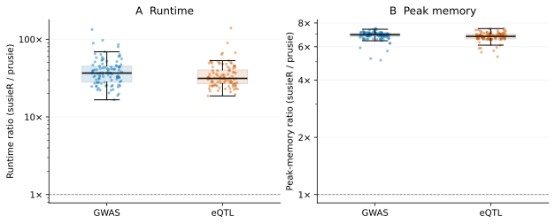

# prusie

Fine-map association signals with SuSiE, then inspect the variants, credible sets
and uncertainty behind the result. prusie fits signed summary statistics and
linkage disequilibrium (LD) through a Python API with Rust computation.

## Quick start

This is the **0.2.4.dev1 development preview** on `post_analysis`. Install from
source with Python ≥3.10, the pinned Rust toolchain, a C linker and Python
headers; see [installation](docs/install.md) for details.

```sh
git clone --branch post_analysis https://github.com/LucaJiang/prusie.git
cd prusie
python -m venv .venv
. .venv/bin/activate
python -m pip install '.[analysis]'
```

Core fitting needs only NumPy at runtime; the optional `analysis` extra adds
Matplotlib and SciPy. Fitting requires neither R nor Rust after installation.
The installed synthetic example works offline from any directory:

```python
import prusie

example = prusie.load_example()
fit = prusie.susie_rss(**example["inputs"], **example["parameters"],
                       track_fit="compact", retain_data=True)
summary = prusie.summarize(fit, example["inputs"]["R"], z=example["inputs"]["z"])
print(prusie.summary_text(summary))
```

The example returns two singleton credible sets, `syn0100` and `syn0350`, after
three IBSS sweeps. Their PIPs are about 0.9697 and 0.99994. Start with the
[quick-start tutorial](docs/example.md) to write an offline report and save the
full posterior.

## Read what changed, and what remains uncertain

The same two leading sets persist when the toy example uses a fixed positive
scaled prior variance. Background PIPs change: `syn0143` rises from about
5.3×10⁻¹¹ to 0.2544. With variance estimation disabled, all five components retain
positive variance, including three without retained CS; those components can
spread probability beyond the original leading candidates.


The [worked examples](docs/worked_examples.md) explain this result and a second
case where refinement improves a stopped fit's objective by 17.46 while an
LD-correlated pair remains unresolved. They link to complete offline reports,
figures and exact values.

Read the documentation in this order:

1. [Quick start](docs/example.md): fit once, read a summary, export a report.
2. [Reading results](docs/results.md): PIP, component alpha, CS, purity and resolution.
3. [Convergence and refinement](docs/post_analysis.md): stopping, warm starts and search.
4. [Sensitivity and LD](docs/sensitivity.md): assumptions, aligned variants and assessed states.
5. [Worked examples](docs/worked_examples.md), then the [API](docs/api.md) and [model](docs/model.md).

The documentation sources above describe this branch. The
[published documentation site](https://lucajiang.github.io/prusie/) reflects its
last deployment and may precede this preview.

## Numerical accuracy and performance

<!-- generated:highlights:start -->

| Analysis | Maximum absolute PIP difference | Paired runtime speedup¹ | Median peak-memory ratio² |
| --- | --- | --- | --- |
| GWAS | 9.14e-09 | 37.4× | 6.94× |
| eQTL | 1.22e-08 | 33.6× | 6.8× |

100 GWAS locus analyses and 100 eQTL analyses, each with 103–4162 variants, compared with susieR 0.16.6. ¹ Geometric mean of per-case ratios of median runtimes (susieR/prusie). ² Median per-case ratio of full-process peak memory (susieR/prusie). Results reanalyze measurements of prusie 0.2.3rc4 made on 6 October 2026; these values identify that measured version.
<!-- generated:highlights:end -->



See [numerical accuracy](docs/numerical_accuracy.md) and
[performance](docs/performance.md) for data, absolute times and measurement methods.
These measurements retain their original version identity; no new performance
measurement is implied by the post-analysis features.

## Citation and license

Cite [SuSiE, Wang et al. (2020)](https://doi.org/10.1111/rssb.12388) and
[SuSiE-RSS, Zou et al. (2022)](https://doi.org/10.1371/journal.pgen.1010299),
and identify this prusie 0.2.4.dev1 development snapshot with [CITATION.cff](CITATION.cff).
Author and maintainer: Wenxin Jiang.

GPL-3.0-or-later. [LICENSE](LICENSE) and
[third-party notices](THIRD_PARTY_NOTICES.md) retain upstream attribution.

For historical development evidence, the [original review snapshot](docs/review/post_analysis/README.md),
[review-fixes snapshot](docs/review/post_analysis_fixes/README.md) and
[sensitivity follow-up](docs/review/sensitivity_followup.md) remain preserved.
