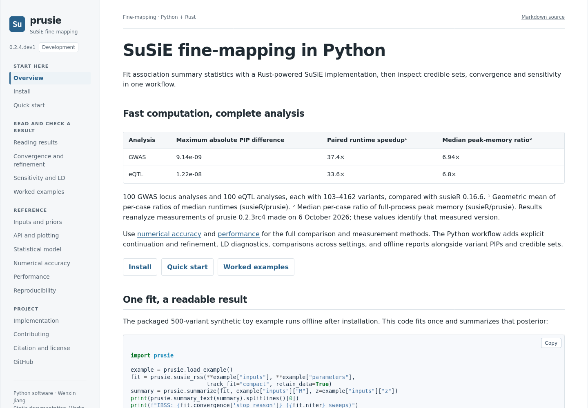
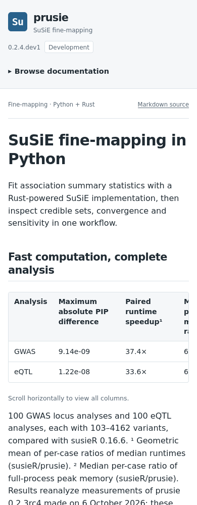
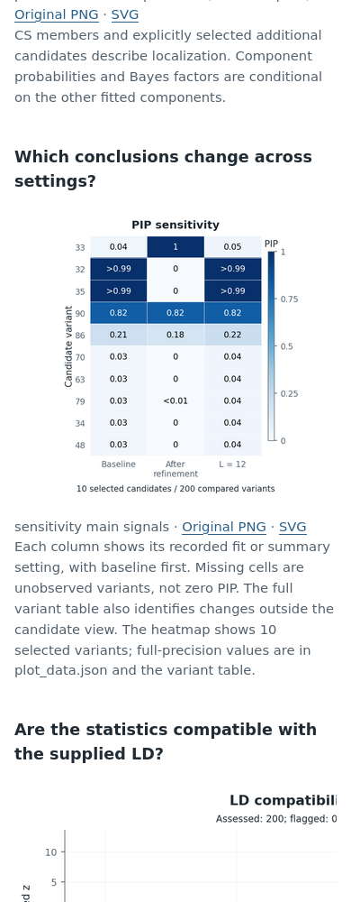
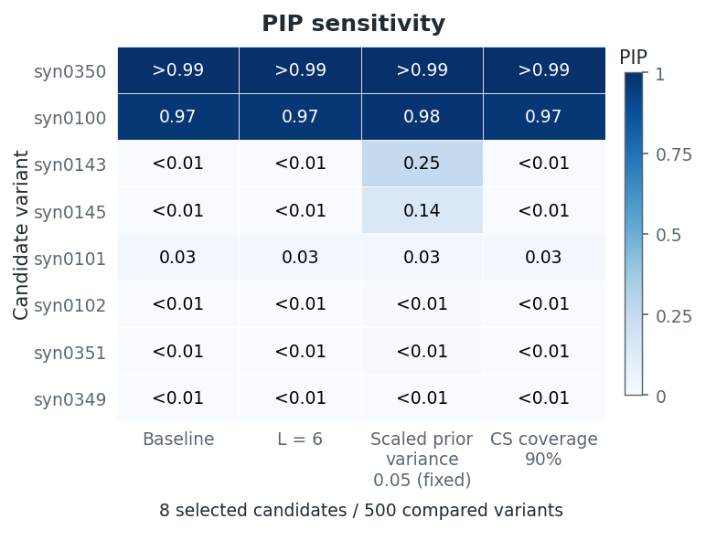
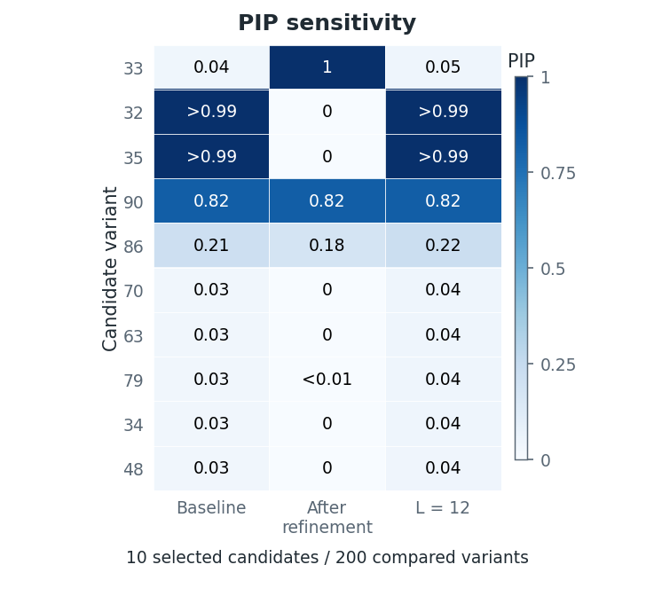
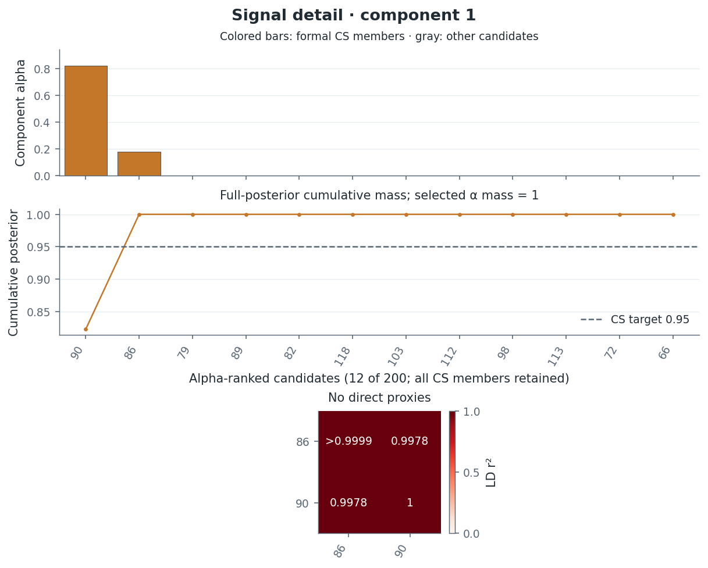
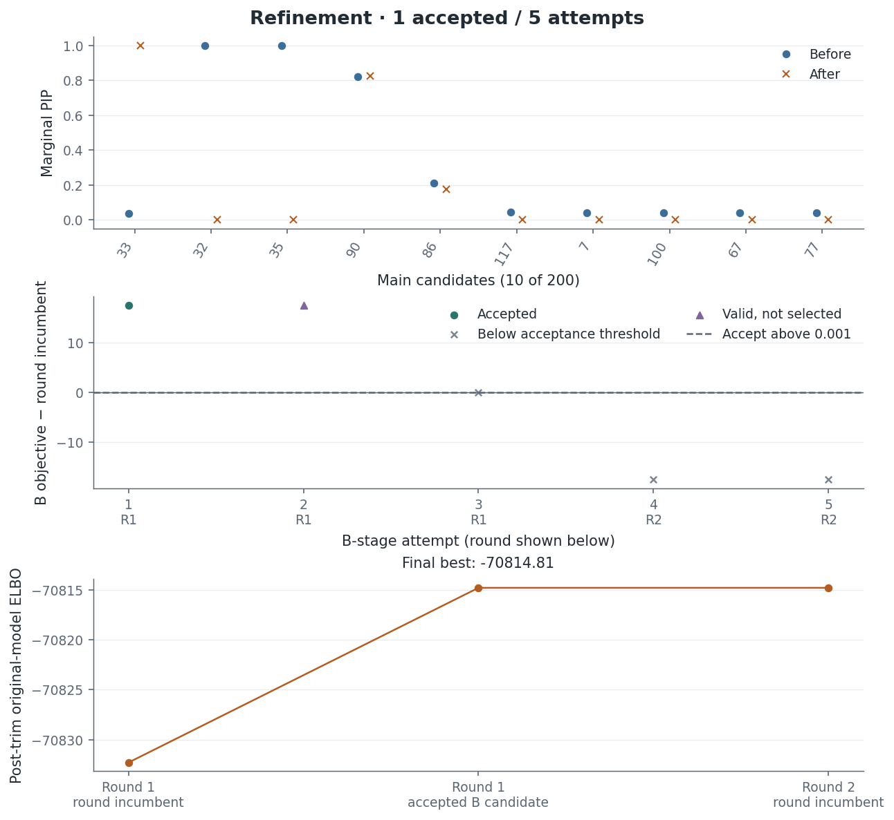

# Website and report previews

These are actual Firefox 146.0.1 captures of the local `post_analysis` files at
1440, 768 and 390 px, with 16 px body text. Render source:
`70161d4651920c2c0b960d8786598d391a1a17b7`. The later artifact commit packages these
files; it did not produce the saved statistical fits.

The existing [public Pages site](https://lucajiang.github.io/prusie/index.html)
was separately opened at desktop and phone widths and returned HTTP 200. It still
serves `main`; the screenshots below are **local branch previews, not a deployed
Pages update**. No Pages source change or deployment was made for this preview.
GitHub file pages display images but do not run the report HTML.

| View | Desktop, 1440 px | Tablet, 768 px | Phone, 390 px |
| --- | --- | --- | --- |
| Homepage | [Open](docs_index_1440.png) | [Open](docs_index_768.png) | [Open](docs_index_390.png) |
| Stable report introduction | [Open](stable_report_1440.png) | [Open](stable_report_768.png) | [Open](stable_report_390.png) |
| Problem report introduction | [Open](problem_report_1440.png) | [Open](problem_report_768.png) | [Open](problem_report_390.png) |
| Stable report heatmap | [Open](stable_report_heatmap_1440.png) | [Open](stable_report_heatmap_768.png) | [Open](stable_report_heatmap_390.png) |
| Problem report heatmap | [Open](problem_report_heatmap_1440.png) | [Open](problem_report_heatmap_768.png) | [Open](problem_report_heatmap_390.png) |

Additional captures show the [phone menu](docs_menu_390.png),
[rendered convergence formulas](convergence_detail_1440.png),
[sensitivity tutorial](sensitivity_detail_1440.png), and
[worked examples](worked_examples_detail_1440.png). Introduction captures cover
the opening viewport, not every section of the page.

## Statistical figures

The [stable index](../stable/figure_index.json) and
[problem index](../problem/figure_index.json) identify every view and its nominal
HTML display width. Selected images were checked against those indices.

| Question | PNG | Editable-text SVG |
| --- | --- | --- |
| Stable sensitivity | [PNG](../stable/figure_5.png) | [SVG](../stable/figure_5.svg) |
| Problem sensitivity | [PNG](../problem/figure_5.png) | [SVG](../problem/figure_5.svg) |
| Problem CS {86, 90}: LD and posterior | [PNG](../problem/figure_8.png) | [SVG](../problem/figure_8.svg) |
| Problem refinement | [PNG](../problem/figure_3.png) | [SVG](../problem/figure_3.svg) |

PIP uses linear Blues on [0, 1], with every selected candidate labelled. Interior
tails use `<0.01` and `>0.99`; exact zero, exact one and missing values remain
distinct. The heatmaps are about 4.8 inches wide at their nominal size. LD r² uses
Reds on [0, 1]; the {86, 90} matrix is about 1.4 inches square and shows the
off-diagonal value as 0.9978. The public signed-r default remains unchanged and
uses RdBu_r on [−1, 1]. Full-precision data are exported separately from display
text. Simple heatmaps fit the report width; complex panels scroll locally when
needed and include original-image links.

## Data identity and viewing

[Render validation](../render_validation.json) records unchanged raw posterior,
CS, LD, full-precision tables, persisted arrays, candidates, masks and comparison
support against the preceding presentation. The original fit producer is
`e45914e512e04feef37cf7310bc0b309582d6058`; saved sensitivity fits come from
`1f2b246ebd7970929711b2a51bb08f6a76ddad56`. Complete source identities, data
checksums and upstream references are in the [stable provenance](../stable/provenance.json)
and [problem provenance](../problem/provenance.json). Neither rendering pass
repeated IBSS, refinement or LD optimization. Separate bounded tutorial smoke
tests exercised the documented computations.

Clone this branch and open `docs/index.html` for the website, or open the
[stable](../stable/index.html) and [problem](../problem/index.html) reports after
copying their complete directories. The reports are offline and self-contained;
CSV, JSON and original-image links resolve beside the HTML.

The homepage, quick start, convergence, sensitivity, worked examples and both
reports were browser-checked at all three widths: no page-level horizontal
overflow, missing images, JavaScript errors or external runtime requests. Menu,
copy feedback, formulas and local figure scrolling were checked. Representative
PNG and SVG files were actually opened; browser checks do not establish visual
parity in every browser or replace scientific review of the underlying results.
