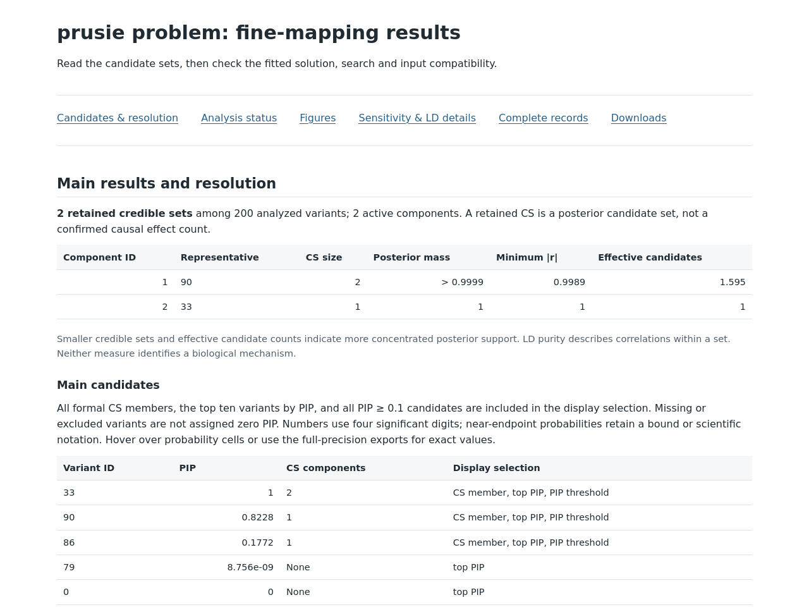
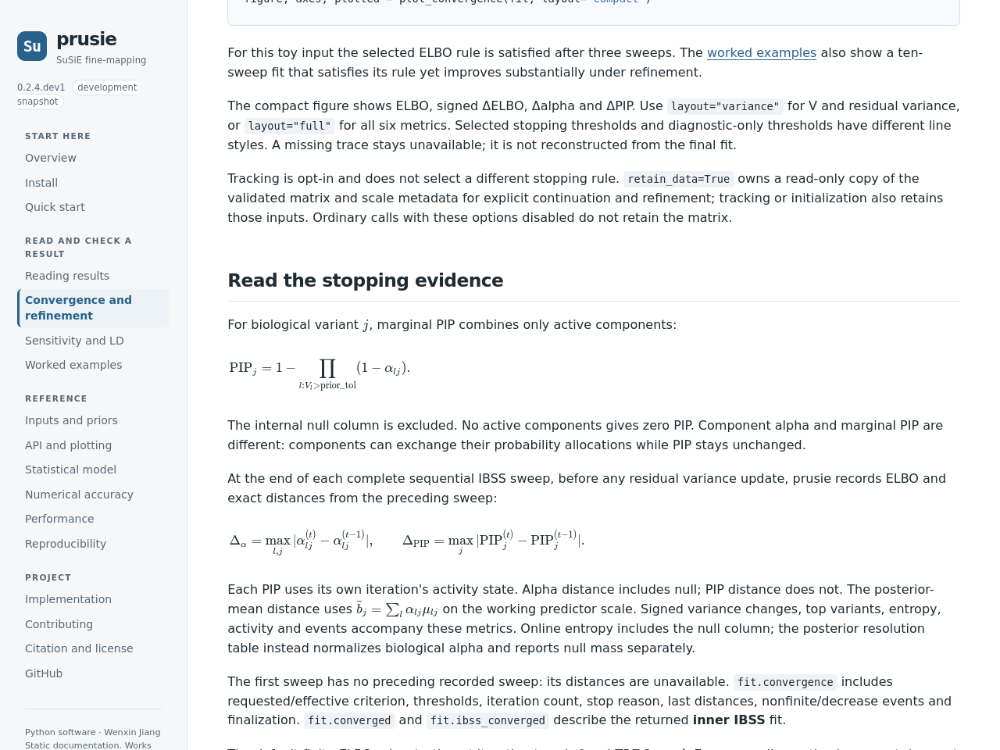

# Graph and document previews

These screenshots show the offline files opened in Firefox 146.0.1 at 1280 px and 768 px, with 16 px body text. They are browser captures, not HTML served by GitHub file pages. Read the [worked examples](../../../worked_examples.md) for the statistical interpretation and data sources.

| View | Desktop | Narrow |
| --- | --- | --- |
| Stable report | [1280 px](stable_report_1280.png) | [768 px](stable_report_768.png) |
| Problem report | [1280 px](problem_report_1280.png) | [768 px](problem_report_768.png) |
| Documentation overview | [1280 px](docs_index_1280.png) | [768 px](docs_index_768.png) |
| Quick start | [1280 px](quickstart_1280.png) | [768 px](quickstart_768.png) |
| Convergence and refinement | [1280 px](convergence_1280.png) | [768 px](convergence_768.png) |
| Worked examples | [1280 px](worked_examples_1280.png) | [768 px](worked_examples_768.png) |

The [formula preview](convergence_math_1280.png) shows local math rendering. The [report figure preview](problem_convergence_1280.png) shows the convergence plot in its HTML context. Introductory screenshots cover the opening viewport; they do not show every section farther down a page.

Selected statistical figures: problem [convergence](../problem/figure_2.png), [refinement](../problem/figure_3.png), [sensitivity](../problem/figure_5.png); stable [sensitivity](../stable/figure_5.png). All seven view types and the separate variance detail are indexed in each case directory.

Copy a complete case directory and open its `index.html` locally to read the report and exports. The numeric producer and presentation producer are recorded separately in each `provenance.json`; screenshots do not represent a new fit.
