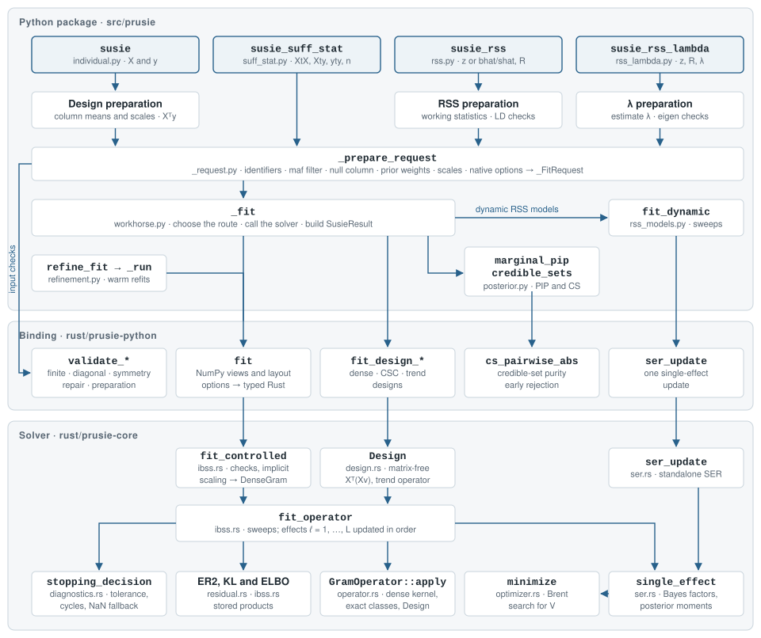

# Implementation

prusie fits the [SuSiE model](model.md) through input preparation, single-effect
updates and posterior summaries. This page traces a fit from the public
functions to the returned `SusieResult`.

The Python package (`src/prusie`) checks inputs, prepares the model, chooses a
fitting route and assembles results. The Rust binding (`rust/prusie-python`,
imported as `prusie._native`) connects NumPy arrays to native routines and
checks native inputs. The solver crate (`rust/prusie-core`) implements iterative
Bayesian stepwise selection (IBSS) without a Python dependency.

The [fitting routes](#fitting-routes) include dynamic RSS models whose sweep loop
runs in Python using native single-effect regression.
[Optimization](optimization.md) describes the speed and memory methods.

## Architecture

{.figure-complex}

The shaded boxes at the top are fitting entry points. The left-hand path marks
native input checks during preparation. In `workhorse.py`, `_fit` dispatches the
prepared request, then adds PIPs and credible sets to the returned arrays and
diagnostics to construct a `SusieResult`. Retained-data continuation and
refinement call `_native.fit` directly through `refinement._run`;
[Call paths](#call-paths) describes these routes.

| Layer | Main modules | Responsibilities |
| --- | --- | --- |
| Python entry points | `individual.py`, `suff_stat.py`, `rss.py`, `rss_lambda.py`, `constructors.py`, `ser.py` | Prepare individual data, sufficient statistics or association summaries and LD; automatic and trend-filter fits; standalone single-effect regression (SER) |
| Python shared core | `_request.py`, `workhorse.py`, `rss_models.py`, `posterior.py`, `result.py`, `refinement.py`, `_validation.py` | Construct fitting requests, dispatch fits, run dynamic RSS sweeps and build posterior summaries; continuation and refinement |
| Rust binding | `lib.rs`, `options.rs`, `array_layout.rs`, `summary_helpers.rs`, `prepare_helpers.rs`, `design.rs`, `ser.rs`, `output.rs`, `executor.rs` | Check NumPy layouts and borrows; parse options; expose fitting, matrix preparation and purity routines; convert results and errors; own private execution resources |
| Rust solver | Main modules below | IBSS, SER, matrix operators, variance estimation, objectives and stopping rules |

Binding filenames refer to `rust/prusie-python/src`. The main solver modules
under `rust/prusie-core/src` are:

| Solver module | Contents |
| --- | --- |
| `ibss.rs` | Dense entry points `fit_controlled` and `fit_controlled_with_executor`; shared `fit_operator` sweeps, evidence lower bound (ELBO), variance updates and trimming |
| `ser.rs`, `optimizer.rs` | Gaussian and fixed-mixture SER, standalone `ser_update` and Brent prior-variance search |
| `residual.rs`, `diagnostics.rs` | Expected residual sum of squares (ER2), convergence metrics, stopping rules and cycle detection |
| `operator.rs`, `exact_columns.rs`, `activation.rs` | `GramOperator`, dense products, implicit scaling, exact signed-column classes and their activation rule |
| `design.rs` | Matrix-free operators for dense, sparse CSC and trend-filtering designs |
| `nig.rs`, `slot.rs` | Normal–Inverse-Gamma residual-variance model and effect-activity priors |
| `input_validation.rs`, `input_validation/` | Finiteness checks, exact-symmetry proofs and paired RSS validation and repair |
| `execution.rs`, `parallel.rs` | Private execution resources, per-fit thread pools and partitioned matrix products |
| `vector_math.rs`, `numerical.rs` | Vector exponentials, compensated summation and digamma |
| `types.rs`, `options.rs`, `model.rs` | Options, model extensions and output types |

## Fitting routes

`susie`, `susie_suff_stat`, `susie_rss` and `susie_rss_lambda` prepare a
`_FitRequest` through `_request._prepare_request`. `workhorse._fit` selects
among three numerical routes, checking for dynamic RSS before dense or design
fitting. Native entry names below belong to `prusie._native`.

| Route | Used for | Native entry | Sweep loop |
| --- | --- | --- | --- |
| Dynamic RSS | `susie_rss` with `R_finite` other than `None` or `False`, `R_mismatch` other than `"none"`, or an `R` or `X` list/tuple of matrices; `susie_rss_lambda` | `ser_update` for each effect update | Python `fit_dynamic` |
| Dense | `susie_suff_stat` (`susie_ss`); remaining `susie_rss` fits with `R` | `fit` | Rust `fit_operator`, with `DenseGram` |
| Matrix-free design | `susie`, `susie_trendfilter`; remaining `susie_rss` fits with reference genotypes `X`, subject to the exception below | `fit_design_dense`, `fit_design_csc`, `fit_design_trend` | Rust `fit_operator`, with `Design` or `TrendDesign` |

With `susie_rss(X=...)`, supplying `bhat`, `shat` and `var_y` builds a dense
correlation matrix before fitting. This selects the dense route unless a dynamic
RSS model is requested. Dynamic RSS recomputes working quantities during fitting
using NumPy matrix products and native SER; it also forms a dense Gram matrix
when supplied with reference `X`.

`L_greedy` adds an outer loop: `_fit_greedy` repeatedly calls `_fit`, increasing
the number of single-effect components $L$ and warm-starting from the preceding
result. Each fit uses the applicable route above. `susie_auto` runs staged
`susie` fits with warm starts.
The standalone `susie_ser` calls `_native.ser_update` once.

## Call paths

These paths trace input preparation, fitting and result construction. The
[fitting routes](#fitting-routes) determine which optional branches are used.

### `susie_rss`

```text
susie_rss                                              rss.py
├─ argument checks; construct RSSControl
├─ R/X panel sequence → prepare_multipanel
│    panel fits → select initial LD panel by final ELBO → joint dynamic fit
├─ z, or z ← bhat/shat; missing z ← 0 with a warning
├─ reference X → _validated_design → _column_stats → _DesignData
│    bhat, shat and var_y → _design_correlation → dense R
├─ dense R → native validation and repair when required
├─ construct working statistics or retain the design
├─ enabled R_finite or R_mismatch → dynamic-model configuration
├─ _prepare_request → _FitRequest                       _request.py
└─ _fit                                                workhorse.py
   ├─ init_only → SusieInputs
   ├─ L_greedy → _fit_greedy → repeated _fit
   ├─ dynamic → fit_dynamic → _native.ser_update
   ├─ design  → _native.fit_design_dense | _native.fit_design_csc
   ├─ dense   → _native.fit
   ├─ credible_sets; marginal_pip; convergence_summary
   └─ SusieResult; optional refinement
```

### `susie`

```text
susie                                                  individual.py
├─ type checks; _validated_design
│    dense → F-ordered float64; sparse → canonical CSC copy
│    TrendDesign → retain implicit representation
├─ _column_stats → column means and centered sums of squares
├─ response, crossproducts, means and scales → _DesignData
├─ _prepare_request(XtX=None, ..., _design=design) → _FitRequest
└─ _fit                                                workhorse.py
   ├─ _native.fit_design_dense | fit_design_csc | fit_design_trend
   ├─ credible_sets (member correlations computed from X); marginal_pip
   └─ SusieResult with fitted values
```

Centering and scaling are applied through the design operator during fitting.
The native design solver does not construct the full Gram matrix.

### Inside the native fit

For a dense fit with the default Gaussian model, the native call reaches the
shared IBSS loop as follows:

```text
_native.fit                                            prusie-python/src/lib.rs
├─ options::parse → FitOptions, FitControl
├─ check NumPy layout and borrow read-only views
├─ fit_controlled                                      prusie-core/src/ibss.rs
│  ├─ check sizes, scalars and scale factors
│  ├─ implicit scaling, or a materialized working matrix
│  ├─ nonnegative working diagonal → DenseGram
│  └─ fit_operator
│     ├─ initialize posterior; rebuild products for a warm start
│     ├─ each sweep: update components in order
│     │  ├─ single_effect (optim method → optimizer::minimize)
│     │  ├─ compute component KL term
│     │  └─ GramOperator::apply → store component product
│     ├─ expected_residual_sum_squares; ELBO; convergence diagnostics
│     ├─ stopping decision; residual-variance update if no stop
│     └─ trim components below prior_tol
└─ output::fit_result → NumPy arrays, warnings and diagnostics
```

Rust source paths above are relative to `rust/`. The design entry points build
a `Design` or `TrendDesign` operator and call the same `fit_operator`. Mixture
and NIG fits use their corresponding SER routines inside that loop. The private
`_fit_with_executor` binding enters through `fit_controlled_with_executor`.

The binding keeps the Python global interpreter lock (GIL) during solver calls.
For `_native.fit`, the matrix and `Xty` read borrows also remain live until the
solver returns; the design bindings copy vector inputs into
Rust-owned buffers and borrow dense `X`.

### Refinement, continuation and warm starts

For supported models, `_prepare_request` calls `make_prepared` when
`retain_data=True`, tracking, refinement or initialization requires a retained
context. `PreparedData` holds read-only input snapshots and a content signature.
`continue_fit` and `refine_fit` use `refinement._run` to call `_native.fit` on
these snapshots, then recompute PIPs and credible sets.

Continuation warm-starts from the saved posterior. For each candidate credible
set, refinement makes a cold-start fit with that set's prior weights set to
zero, then warm-starts a second fit from its posterior with the original weights
and initial variances restored. Each round accepts its best candidate only if the
last logged ELBO improves by more than `RefinementConfig.absolute_tol`.
[Convergence and refinement](post_analysis.md) describes the search controls.

The retained-data path excludes matrix-free designs, dynamic RSS, mixture, NIG
and slot priors, `convergence_method="pip"`, `L_greedy`, and nondefault
`median_abs_corr` or `cs_extension_corr`. For these fits, plain `refine=True`
uses `workhorse._refine_by_refitting` to repeat `_fit`, except that multi-panel
RSS rejects refinement. `retain_data=True` and a `RefinementConfig` require a
supported model.

A warm-start mapping supplied through `model_init` or its alias `s_init` needs
`alpha`, `mu` and `mu2`; `V` and `sigma2` are optional. `initial_options` checks
the posterior arrays and supplied variant IDs, allele labels, scales and
null-column layout. For a native warm start, Rust rebuilds all component matrix
products before the first sweep rather than resuming stored products.

## Pseudocode

The fitting loop below follows the ordinary Gaussian model, with prior-variance
and stopping options shown explicitly. Mixture, NIG and slot priors change the
updates as described under [Additional model options](model.md#additional-model-options).
Dynamic RSS uses its separate Python loop.

### Preparation

Entry points first construct sufficient statistics or prepare a design operator.
[From summaries to working sufficient statistics](model.md#from-summaries-to-working-sufficient-statistics)
gives the RSS constructions, including the internal sample-size placeholder
and disabled standardization when `n` is missing. Shared preparation and
fitting then proceed schematically as follows:

```text
function _request._prepare_request(statistics or design, options):
    validate statistics, identifiers, metadata, priors and controls
    apply the requested MAF filter; add a null predictor if requested
    normalize prior weights; resolve the component count
    obtain predictor scales and the working crossresponse
    prepare a dense matrix with scale factors, a scaled matrix, or a design
    prepare initial variances, convergence controls and any warm start
    if supported and requested: retain read-only inputs and their signature
    return _FitRequest

function workhorse._fit(request):
    if init_only: return SusieInputs(request)
    if L_greedy is set: return _fit_greedy(request)
    output ← fit using the request's dense, design or dynamic route
    emit output warnings; warn if not converged
    sets ← credible_sets(output, correlation or design)
    pip ← marginal_pip(output)
    result ← SusieResult(output, pip, sets, diagnostics, …)
    if requested: apply the supported refinement route
    return result
```

### IBSS

Use the working statistics $\mathbf Q$, $\mathbf g$ and $s_y$ defined in the
[model](model.md#data-notation-and-scale), with $p$ variants, $L$ components and
sample size $n$. The stored component product is
$\mathbf u_\ell=\mathbf Q(\boldsymbol\alpha_\ell\odot\boldsymbol\mu_\ell)$,
and $\mathbf f=\sum_\ell\mathbf u_\ell$ is the fitted crossproduct.
Here $\boldsymbol\alpha_\ell$ contains posterior variant probabilities,
$\boldsymbol\mu_\ell$ contains conditional effect means, and `mu2` stores
conditional second moments. The normalized prior weights are $\pi_j$;
$V_\ell$ and $\sigma^2$ are the prior and residual variances.
$\varepsilon$ denotes float64 machine epsilon, and `Q(v)` denotes a
Gram-operator application.

```text
function fit_operator(Q, g, s_y, n, options):
    α_ℓj ← 1/p;  μ_ℓj, μ2_ℓj ← 0
    V_ℓ, σ² ← prepared initial variances
    u_ℓ ← 0;  f ← 0
    if warm start:
        load posterior and any supplied variances; rebuild u_ℓ and f
    method ← estimate_prior_method if estimate_prior_variance else "none"
    log_prior_j ← log(π_j + √ε)
    for t = 1, …, max_iter:
        for ℓ = 1, …, L in order:
            f ← f − u_ℓ;  r ← g − f
            α_ℓ, μ_ℓ, μ2_ℓ, V_ℓ, lbf_variable_ℓ, lbf_ℓ ← single_effect(
                r, diag Q, σ², V_ℓ, log_prior, method)
            compute KL_ℓ from this SER posterior and its evidence
            u_ℓ ← Q(α_ℓ ⊙ μ_ℓ);  f ← f + u_ℓ
        if check_prior: check V against scores using the current σ²
        ER2 ← expected_residual_sum_squares(g, s_y, diag Q, α, μ, μ2, u)
        ELBO ← −(n/2) log(2πσ²) − ER2 / (2σ²) − Σ_ℓ KL_ℓ
        if ELBO is infinite: error
        if ELBO is NaN and any of α, μ, μ2, V is nonfinite: error
        decision ← stopping_decision(current sweep, changes, cycles, controls)
        apply alpha-cycle averaging when required; record diagnostics
        if decision ≠ continue: break
        if estimate_residual_variance:
            estimate ← ER2 / n;  reject a nonpositive or nonfinite estimate
            σ² ← clamp(estimate, residual lower bound, residual upper bound)
    for ℓ with V_ℓ < prior_tol:
        α_ℓ ← π;  μ_ℓ, μ2_ℓ, lbf_variable_ℓ, lbf_ℓ, KL_ℓ, V_ℓ ← 0
    return posterior, variances, ELBO history, f, diagnostics
```

If residual-variance estimation is enabled, its update also follows the final
allowed sweep when the stopping decision is still `continue`. Returned `sigma2`
can therefore differ from the value used for the last ELBO. Final trimming
does not recompute the stored ELBO or fitted crossproduct;
[Results](results.md#iterations-and-finalization) explains these quantities.

### Single-effect regression

[The Gaussian SER equations](model.md#one-single-effect-regression) give the
Bayes factors and posterior moments. Both the prior-variance search and the
posterior use the smoothed `log_prior` prepared above. The sampling variances
are cached until $\sigma^2$ changes. Bayes factors use a variance floor of
$\varepsilon$; posterior moments use the unfloored sampling variances.

```text
function single_effect(r, diag Q, σ², V, log_prior, method):
    b̂_j ← (1/Q_jj) r_j;  s_j² ← σ²/Q_jj
    logBF_j(V) ← Gaussian log BF using max(s_j², ε)
                  (zero if b̂_j or s_j² is nonfinite)
    h(V) ← logsumexp(logBF_j(V) + log_prior_j)
    if method = "optim":
        candidate ← Brent search maximizing h(V) over log V ∈ [−30, 15]
        if h(candidate) ≥ h(V): V ← candidate
    if method ∈ {"optim", "simple"} and h(0) + check_null_threshold ≥ h(V): V ← 0
    lbf_variable_j ← logBF_j(V);  w_j ← lbf_variable_j + log_prior_j
    weights_j ← exp(w_j − max_k w_k);  total ← Σ_j weights_j
    α_j ← weights_j / total;  lbf ← max_j w_j + log(total)
    for each variant j:
        if r_j/Q_jj and s_j² are finite:
            v_j ← V s_j² / (V + s_j²)
            μ_j ← (v_j / s_j²) (r_j/Q_jj);  μ2_j ← v_j + μ_j²
        else: μ_j, μ2_j ← 0
    if method = "EM": V ← Σ_j α_j μ2_j
    reject nonfinite evidence or moments
    return α, μ, μ2, V, lbf_variable, lbf
```

With `method="none"`, the supplied variance is retained. EM updates the variance
after computing the posterior, so the returned evidence refers to the variance
used before that update.

### Stopping rule

The native solver rejects infinite ELBOs before applying this decision. For a
finite posterior state, the remaining logic is:

```text
function stopping_decision(t, ELBO, ΔELBO, Δα, ΔPIP, cycle, controls):
    if ELBO is NaN and criterion = "joint": return numerical_failure
    if t < min_iter: return continue
    fallback ← ELBO is NaN and criterion = "elbo"
    pip_rule ← criterion = "pip" or (fallback and nan_elbo_pip)
    posterior_stable ← Δα < alpha_tol and ΔPIP < pip_tol
    objective_stable ← ELBO is finite and 0 ≤ ΔELBO < tol
    if pip_rule: satisfied ← Δα < tol and ΔPIP < tol
    else if criterion = "alpha_pip" or fallback: satisfied ← posterior_stable
    else if criterion = "joint": satisfied ← objective_stable and posterior_stable
    else: satisfied ← objective_stable
    if satisfied: return converged
    if cycle lag > 1 and (criterion ≠ "elbo" or fallback):
        if pip_rule: return converged
        return cycle_detected
    return continue
```

$\Delta\mathrm{ELBO}$ is the change from the preceding sweep;
$\Delta\alpha$ and $\Delta\mathrm{PIP}$ are the maximum absolute changes in
their respective arrays. Cycle detection compares both arrays with earlier
states, using `tol` for the PIP rule and `alpha_tol` and `pip_tol` otherwise.
The largest lag is `cycle_lag` (default 5), and successful or cycle stops
require `min_iter` sweeps (default 2). A PIP-rule cycle stop averages alpha over
the cycle in the IBSS loop.

Preparation sets the internal `nan_elbo_pip` flag when no `convergence` is
supplied and the resolved `ConvergenceConfig` has default values. Other
NaN-ELBO fallbacks use the separate alpha and PIP tolerances. With a finite ELBO,
the ELBO rule records cycles without stopping. [Stopping rules](model.md#stopping-rules)
describes PIP history, averaging and model-specific rule selection.

Dynamic RSS uses `rss_models.fit_dynamic` and also requires the estimated
mismatch-bias change to be at most `tol` before declaring convergence.
Its permitted `ConvergenceConfig` settings are described in the same reference.

## Boundaries and exceptions

Input errors stop a call. A completed fit can still return `converged=False`;
its stopping record explains why.

### Errors

Shape, range and option-combination checks raise `ValueError`. The binding also
converts Rust solver error messages to `ValueError`, preserving the message.
Explicit Python type checks raise `TypeError`, for example for invalid
`standardize`, `slot_prior` or `convergence` types. The `SusieInputs` mapping
returned by `init_only=True` accepts `"data"` and `"params"`; another key raises
`KeyError`.

Shared preparation and fitting emit `RuntimeWarning`s and retain their messages
in `fit.warnings` when a result is returned. Ordinary `susie_rss` adds its
collected input warnings to that list. Input warnings emitted directly by
`susie_rss_lambda` are not copied into it.

### Input checks

For dense `susie_suff_stat` and ordinary `susie_rss`, matrices must have matching
dimensions, finite entries and nonnegative diagonals. Ordinary RSS does not
separately enforce a unit LD diagonal or entries in $[-1,1]$. The caller must
supply correctly scaled, signed LD with matching variant order and effect
alleles.

| Condition | Behavior |
| --- | --- |
| Unequal off-diagonal entries in the working matrix | `RuntimeWarning`; average with its transpose. Symmetry is checked exactly, without a tolerance |
| `check_input=True` | Add an eigendecomposition before standardization. Reject a negative eigenvalue at or below `-r_tol`; warn if the `Xty` projection check fails |
| Missing (`NaN`) z-scores | Replace with zero and warn; infinite z-scores raise `ValueError` |
| Missing `Xty` entries | Replace with zero and warn with `check_input=False`; reject with `check_input=True`. Infinite entries always raise `ValueError` |
| Effect estimates and standard errors | Require finite `bhat` and positive `shat` without missing values. Scalar `shat` and positive infinity are accepted; a finite `bhat` divided by infinite `shat` gives zero |
| `yty=0` in the ordinary Gaussian model | Require `Xty=0`, an explicitly positive `residual_variance` and `estimate_residual_variance=False` |

For z-score RSS, the exact symmetry check applies after scaling to the working
`XtX`. With `bhat`, `shat`, `n` and `var_y`, the reconstructed `XtX` is always
averaged with its transpose. The resulting matrix is also checked for finite
entries and a nonnegative diagonal. These routes do not clip eigenvalues or
repair a matrix to be positive semidefinite.

For individual-level input, `X` must be finite and infinite `y` is rejected.
Missing `y` requires `na_rm=True`, which omits the corresponding rows.
[Inputs](inputs.md#shapes-and-numerical-checks) gives the numerical and projection
checks; [priors and zero-information columns](inputs.md#priors-and-zero-information-columns)
describes weight normalization, null columns and the component-count rules.

### Numerical safeguards

Posterior weights are normalized after subtracting the largest log weight.
This prevents exponential overflow without changing relative probabilities.
For log weights $(1000, 999)$, $e^{1000}$ overflows in float64, whereas the
shifted form does not:

<!-- calculated:logsum:start -->
A 60-digit decimal calculation gives **1000.313261687518**; the first normalized weight is **0.731058578630**.
<!-- calculated:logsum:end -->

In ordinary Gaussian SER, finite sampling variances are floored at float64
machine epsilon $\varepsilon$ for log Bayes factors and the prior-variance
objective. Posterior moments use the unfloored variances. Prior weighting uses
$\log(\pi_j+\sqrt\varepsilon)$, so a supplied zero weight can retain positive
posterior probability. A zero working diagonal gives log BF zero and zero
conditional moments; its location probability can remain positive.
[Single-effect regression](#single-effect-regression) shows these branches.

Gaussian SER rejects nonfinite evidence or conditional moments. Native IBSS
rejects an infinite ELBO. A NaN ELBO also raises an error if the posterior arrays
contain nonfinite entries; otherwise the stopping rules below apply. The native
residual-variance update rejects a nonpositive or nonfinite estimate before
constraining it by `residual_variance_lowerbound` and `residual_variance_upperbound`.

With `check_prior=True`, the native loop checks the component variances after
each sweep, using the current residual variance. Write
$z_{\max}=\{\max_{j:Q_{jj}>0}(|g_j|/\sqrt{Q_{jj}})\}/\sqrt{\sigma^2}$ for the largest
absolute working score. Any $V_\ell>100z_{\max}^2$ raises `ValueError` with a
summary-statistic/LD consistency message. Zero-diagonal columns are excluded;
with no positive diagonal the bound does not reject a variance.

Brent's prior-variance search checks new trial objectives for finiteness and
raises an error if its 1000-iteration limit is exhausted. Native slot-activity
updates constrain log-odds to $[-20,20]$. Kernel eligibility and fallback rules
are described in [Optimization](optimization.md).

### Convergence outcomes

The native IBSS loop reports these `fit.convergence` outcomes:

| `stop_reason` | `converged` | Meaning |
| --- | --- | --- |
| `criterion_satisfied` | `True` | The selected rule accepted the fit, including an eligible PIP-rule cycle |
| `iteration_limit` | `False` | The sweep limit was reached |
| `cycle_detected` | `False` | An eligible alpha/PIP cycle at lag greater than one under `"alpha_pip"`, `"joint"` or an ELBO fallback using separate tolerances |
| `numerical_failure` | `False` | A NaN ELBO under `"joint"` |

An ELBO decrease larger than `tol` produces a warning and increments the decrease
count. The selected stopping rule still decides whether fitting stops. A NaN
ELBO with finite posterior arrays under `"elbo"` invokes a warned alpha/PIP
fallback at or after `min_iter`. With the internal `nan_elbo_pip` flag, this uses
the PIP rule and averages alpha over an accepted cycle. Otherwise it uses the
separate `alpha_tol` and `pip_tol`, and a longer cycle returns
`converged=False` without averaging. [Stopping rule](#stopping-rule) gives the
flag selection and decision order. `workhorse._fit` warns when the solver
returns `converged=False`, including the iteration count and stop reason.

Dynamic RSS has a separate Python loop and reports `elbo_tolerance`,
`alpha_pip_fixed_point`, `alpha_pip_cycle_<lag>` or `max_iter`.
[Results](results.md#iterations-and-finalization) explains how to read the
stopping record and returned posterior.

### Trimming and output shapes

Final trimming resets components with $V_\ell<\mathtt{prior\_tol}$: alpha to
the normalized prior weights, and `V`, moments, log Bayes factors and KL terms
to zero. Component rows remain in the result. Native IBSS leaves the stored
ELBO and `XtXr` unchanged; dynamic RSS constructs `XtXr` from the finalized
arrays. [Results](results.md#iterations-and-finalization) describes these phases.

With a null column, `alpha`, `mu`, `mu2` and `lbf_variable` have one more column
than `pip`. During fitting, credible sets containing the null column are
rejected. If no credible set qualifies, PIPs are still returned. PIPs use
components with $V_\ell>\mathtt{prior\_tol}$; credible sets use the separate
fixed cutoff $V_\ell>10^{-9}$.

## Native threading

`n_threads` sets a native thread limit for each call, from 1 to 32, with default
1. Public fitting functions use this option independently of
`PRUSIE_NUM_THREADS`. They do not change process-wide Rayon or BLAS settings.
NumPy matrix operations, including those in dynamic RSS, follow their own
BLAS threading settings.

With `n_threads > 1`, large dense Gram products use a private Rayon pool to
partition output rows. Each row retains its source-column accumulation order;
IBSS components are updated sequentially. Pool creation is skipped for one
thread or a matrix dimension below 1024. Product dispatch requires at least
1024 output rows and 1,048,576 matrix entries; a compact product formed from
exact signed-column classes uses its reduced dimensions for this check.
Matrix-free design operators and the dynamic RSS sweep loop are not
parallelized by `n_threads`. The fitting pool is local to the native call and
is dropped when that call ends.

For `susie_rss` with known `n` and `var_y=None`, eligible LD inputs can also use
parallel preparation for the sufficient exact-symmetry proof and owned
validation and repair. This requires `n_threads > 1`, at least 1024 variants
and a plain NumPy array with aligned, C-contiguous, native float64 storage
without dtype metadata. Eligibility is checked on normalized preparation inputs,
independently of solver and output controls.
Array subclasses, including memory-mapped LD, other dtypes and other layouts
prepare serially. The requested solver count is retained when preparation is
serial. `overwrite_ld=True` preparation is always serial; its storage contract
is described under [Optional LD workspace](api.md#optional-ld-workspace).

Parallel preparation requires the optional GNU/Linux x86-64 native math shim;
`portable-math` builds use serial preparation. Read-only probes check the caller
and every worker for nearest rounding, masked exceptions, disabled subnormal
flushing (FTZ/DAZ) and the canonical x87 control word. Unsupported or nonstandard
controls select serial preparation; the probes do not change them. Sticky
exception flags can accrue on different threads, so equality of the complete
floating-point environment is not part of the result contract.

Preparation workers read the matrix under a native read borrow and make no
Python calls. Owned repair partitions unordered matrix pairs into disjoint jobs;
each job writes both orientations into a separate repair array using the same
ordered scaled terms and average as serial preparation. The calling thread
dispatches warnings and errors: raw validation errors take priority, and a
symmetry warning precedes a deferred repair error.

The preparation owner explicitly joins its workers before later NumPy
transformations or warning dispatch, including cleanup on exceptions. It stays
out of result options and serialization; fitting creates a separate pool when
eligible. A construction failure or recoverable task panic selects the complete
serial validator after joining any workers and discarding partial output.
A worker join failure prevents a successful result. These explicit preparation
joins are separate from the fitting pool's ordinary drop lifecycle.

## Numerical reproducibility

prusie uses float64 arithmetic. Summation order and math-library implementations
can differ from susieR, so agreement is assessed numerically. Core comparisons
use pinned susieR 0.16.6 with matched inputs and fitting settings. The criterion
is a maximum absolute difference of `1e-5` (`rtol=0`) across the complete final
`alpha` matrix, retaining every component and the original component and variant
order. PIPs and other summaries are separate diagnostics.
[Computational compatibility](model.md#computational-compatibility) defines the
comparison and probability-validity checks.

On native GNU/Linux x86-64 builds, the optional vector-math shim can evaluate SER
exponentials through glibc `libmvec`, using SSE2 or AVX2 according to library and
CPU support. Scalar exponentials are used when vector math is unavailable or
the caller's rounding or subnormal controls require them. The compile-time
`portable-math` feature disables this shim and uses scalar exponentials without
changing model settings. Bitwise equality across implementations or platforms
is not promised.

[Numerical accuracy](numerical_accuracy.md) reports the tested configurations
and results. Agreement on those cases does not establish agreement for every
input, model option or platform.

## Dense storage and matrix products

A dense float64 matrix for $p$ variants occupies $8p^2$ bytes. Input conversion,
symmetry repair and materialized scaling can each require additional full matrices.

<!-- calculated:memory:start -->
At $p=5000$, $8p^2=200,000,000$ bytes, or approximately **190.7 MiB**.
<!-- calculated:memory:end -->

RSS validation preserves the caller's `R` by default, using owned storage for
repair. For supported z-score inputs with `R` and known `n`,
`susie_rss(overwrite_ld=True)` can reuse `R` for repair. Once writes begin, later
errors can leave `R` and its aliases changed, with no rollback. Reload the
original LD before reuse, including after a failed call.
[Optional LD workspace](api.md#optional-ld-workspace) gives the restrictions.

A sufficient exact-symmetry proof can return without writes. Otherwise, a
read-only search must find finite original and scaled entries with unequal
scaled values before destructive repair starts. With no such pair, owned
preparation keeps `R` unchanged. Repair holds one mutable NumPy borrow under the
GIL and loads both original orientations before either store. With `s = n - 1`,
each pair receives `(Rij*s + Rji*s)/2` in that operation order, using original
entries `Rij` and `Rji`. The traversal allocates no full backup or repair array.
Consumed `R` is scaled `XtX` with global scale 1; unchanged `R` retains global
scale $n-1$.

The dense operator can apply RSS and predictor scaling without storing the
working matrix. Outside the [implicit-scaling bounds](optimization.md#implicit-scaling),
it materializes that matrix once. If the ordinary factored product has a
nonfinite intermediate or result, it is retried with a temporary materialized
matrix.

The column-major product kernel skips zero coefficients and adds columns in
ascending order, grouping four nonzero columns per output update. On x86-64,
runtime CPU detection selects AVX2 when available, with a portable fallback.
[Exact signed-column classes](optimization.md#exact-signed-column-classes) can
combine coefficients after proving column relations, keeping separate posterior
coordinates for every variant. [Native threading](#native-threading) describes
parallel product dispatch and sequential component updates.

Runtime and memory depend on the input, matrix structure, preparation, iterations
and threads. Reducing temporary storage or adding threads need not reduce runtime.

## Reference source mapping

Use this mapping to compare input preparation and Gaussian IBSS updates with
[susieR 0.16.6](https://github.com/stephenslab/susieR/tree/8e56a8e038e989856d106d9ca5175cc664fea9d2),
commit `8e56a8e038e989856d106d9ca5175cc664fea9d2`. The table groups code by
responsibility; links to reference files point to this commit. Python filenames
are relative to `src/prusie`, and Rust filenames to `rust/prusie-core/src`.

| prusie | susieR 0.16.6 |
| --- | --- |
| `individual.py`: `susie`; `suff_stat.py`: `susie_suff_stat` (`susie_ss`); `rss.py`: `susie_rss`; `rss_lambda.py`: `susie_rss_lambda` | `susie`, `susie_ss`, `susie_rss`, `susie_rss_lambda` in [R/susie.R](https://github.com/stephenslab/susieR/blob/8e56a8e038e989856d106d9ca5175cc664fea9d2/R/susie.R) |
| Input preparation in the entry modules and `_request.py`: `_prepare_request` | `individual_data_constructor`, `sufficient_stats_constructor`, `summary_stats_constructor`, `rss_lambda_constructor` in [R/susie_constructors.R](https://github.com/stephenslab/susieR/blob/8e56a8e038e989856d106d9ca5175cc664fea9d2/R/susie_constructors.R) |
| `workhorse.py`: `_fit`; `ibss.rs`: `fit_operator` | `susie_workhorse` in [R/susie_workhorse.R](https://github.com/stephenslab/susieR/blob/8e56a8e038e989856d106d9ca5175cc664fea9d2/R/susie_workhorse.R); `ibss_fit` in [R/iterative_bayesian_stepwise_selection.R](https://github.com/stephenslab/susieR/blob/8e56a8e038e989856d106d9ca5175cc664fea9d2/R/iterative_bayesian_stepwise_selection.R) |
| Component updates in `ibss.rs`; `ser.rs`: `single_effect`; `optimizer.rs`: `minimize` | `single_effect_update`, `single_effect_regression`, `optimize_prior_variance` in [R/single_effect_regression.R](https://github.com/stephenslab/susieR/blob/8e56a8e038e989856d106d9ca5175cc664fea9d2/R/single_effect_regression.R) |
| `residual.rs`: `expected_residual_sum_squares`; ELBO in `ibss.rs` | `get_ER2.ss`, `Eloglik.ss` in [R/sufficient_stats_methods.R](https://github.com/stephenslab/susieR/blob/8e56a8e038e989856d106d9ca5175cc664fea9d2/R/sufficient_stats_methods.R); `get_objective.default` in [R/model_methods.R](https://github.com/stephenslab/susieR/blob/8e56a8e038e989856d106d9ca5175cc664fea9d2/R/model_methods.R) |
| `diagnostics.rs`: `stopping_decision`, `detect_cycle` | `check_convergence.default` in [R/model_methods.R](https://github.com/stephenslab/susieR/blob/8e56a8e038e989856d106d9ca5175cc664fea9d2/R/model_methods.R); `check_alpha_pip_cycle_convergence` in [R/susie_utils.R](https://github.com/stephenslab/susieR/blob/8e56a8e038e989856d106d9ca5175cc664fea9d2/R/susie_utils.R) |
| Residual-variance update and trimming in `ibss.rs` | `update_model_variance.default`, `trim_null_effects.default` in [R/model_methods.R](https://github.com/stephenslab/susieR/blob/8e56a8e038e989856d106d9ca5175cc664fea9d2/R/model_methods.R) |

The Brent search in `optimizer.rs` is adapted from `Brent_fmin` in R's
`src/library/stats/src/optimize.c` (GPL-2.0-or-later). Attribution and licenses
are retained in the [third-party notices](https://github.com/LucaJiang/prusie/blob/main/THIRD_PARTY_NOTICES.md).
