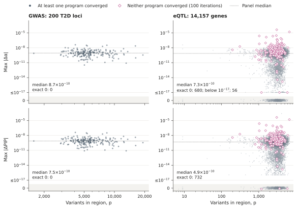

# Numerical accuracy

Numerical comparisons assess how closely prusie's fitted SuSiE posteriors agree
with susieR when both implementations receive the same inputs and fitting
settings. This page compares prusie 0.3.0 with susieR 0.16.6, using the complete
`alpha` matrix of single-effect posterior inclusion probabilities as the primary
[agreement criterion](#component-posterior-validation).

The evidence includes fixed-reference checks, fresh susieR fits for FinnGen
type 2 diabetes GWAS loci and GTEx Whole_Blood eQTL analyses, and an
[independent toy example](#independent-toy-example). Results apply to the tested
configurations; numerical agreement is separate from the statistical calibration
of [variant inclusion probabilities and credible sets](model.md#pip-and-credible-sets).

## Component posterior validation

Comparisons use susieR 0.16.6, commit
`8e56a8e038e989856d106d9ca5175cc664fea9d2`, with matched inputs, model settings
and verified variant order. The numerical criterion is a maximum absolute
difference of `1e-5`, with `rtol=0`, across the complete final `alpha` matrix.
Both matrices must have the same shape and retain their original component rows
and variant columns, including inactive components and components without
credible sets. Every entry must be finite and in $[0,1]$, and each row must sum
to one within `1e-10`.

Marginal posterior inclusion probabilities (PIPs), credible-set memberships,
posterior moments, variances, Bayes factors, ELBOs, iteration counts and
convergence flags are additional diagnostics. Small differences near component
activity or credible-set thresholds can change the reported summaries even
when `alpha` passes. The fitting thresholds and stopping tolerances stay at
the specified values. See [Computational compatibility](model.md#computational-compatibility)
for the floating-point assumptions and full criterion.

The fixed-reference validation covers 184 RSS cases, each tested with
`n_threads=1`, `2`, `4` and `8`, and with both `overwrite_ld=False` and
`overwrite_ld=True`. All 1,472 case–setting comparisons pass, with a maximum
absolute alpha difference from the fixed R reference of $9.65\times10^{-8}$.
Each setting is fitted twice from independently reloaded inputs, giving 2,944
prusie calls. Repeated calls and the saved same-setting prusie comparison arrays
agree bit for bit in `alpha`. The [machine-readable summary](assets/benchmark/v030_summary.json)
records the settings, errors and identities of these separate R and prusie
references.

These fixed-reference checks use `refine=False` and are separate from the
[fresh-R real-data comparisons](#variant-inclusion-probabilities) and
[independent toy example](#independent-toy-example). The results cover the tested
inputs, model settings and platforms; [refinement](post_analysis.md#refinement-compared-with-susier)
and stochastic draws across languages require separate validation.

## Variant inclusion probabilities

The primary real-data comparison fits FinnGen R13 type 2 diabetes GWAS loci
and GTEx v11 Whole_Blood eQTL analyses with prusie and fresh susieR 0.16.6.
prusie uses `n_threads=1` and `refine=False`. Both implementations receive
matched summary statistics, LD and model settings; see the
[input provenance](reproducibility.md#real-gwas-and-eqtl-inputs) and
[fitting methods](performance.md#methods).

<!-- generated:maxima:start -->

| Analysis | Cases | Alpha passes / failures / unavailable | Maximum &#124;Δalpha&#124; | Maximum &#124;ΔPIP&#124; |
| --- | --- | --- | --- | --- |
| GWAS | 200 | 200 / 0 / 0 | 6.58e-08 | 6.58e-08 |
| eQTL | 14157 | 14156 / 1 / 0 | 1.27e-05 | 1.27e-05 |

The gate remains absolute alpha error ≤ 1e-5, with relative tolerance zero. Iteration-limit exceedances remain failures of this numerical threshold.
<!-- generated:maxima:end -->

The table reports observed maximum absolute differences over the complete
returned arrays. Pass/fail status follows the
[alpha criterion](#component-posterior-validation); PIP differences are
additional diagnostics. The [per-case table](assets/benchmark/v030_primary.tsv)
gives the errors and numerical status of each primary comparison.

The vertical axes use a symmetric-log scale that retains exact zeros. The
dashed lines mark the alpha acceptance limit in the top panels.
[Vector PDF](assets/benchmark/v030_numerical_agreement.pdf).

<!-- generated:limits:start -->

| Analysis | prusie iteration-limit cases | R iteration-limit cases |
| --- | --- | --- |
| GWAS | 0 | 0 |
| eQTL | 224 | 224 |

All completed positive timing pairs enter the performance summaries, independently of convergence, alpha agreement and credible-set presence. Per-case records list every status.
<!-- generated:limits:end -->

The only gene exceeding the alpha criterion is `ENSG00000110203.10`. Its
maximum absolute alpha difference is $1.26768\times10^{-5}$ in the primary
comparison and in the separate `n_threads=2`, `4` and `8` comparisons. In all
observed fits for this gene, both backends reached `max_iter=100` with
`converged=False`. All four settings remain recorded as threshold failures.
No exceedance involved a converged backend. The
[full summary](assets/benchmark/v030_summary.json) retains the individual
outcomes and probability-validity checks.

## Reference integrity and posterior diagnostics

The first table checks whether fresh susieR `alpha` matrices reproduce the
stored R references exactly, comparing both values and bit patterns. This is
separate from the [alpha tolerance](#component-posterior-validation) used to
compare prusie with fresh susieR. The second table lists the four settings with
alpha threshold failures described [above](#variant-inclusion-probabilities).

<!-- generated:errors:start -->

| Analysis | Fresh/frozen R: non-bitwise cases | Fresh/frozen R: unequal-value cases | Integrity unavailable | Maximum fresh/frozen &#124;Δalpha&#124; |
| --- | --- | --- | --- | --- |
| GWAS | 200 | 200 | 0 | 5e-16 |
| eQTL | 14101 | 14101 | 0 | 5.55e-16 |

Fresh R is checked before timing against the stored frozen alpha values. Every nonzero difference remains recorded; the full-precision new R alpha is used for the prusie comparison. Frozen decimal serialization can prevent bitwise identity.

| Case | Setting | Maximum &#124;Δalpha&#124; | prusie: iterations / converged | R: iterations / converged | Both at iteration limit |
| --- | --- | --- | --- | --- | --- |
| ENSG00000110203.10 | primary | 1.26768e-05 | 100 / False | 100 / False | True |
| ENSG00000110203.10 | threads2 | 1.26768e-05 | 100 / False | 100 / False | True |
| ENSG00000110203.10 | threads4 | 1.26768e-05 | 100 / False | 100 / False | True |
| ENSG00000110203.10 | threads8 | 1.26768e-05 | 100 / False | 100 / False | True |
<!-- generated:errors:end -->

Every primary case has a stored R reference. The nonzero R-versus-R differences
remain exact-integrity mismatches, even at rounding scale. The
[per-case table](assets/benchmark/v030_primary.tsv) retains each primary case's
bitwise status and maximum absolute difference.

The full real-data comparison does not provide error bounds for posterior
moments, variances, log Bayes factors or ELBOs. See the
[posterior field definitions](results.md#posterior-fields) for their meanings
and working scales, and [iterations and finalization](results.md#iterations-and-finalization)
for the relation between recorded objectives and returned arrays.

## Credible sets

The real-data fits construct [credible sets](model.md#pip-and-credible-sets)
with target posterior mass `coverage=0.95` and minimum absolute LD correlation
`min_abs_corr=0.5`.

<!-- generated:cs:start -->

| Analysis | Backend | Cases with recorded counts | Credible sets (first retained fit) | Empty-CS cases |
| --- | --- | --- | --- | --- |
| GWAS | prusie | 200 | 1139 | 7 |
| GWAS | susieR | 200 | 1139 | 7 |
| eQTL | prusie | 14157 | 14207 | 5049 |
| eQTL | susieR | 14157 | 14207 | 5049 |

This full-panel campaign records set counts; it does not compare full member identities, returned mass or purity. The separate packaged example and regression suites check those quantities.
<!-- generated:cs:end -->

Matching aggregate counts do not establish agreement of individual sets.
Credible-set presence also does not establish convergence. Interpret the counts
alongside the [recorded convergence flags](assets/benchmark/v030_records.jsonl.gz)
and the [credible-set fields](results.md#credible-set-fields).

## Independent toy example

The packaged toy example checks numerical agreement on a single simulated
dataset, using a separate susieR reference. Load its summary statistics and LD
with `prusie.load_example()`.

<!-- generated:toy:start -->
The independent 500-variant toy example converged in 3 iterations and returned 2 credible sets. Its maximum absolute PIP difference from the separately generated susieR 0.16.6 reference was 1.66e-10.
<!-- generated:toy:end -->

The dashed lines mark the simulated nonzero effects. Credible-set memberships
also match the R reference for this example. See the [toy example tutorial](example.md)
for the simulation method, fitting options and packaged reference, and the
[vector PDF](assets/toy_fit.pdf).

## Reproduce the comparisons

The [public summary](assets/benchmark/v030_summary.json),
[primary comparison table](assets/benchmark/v030_primary.tsv) and
[full per-case records](assets/benchmark/v030_records.jsonl.gz) provide numerical
errors, convergence diagnostics and reference-integrity results. Follow the
[regeneration instructions](reproducibility.md#tables-and-figures) to rebuild
the tables and figures from retained measurements without refitting.

The [offline toy checks](reproducibility.md#toy-example) compare a prusie fit
with the packaged R reference. The [fresh susieR comparison](reproducibility.md#r-comparison)
fits both implementations using matched inputs and settings. Repeating the
real-data comparisons requires the separately obtained
[association summaries and LD](reproducibility.md#real-gwas-and-eqtl-inputs),
with the same variant order and fitting settings. Preserve the frozen inputs
and reference files when running new checks.
