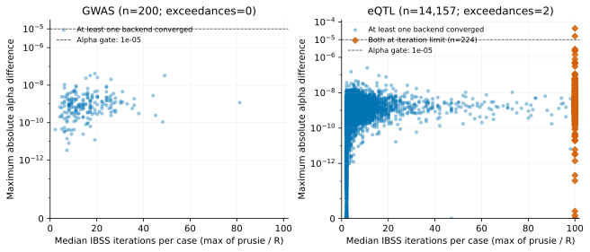

# Numerical accuracy

Numerical comparisons assess how closely prusie's fitted SuSiE posteriors agree
with susieR when both implementations receive the same inputs and fitting
settings. This page compares prusie 0.3.0 with susieR 0.16.6, using the complete
`alpha` matrix of component inclusion probabilities as the
[primary comparison](#component-posterior-validation).

The evidence includes fixed-reference checks, fresh susieR fits for FinnGen
type 2 diabetes GWAS loci and GTEx Whole_Blood eQTL analyses, and an
[independent toy example](#independent-toy-example). Results apply to the tested
configurations; numerical agreement is separate from the statistical calibration
of [variant inclusion probabilities and credible sets](model.md#pip-and-credible-sets).

## Component posterior validation

Comparisons use susieR 0.16.6, commit
`8e56a8e038e989856d106d9ca5175cc664fea9d2`, with matched inputs, model settings
and verified variant order. Each case is summarized by the maximum absolute
difference across its complete final `alpha` matrix, keeping the original
component rows and variant columns, including inactive components and
components without credible sets. Every entry must be finite and in $[0,1]$,
and each row must sum to one within `1e-10`.

Most per-case maximum differences fall near $10^{-9}$, far below any
probability that matters for interpretation. Iteration counts and convergence
status were identical in every case and every timed call, and every credible
set contained exactly the same variants in both implementations, so these
numerical differences do not affect statistical inference. Marginal posterior inclusion probabilities (PIPs), credible-set
memberships, posterior moments, Bayes factors, ELBOs and convergence flags are
compared separately. See [Computational compatibility](model.md#computational-compatibility)
for the floating-point assumptions.

The fixed-reference validation covers 184 RSS cases, each tested with
`n_threads=1`, `2`, `4` and `8`, and with both `overwrite_ld=False` and
`overwrite_ld=True`. Across all 1,472 case–setting comparisons, the largest
absolute alpha difference from the fixed R reference was $9.65\times10^{-8}$.
Each setting is fitted twice from independently reloaded inputs, giving 2,944
prusie calls. Repeated calls and the saved same-setting prusie comparison arrays
agree bit for bit in `alpha`. The [qualification record](assets/benchmark/release_qualification.json)
lists the settings, errors and identities of these checks.

These fixed-reference checks use `refine=False` and are separate from the
[fresh-R real-data comparisons](#variant-inclusion-probabilities) and
[independent toy example](#independent-toy-example). The results cover the tested
inputs, model settings and platforms; [refinement](post_analysis.md#refinement-compared-with-susier)
and stochastic draws across languages require separate validation.

## Variant inclusion probabilities

The primary real-data comparison fits FinnGen R13 type 2 diabetes GWAS loci
and GTEx v11 Whole_Blood eQTL analyses on exclusive AMD EPYC 7742 nodes, using the AVX2-capable
native build and fresh susieR 0.16.6. The arrays are a by-product of the formal
timed calls, with no additional fits. R alpha is saved as binary float64.
prusie uses `n_threads=1` and `refine=False`. Both implementations receive
matched summary statistics, LD and model settings; see the
[input provenance](reproducibility.md#real-gwas-and-eqtl-inputs) and
[fitting methods](performance.md#methods).

<!-- generated:maxima:start -->

| Analysis | Cases | Per-case max &#124;Δalpha&#124;, median [IQR] | Cases ≤ 1e-8 | Largest | Per-case max &#124;ΔPIP&#124;, median | Largest |
| --- | --- | --- | --- | --- | --- | --- |
| GWAS | 200 | 8.7e-10 [3.36e-10, 1.9e-09] | 96.5% | 4.05e-08 | 7.5e-10 | 4.05e-08 |
| eQTL | 14,157 | 7.29e-10 [2.41e-10, 1.61e-09] | 98.8% | 4.35e-05 | 4.95e-10 | 0.000243 |
<!-- generated:maxima:end -->

Each case contributes its maximum absolute difference over the complete
returned arrays; the table summarizes these maxima across cases. The
[per-case records](assets/benchmark/benchmark_records.jsonl.gz) give the
differences for every case.

The vertical axes are logarithmic. Exact zeros appear in a separate band at
the bottom, and dotted lines mark the panel medians.
[PDF](assets/benchmark/v030_numerical_agreement.pdf).

<!-- generated:limits:start -->

| Analysis | prusie nonconverged | susieR nonconverged |
| --- | --- | --- |
| GWAS | 0 | 0 |
| eQTL | 224 | 224 |

Nonconverged fits stopped at `max_iter=100`. They remain in every runtime and memory summary.
<!-- generated:limits:end -->

## Largest differences

The six cases with the largest alpha differences are listed below. In all six,
neither program converged within `max_iter=100`, and both returned the same
number of credible sets.

<!-- generated:errors:start -->

| Case | Variants | Max &#124;Δalpha&#124; | Max &#124;ΔPIP&#124; | Iterations (prusie / susieR) | Converged | Credible sets (prusie / susieR) |
| --- | --- | --- | --- | --- | --- | --- |
| ENSG00000110203.10 | 3,042 | 4.35e-05 | 4.35e-05 | 100 / 100 | neither | 9 / 9 |
| ENSG00000164741.15 | 6,644 | 1.59e-05 | 1.59e-05 | 100 / 100 | neither | 8 / 8 |
| ENSG00000131238.18 | 2,967 | 2.94e-06 | 9.47e-08 | 100 / 100 | neither | 10 / 10 |
| ENSG00000243264.3 | 1,031 | 2.45e-06 | 2.45e-06 | 100 / 100 | neither | 7 / 7 |
| ENSG00000293517.2 | 2,387 | 2.25e-06 | 8.61e-07 | 100 / 100 | neither | 7 / 7 |
| ENSG00000242371.1 | 1,590 | 1.4e-06 | 1.17e-06 | 100 / 100 | neither | 9 / 9 |
<!-- generated:errors:end -->

The largest PIP difference, $2.43\times10^{-4}$ at ENSG00000080822.17, occurred
in a case where both programs converged and the alpha difference was only
$1.72\times10^{-9}$. A PIP combines only components whose prior variance
exceeds `prior_tol`, so a component close to that boundary can shift the PIP
without a corresponding change in `alpha`.

The full real-data comparison does not provide error bounds for posterior
moments, variances, log Bayes factors or ELBOs. See the
[posterior field definitions](results.md#posterior-fields) for their meanings
and working scales, and [iterations and finalization](results.md#iterations-and-finalization)
for the relation between recorded objectives and returned arrays.

## Iterations and alpha differences

prusie and susieR group floating-point operations differently, and each IBSS
sweep reuses the previous sweep's results, so small rounding differences can
build up over sweeps. The figure plots each case's maximum absolute alpha
difference against its iteration count (the larger of the two backends'
medians); cases where neither backend converged within `max_iter=100` are
marked.

In every case where at least one backend converged, the difference was at
most $4.05\times10^{-8}$ for GWAS and $2.55\times10^{-7}$ for eQTL. Differences grow only slightly with sweeps. For eQTL, the median rises
from $4.25\times10^{-10}$ in cases with 1–5 sweeps ($n=8{,}886$) to
$1.75\times10^{-9}$ with 21–50 sweeps ($n=181$). The correlation between
iteration count and $\log_{10}$ of the difference is 0.22 for GWAS and 0.23 for
eQTL, so most of the case-to-case spread comes from other properties of each
problem, such as how well conditioned the LD matrix is.

## Credible sets

The real-data fits construct [credible sets](model.md#pip-and-credible-sets)
with target posterior mass `coverage=0.95` and minimum absolute LD correlation
`min_abs_corr=0.5`.

<!-- generated:cs:start -->

| Analysis | Backend | Credible sets | Cases with no credible set |
| --- | --- | --- | --- |
| GWAS | prusie | 1,139 | 7 |
| GWAS | susieR | 1,139 | 7 |
| eQTL | prusie | 14,207 | 5,049 |
| eQTL | susieR | 14,207 | 5,049 |

Counts come from the first retained call. Credible sets re-derived from the saved final alpha of both implementations with the susieR 0.16.6 rule contain the same variants in every case.
<!-- generated:cs:end -->

The [per-case membership table](assets/benchmark/cs_membership.tsv.gz) lists
the credible sets of both implementations and whether their members agree.
Credible-set presence does not establish convergence. Interpret the sets
alongside the [recorded convergence flags](assets/benchmark/benchmark_records.jsonl.gz)
and the [credible-set fields](results.md#credible-set-fields).

## Independent toy example

The packaged toy example checks numerical agreement on a single simulated
dataset, using a separate susieR reference. Load its summary statistics and LD
with `prusie.load_example()`.

<!-- generated:toy:start -->
The independent 500-variant toy example converged in 3 iterations and returned 2 credible sets. Its maximum absolute PIP difference from the separately generated susieR 0.16.6 reference was 1.66e-10.
<!-- generated:toy:end -->

The dashed lines mark the simulated nonzero effects. Credible-set memberships
also match the R reference for this example. See the [toy example tutorial](example.md)
for the simulation method, fitting options and packaged reference, and the
[vector PDF](assets/toy_fit.pdf).

## Reproduce the comparisons

The [benchmark summary](assets/benchmark/benchmark_summary.json) and
[full per-case records](assets/benchmark/benchmark_records.jsonl.gz) provide
numerical errors and convergence diagnostics. The compared arrays come from the
last retained call of each case (call seven for the 24 cases run under the
earlier seven-call schedule, call three otherwise). Follow the
[regeneration instructions](reproducibility.md#tables-and-figures) to rebuild
the tables and figures from retained measurements without refitting.

The [offline toy checks](reproducibility.md#toy-example) compare a prusie fit
with the packaged R reference. The [fresh susieR comparison](reproducibility.md#r-comparison)
fits both implementations using matched inputs and settings. Repeating the
real-data comparisons requires the separately obtained
[association summaries and LD](reproducibility.md#real-gwas-and-eqtl-inputs),
with the same variant order and fitting settings. Preserve the frozen inputs
and reference files when running new checks.
