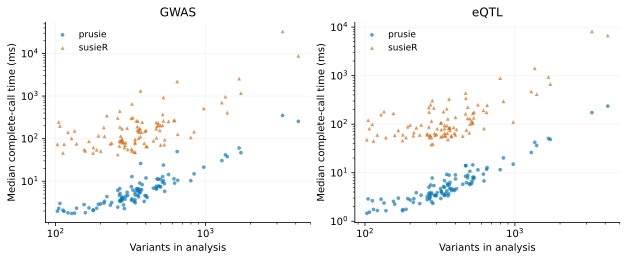
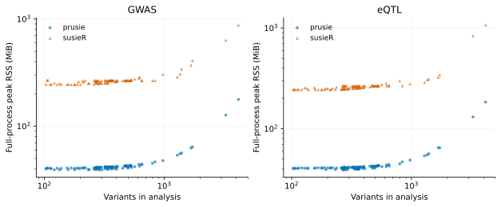
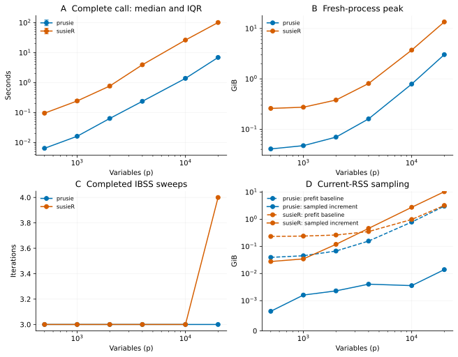

# Performance

These measurements describe the source revision and settings identified on this
page. They do not measure later revisions of the solver. See
[computational compatibility](model.md#computational-compatibility) for the
current numerical validation criteria.

These measurements compare prusie 0.2.4.dev2 with susieR 0.16.6 on 100 GWAS and
100 eQTL locus analyses. They measure the runtime of one fitting call and the
peak resident memory (RSS) of a new process for each locus and backend.

<!-- current:highlights:start -->
Measured **0.2.4.dev2** against susieR 0.16.6.

| Analysis | Loci | Max. absolute PIP difference vs susieR | Speed-up¹ | Memory ratio² |
| --- | --- | --- | --- | --- |
| GWAS | 100 | 9.14e-09 | 26× | 6.3× |
| eQTL | 100 | 1.22e-08 | 22× | 6.2× |

¹ Geometric mean of per-locus susieR/prusie runtime ratios. ² Median per-locus susieR/prusie ratio of peak resident memory (RSS), including the interpreter and inputs.
<!-- current:highlights:end -->

**Environment:** AMD EPYC 9754; Linux x86-64, glibc 2.35; CPython 3.12.2,
NumPy 2.2.6; R 4.4.0 with OpenBLAS 0.3.20 (Zen); one numerical thread.
NumPy uses its packaged OpenBLAS; the Rust single-effect updates use the
optional glibc libmvec AVX2 path. The [environment record](assets/benchmark/protocol.json)
identifies the loaded libraries and binary hashes.

## Data

<!-- generated:panel:start -->
The data cover 100 genomic windows: 100 analyses of one FinnGen R10 inflammatory bowel disease GWAS (K11_IBD_STRICT; n = 412181) and 100 BLUEPRINT monocyte eQTL analyses (QTD000021; n = 191), representing 83 distinct genes. The interval metadata contain 0 overlapping window pairs. Analyses share study participants and reference samples; the 200 trait analyses are not 200 independent loci.
<!-- generated:panel:end -->

Each analysis contains 103–4,162 aligned variants. Signed LD comes from
external 1000 Genomes samples: 99 FIN founders for GWAS and 525 EUR founders
for eQTL. Both analyses use the same variant intersection within each window,
with the respective LD matrix. See the [input sources](reproducibility.md#real-gwas-and-eqtl-inputs)
for study pages and harmonization details.

## Methods

Timing surrounds the public `susie_rss` call, including input validation, RSS
preparation, IBSS, posterior summaries and credible-set construction. Imports,
file reads, explicit garbage collection and exports are outside the clock.
One warm-up precedes seven repeats; the median represents each locus/backend.
Backends run sequentially, with their order alternating between cases. The
machine is shared, so the results include repeat variability.

The speed-up for a locus is its median susieR runtime divided by its median
prusie runtime. The main table reports the geometric mean of these ratios.
The memory ratio is susieR peak RSS divided by prusie peak RSS for each locus;
the table reports their median. Neither ratio is a ratio of the group medians.

Memory is measured separately from timing in a new process for each
locus/backend. The process fits once and retains the result; its high-water
mark includes the interpreter, imports and input loading. Current RSS is also
sampled before and during fitting. The sampled increment subtracts the RSS
immediately before fitting from the sampled fit peak. Sampling targets 2 ms;
short allocations can be missed, making sampled peaks and increments lower
bounds. The largest observed gaps are 35.1 ms for prusie and 404.5 ms for R.
The process high-water mark is the primary memory measure. KiB is divided by
1024 to obtain MiB.

All 200 analyses are included, including iteration-limit and empty-CS results.
Settings are L=5, `tol=0.001`, `max_iter=100`, `scaled_prior_variance=0.2`,
fixed residual variance 1, estimated prior variance, uniform variant priors,
no null column, standardization, coverage 0.95 and minimum absolute correlation
0.5. Purity uses every pair of variants in each set. Both implementations
skip optional eigenvalue/projection diagnostics; prusie's `check_input=False`
retains finite-value, symmetry, diagonal and range checks. Process address
space is limited to 16 GiB. The results apply to these inputs, binaries and
hardware; implementation agreement does not establish model validity.

## Results

### Runtime

<!-- current:runtime:start -->

| Analysis | prusie (ms) | susieR (ms) | Faster / tied / slower | prusie repeat IQR/median | susieR repeat IQR/median |
| --- | --- | --- | --- | --- | --- |
| GWAS | 5.18 | 142 | 100 / 0 / 0 | 0.0974 | 0.144 |
| eQTL | 4.61 | 88.1 | 100 / 0 / 0 | 0.101 | 0.127 |
<!-- current:runtime:end -->

Runtime columns are medians across loci of the seven-repeat medians. The
variability columns summarize each locus's interquartile range divided by its
median. Faster/tied/slower counts compare prusie with susieR at every locus.
Downloads below retain individual repeats and convergence/CS groups.

### Memory

<!-- current:memory:start -->

| Analysis / backend | Peak RSS (MiB) | Before fitting (MiB) | Sampled fit peak (MiB) | Sampled increment (MiB) |
| --- | --- | --- | --- | --- |
| GWAS / prusie | 41.2 | 39 | 41.2 | 2.31 |
| GWAS / susieR | 266 | 238 | 266 | 28.2 |
| eQTL / prusie | 41.3 | 39.1 | 41.3 | 2.29 |
| eQTL / susieR | 262 | 238 | 262 | 23.7 |
<!-- current:memory:end -->

Each column is a separate median across loci. The sampled increment is
calculated within each process before summarization.

### Dense-matrix scaling

A separate deterministic computational fixture uses L=5, n=5000, AR(1)
correlation ρ=0.4, effects [8,7,6] at [p//5,p//2,4p//5], and a
0.15 cos(0.73j) background. It uses `tol=0.001`, `max_iter=100`, estimated
prior variance and fixed residual variance 1.

All six sizes meet the PIP comparison criterion; the largest absolute
difference is 2.62e-11, with matching convergence flags and CS membership.
At p=20,000, prusie takes three sweeps and susieR four. The timings include
this iteration-count difference.

<!-- current:scaling:start -->

| Variants | Backend | Median (s) | Iterations | Converged | Peak RSS (MiB) | Sampled increment (MiB) |
| --- | --- | --- | --- | --- | --- | --- |
| 500 | prusie | 0.00644 | 3 | True | 41.7 | 0.664 |
| 500 | susieR | 0.0958 | 3 | True | 266 | 28.4 |
| 1000 | prusie | 0.0162 | 3 | True | 48.4 | 1.65 |
| 1000 | susieR | 0.245 | 3 | True | 281 | 35.4 |
| 2000 | prusie | 0.0638 | 3 | True | 71.5 | 2.35 |
| 2000 | susieR | 0.773 | 3 | True | 390 | 122 |
| 4000 | prusie | 0.238 | 3 | True | 165 | 4.15 |
| 4000 | susieR | 3.95 | 3 | True | 830 | 470 |
| 10000 | prusie | 1.39 | 3 | True | 809 | 3.67 |
| 10000 | susieR | 26.5 | 3 | True | 3.82e+03 | 2.82e+03 |
| 20000 | prusie | 6.95 | 3 | True | 3.11e+03 | 14.3 |
| 20000 | susieR | 102 | 4 | True | 1.39e+04 | 1.06e+04 |
<!-- current:scaling:end -->

All sizes use dense arrays materialized before fitting from lossless gzip
files. Peak process RSS includes loading costs. Curves connect measured sizes.

## Reproducibility

<!-- current:identity:start -->
- Compute commit: `ff379ada284a63a3cf1770d43faacc6b929dc923`
- CPython 3.12 wheel SHA-256: `7fbc1305a17dfeb2decf446c4703096d4a677a843ce0225641a9fe03300d139a`
- Native extension SHA-256: `509f2f1b7c7f330807263241cd3f6e2ac122d938c43fd41c22a209f7a8643816`
<!-- current:identity:end -->

Download the [locus summaries](assets/benchmark/real_summary.json),
[locus and repeat CSV](assets/benchmark/real_cases.csv),
[scaling summaries](assets/benchmark/scaling_summary.json) and
[scaling CSV](assets/benchmark/scaling_cases.csv). These records contain
anonymous case labels and measurements; they contain no association inputs
or individual genotypes. Values retain full precision in the downloads.

`python tools/generate_results.py` renders the tables from these records.
The [reproducibility guide](reproducibility.md) describes figure generation
and input-level reruns; [comparison scripts](https://github.com/LucaJiang/prusie/tree/main/tools/benchmark)
implement the timing and memory protocols.

## Earlier measurements

Measurements of prusie 0.2.3rc4 on the same loci, made on 6 October 2026:

<!-- generated:earlier:start -->

| Analysis | Speed-up (geometric mean) | Peak RSS ratio (median) |
| --- | --- | --- |
| GWAS | 37× | 6.9× |
| eQTL | 34× | 6.8× |
<!-- generated:earlier:end -->

These use the same definitions of speed-up and peak process memory. Full
[summary](assets/r_comparison_summary.json),
[case table](assets/r_comparison_cases.tsv),
[repeats](assets/r_comparison_repeats.json) and
[environment](assets/r_comparison_protocol.json) identify the measured binary.
