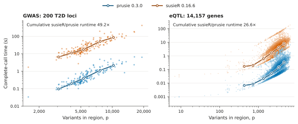
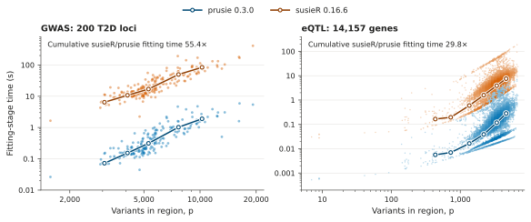
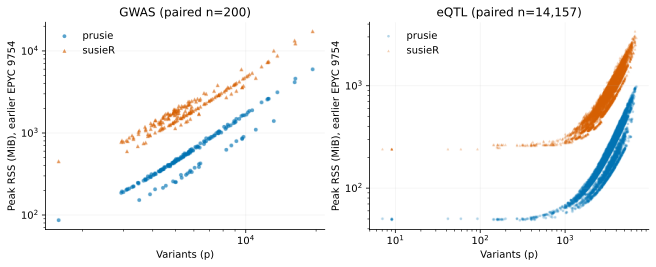
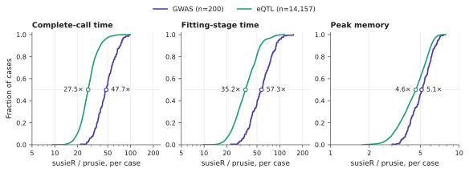
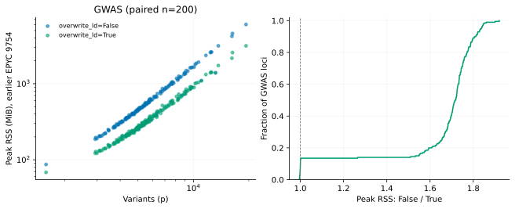
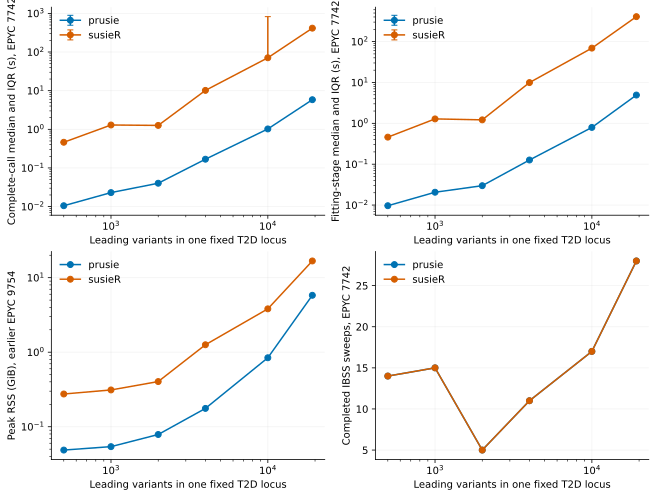
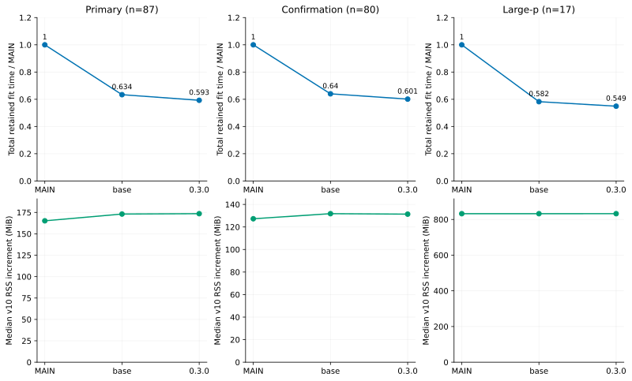

# Performance

These measurements assess the time and memory required for SuSiE-RSS
fine-mapping with prusie 0.3.0 and susieR 0.16.6. The comparison uses fresh fits
on FinnGen R13 type 2 diabetes GWAS loci and GTEx v11 Whole_Blood eQTL analyses.
Runtime is measured on exclusive AMD EPYC 7742 nodes, with complete-call and
fitting-stage times from the same calls. Peak resident set size (RSS) comes
from an earlier local workstation.

<!-- current:highlights:start -->
Measured **prusie 0.3.0** against fresh **susieR 0.16.6** fits.

| Analysis | Cases | Complete-call speed-up¹ | Fitting-stage speed-up¹ | Complete-call sum-of-medians² | Peak RSS ratio³ |
| --- | --- | --- | --- | --- | --- |
| GWAS | 200 | 49.2× | 55.4× | 42.9× | 3.66× |
| eQTL | 14157 | 26.6× | 29.8× | 26.6× | 3.77× |

¹ Sum of three retained R times divided by the corresponding prusie total, on exclusive AMD EPYC 7742 nodes. The fitting stage excludes input/LD preparation. ² Sum of within-case R medians divided by the sum of prusie medians. ³ Median paired R/prusie fresh-process peak RSS from the earlier local workstation measurements, including interpreter and inputs. Runtime and memory have separate origins.
<!-- current:highlights:end -->

The runtime comparison uses one numerical thread per fit. The
[protocol](assets/benchmark/benchmark_protocol.json) records the timing
boundaries and software identities; [reproducibility](#reproducibility)
identifies the frozen release and its timing-instrumented copy.
[Numerical accuracy](numerical_accuracy.md) reports agreement with fresh
susieR under the [alpha criterion](model.md#computational-compatibility).

## Data

<!-- generated:panel:start -->
The fixed panel contains **200 FinnGen R13 type 2 diabetes GWAS loci** (n = 486,019; 89,727 cases and 396,292 controls) and **14,157 GTEx v11 Whole_Blood genes** (n = 800). GWAS is fitted with the frozen Gaussian RSS approximation. All cases remain accounted for, including iteration-limit outputs, empty credible sets, numerical discrepancies and operational failures. Gene windows and study participants overlap; cases are not independent biological replications.

| Analysis | Cases | Variants per case | Alpha passes / failures / unavailable | Unresolved case failures |
| --- | --- | --- | --- | --- |
| GWAS | 200 | 1575 to 19221 | 200 / 0 / 0 | 0 |
| eQTL | 14157 | 7 to 6862 | 14155 / 2 / 0 | 0 |
<!-- generated:panel:end -->

For each case, prusie and susieR use the same aligned summary statistics,
variant order and signed LD matrix. LD comes from external 1000 Genomes
reference samples: 99 Finnish (FIN) samples for GWAS and 525 European (EUR)
samples for eQTL. EUR describes the LD reference; the GTEx association cohort
was not restricted to European ancestry for this comparison. See the
[input sources](reproducibility.md#real-gwas-and-eqtl-inputs) for study and
reference provenance and harmonization details.

The alpha counts use the
[complete-matrix comparison criterion](model.md#computational-compatibility).
Any discrepancy remains included in the descriptive performance summaries;
[numerical accuracy](numerical_accuracy.md) lists individual exceedances.

## Methods

Complete-call timing surrounds the public `susie_rss` call, including input
validation, RSS preparation, IBSS, posterior summaries and credible-set
construction. The added fitting-stage metric directly times solver
initialization, IBSS/SER, ELBO and convergence calculations, and final
posterior/credible-set construction. Full input handling, LD checks, repair
and forced symmetrization are excluded from the fitting stage but still run.
Imports, file reads, LD reconstruction, explicit garbage collection,
numerical comparisons and exports are outside both clocks.

Each case/backend starts in a fresh process, loads inputs untimed, then makes
**one warmup and three retained calls**. The two backends run sequentially on
the same lane in a seeded, balanced order. The primary comparison uses
`n_threads=1` and `overwrite_ld=False`. The three-repeat protocol follows the
2026-10-28 amendment: 24 cases had already completed seven retained calls;
their first three are used, with every original observation preserved.

Nodes are exclusive and use the same CPU model. Each timing lane occupies one
physical core in an L3 domain; its other cores and SMT sibling stay idle.
One separate L3 domain serves the coordinator. Memory is bound to the lane's
NUMA node where supported, with any fallback recorded. Admission reserves at
most 90% of node memory using prior measured peaks as planning estimates and
allows at most four cases per socket with an LD matrix larger than 1 GiB.
These reservations are estimates, not per-process memory guarantees.

Inputs are staged to node-local storage. Signed LD is reconstructed with
single-thread PLINK before each case and removed afterwards. The variants,
order, alleles, z-scores and genotype/sample source match the local panel;
the reconstructed LD need not be bitwise identical. In the 24-case fidelity
sample, the maximum absolute LD difference was $2.15\times10^{-14}$, with no
sign disagreements. PLINK made 22 previously slightly asymmetric matrices
exactly symmetric. This can affect the native validation/allocation path, so
changes from local timing cannot be attributed solely to reduced interference.

Both metrics use instrumented copies of the frozen artifacts. Eight-case
qualification preserved final alpha/PIP arrays bit for bit and recorded the
same iteration, convergence and CS-count outcomes. Instrumented/original
median complete-call ratios ranged from 0.805 to 1.026 for prusie and 0.957 to
1.064 for R. These observations include order and binary-layout effects and
do not isolate timestamp overhead. Exact boundaries and limitations are
[documented with the instrumentation](reproducibility.md#benchmark-protocol).

For each metric, the headline speed-up is the sum of all three retained R
times divided by the corresponding prusie total. The sum-of-medians
sensitivity divides the sum of within-case R medians by the sum of prusie
medians. The geometric mean of within-case median ratios gives each case
equal weight. These are separate summaries with different weighting.

The retained memory experiment used a new process per case/backend on an
earlier local workstation. It fitted once and read the resident-memory
high-water mark immediately afterwards, before comparisons or serialization.
Peaks include the interpreter, imports, input loading, preloaded validation
reference and fit. Published memory ratios are medians of within-case R/prusie
peak ratios. Current compute-cluster process peaks are diagnostics only.

Fits request `L=10` components, capped at the variant count, with `tol=0.001`,
`max_iter=100`, `scaled_prior_variance=0.2`, estimated prior variance
(`estimate_prior_method="optim"`) and fixed residual variance 1
(`estimate_residual_variance=False`). Both implementations use uniform variant
priors, `null_weight=0`, `standardize=True`, `coverage=0.95` and
`min_abs_corr=0.5`. Credible-set purity uses all pairs of set members, with
`n_purity` set to the case's variant count. Calls use the Wald RSS adjustment,
ELBO convergence, `check_prior=True` and `refine=False`. With
`check_input=False`, optional eigenvalue and eigenspace diagnostics are skipped;
prusie's basic matrix validation remains within the timed call. Iteration
counts and convergence are retained in the records.

Every complete positive timing pair enters the descriptive timing summaries,
including iteration-limit fits, empty credible sets and alpha discrepancies.
Memory summaries use complete memory pairs; operational failures remain
accounted for separately. Agreement with susieR does not establish model
validity.

## Results

### Runtime

<!-- current:runtime:start -->

| Analysis | Metric | prusie median (ms) | R median (ms) | Total R/prusie | Sum-of-medians | Geometric mean | Faster / tied / slower |
| --- | --- | --- | --- | --- | --- | --- | --- |
| GWAS | Complete call | 393 | 1.87e+04 | 49.2× | 42.9× | 47.7× | 200 / 0 / 0 |
| GWAS | Fitting stage | 317 | 1.82e+04 | 55.4× | 48.1× | 56.5× | 200 / 0 / 0 |
| eQTL | Complete call | 130 | 3.82e+03 | 26.6× | 26.6× | 27.8× | 14157 / 0 / 0 |
| eQTL | Fitting stage | 104 | 3.62e+03 | 29.8× | 29.8× | 35.3× | 14157 / 0 / 0 |
<!-- current:runtime:end -->

Runtime entries are medians across cases of the three-repeat within-case
medians. Faster/tied/slower counts compare those within-case medians. The
[per-case records](#reproducibility) retain individual repeats, timestamps,
iteration counts, convergence flags and credible-set counts.

**The GWAS headline is sensitive to two retained R outliers:** the total-time
ratio is 49.20×, compared with 42.86× for the sum of case medians. The fitting-stage
ratios are 55.35× and 48.06×, respectively. A third R outlier affects the nested
windows, whose complete-call ratios are 140.46× and 70.21×. These three calls
shared NUMA domain 0 on cpunode-029 during the interval ending in the recorded
out-of-memory event. Their placement and timestamps are consistent with local
memory pressure, although the stalls themselves were not profiled. All calls
remain included; none was rerun or discarded because of its duration.





<!-- current:variability:start -->

| Analysis | Complete-call timing | Backend | Median IQR/median | Cases with a repeat >3× median | Time in repeats >2× median |
| --- | --- | --- | --- | --- | --- |
| GWAS | EPYC 7742, 3 calls | prusie | 0.0128 | 0 | 0% |
| GWAS | EPYC 7742, 3 calls | susieR | 0.00668 | 2 | 15.2% |
| GWAS | Local, first 3 calls | prusie | 0.105 | 0 | 0% |
| GWAS | Local, first 3 calls | susieR | 0.109 | 0 | 1.63% |
| eQTL | EPYC 7742, 3 calls | prusie | 0.0231 | 0 | 0% |
| eQTL | EPYC 7742, 3 calls | susieR | 0.021 | 0 | 0% |
| eQTL | Local, first 3 calls | prusie | 0.102 | 128 | 3.02% |
| eQTL | Local, first 3 calls | susieR | 0.0873 | 0 | 0.0111% |
<!-- current:variability:end -->

IQR/median is computed within each case and then summarized across cases.
The earlier local seven-repeat comparison is also restricted to its first
three retained calls for this sensitivity check. The full seven-repeat
statistics and variant-count quintiles remain in the
[machine-readable summary](assets/benchmark/benchmark_summary.json).
Both eQTL backends and native GWAS had no retained repeat above twice its case
median. The two extreme R GWAS repeats account for 15.23% of total retained
R GWAS time; the one extreme nested-window repeat accounts for 52.53% of that
panel's R total. Thus typical variability fell substantially, but exclusive
nodes did not eliminate every source of interference. The
[individual extreme calls](assets/benchmark/archive/extreme_retained_calls.json)
remain available with timestamps and both measured durations.

### Memory

<!-- current:memory:start -->

| Analysis / backend | Fresh-process peak RSS, across-case median (MiB) | Measured cases |
| --- | --- | --- |
| GWAS / prusie | 478 | 200 |
| GWAS / susieR | 1.76e+03 | 200 |
| eQTL / prusie | 229 | 14157 |
| eQTL / susieR | 883 | 14157 |
<!-- current:memory:end -->

Each peak-RSS entry is a separate median across cases from an earlier local workstation. The paired memory
ratio in the opening table is calculated within each case before taking its
median, as defined in [Methods](#methods).



The following distributions show the EPYC 7742 complete-call and fitting-stage
ratios, followed by the earlier local memory ratios.



### Thread scaling

The controlled thread-scaling experiment used exclusive AMD EPYC 7742 nodes and
87 fixed real-data cases. Ratios below first pair each retained call with its
one-thread counterpart, take the median within each case, and then the median
across cases. Lower ratios mean shorter runtime.

| Threads | Median time / one-thread time | Faster / tied / slower, out of 87 |
| --- | --- | --- |
| 2 | 0.799 | 87 / 0 / 0 |
| 4 | 0.735 | 87 / 0 / 0 |
| 8 | 0.783 | 79 / 0 / 8 |

Four threads had the lowest median ratio. Eight threads were slower than four
in 52 of 87 cases; their paired median eight/four ratio was 1.052. Eight
threads were also slower than one in 8 cases. See
[Threads](optimization.md#threads) for the 2–4-thread guidance and the work
controlled by `n_threads`. These are the retained controlled M1 measurements;
the loaded-host M2 thread series is not used for this guidance.

### LD overwrite

The separate earlier local workstation memory experiment used 200 GWAS cases and
one numerical thread. With `overwrite_ld=True`, 173 cases had a material
reduction in fresh-process peak RSS; 27 had no material saving. Differences
of about 1.1 MiB or less are ties at measurement resolution, rather than evidence
of higher peaks. In the 27 cases without material saving, the median peak was
about 1.34 times the LD matrix bytes in both modes. The median within-case
False/True peak ratio over all 200 cases was 1.72.

For ordinary z/LD/sample-size fits, the default path can reuse an aligned,
C-contiguous float64 LD matrix without a second full dense working copy when
its native exact-symmetry/correlation checks and implicit-scaling bounds
succeed. Repair, layout conversion, stronger input checks, retained analysis
state and exceptional scaling can require additional matrix storage. This
statement concerns the storage path; peak RSS alone does not identify which
branch a particular fit used.

The separate controlled M1 experiment reported a median paired-round runtime
ratio of 0.810 for True/False on 87 cases (75 faster, 12 slower). Its acceptance
criterion concerned memory; this runtime result is descriptive.

This option may consume the caller's LD array even if the call later fails.
Reload the original LD before reuse. The
[LD workspace contract](api.md#optional-ld-workspace) describes supported
inputs and ownership.



### Nested locus windows

This series takes nested sets of leading variants, in their frozen order,
from the largest FinnGen T2D locus. Fitting settings follow
[Methods](#methods). These measurements describe one locus and its observed
convergence paths; they are not independent loci or a complexity-law study.

<!-- current:scaling:start -->

| Leading variants | Backend | Complete-call median (s) | Fitting-stage median (s) | Observed iterations | Converged | Earlier local peak RSS (MiB) |
| --- | --- | --- | --- | --- | --- | --- |
| 500 | prusie | 0.0105 | 0.00966 | 14 | True | 49.8 |
| 500 | susieR | 0.463 | 0.46 | 14 | True | 282 |
| 1000 | prusie | 0.0231 | 0.0206 | 15 | True | 55.4 |
| 1000 | susieR | 1.29 | 1.28 | 15 | True | 319 |
| 2000 | prusie | 0.0403 | 0.0298 | 5 | True | 80.6 |
| 2000 | susieR | 1.26 | 1.22 | 5 | True | 413 |
| 4000 | prusie | 0.169 | 0.127 | 11 | True | 180 |
| 4000 | susieR | 10.2 | 9.94 | 11 | True | 1.29e+03 |
| 10000 | prusie | 1.02 | 0.795 | 17 | True | 863 |
| 10000 | susieR | 71.1 | 69.3 | 17 | True | 3.91e+03 |
| 19221 | prusie | 5.84 | 4.92 | 28 | True | 5.95e+03 |
| 19221 | susieR | 415 | 408 | 28 | True | 1.72e+04 |
<!-- current:scaling:end -->



Dense LD matrices are materialized before fitting, and peak process RSS
includes input loading. Lines connect measured windows; iteration counts
change with window size. Runtime and iteration results use the EPYC 7742
inputs; the displayed memory results retain the earlier local inputs and host.

## Reproducibility

<!-- current:identity:start -->
- Frozen release code: `6d60d5e5723461c3e1fc5a46fd0a0e7b6378cfa7`
- Original release wheel SHA-256: `85285c26c1f6ae3caaed99c4d7766ede7f0083ea98eb2d26b7763d8654840b59`
- Original native extension SHA-256: `a9d377e45583b654ddfbe8323a783e32a61bf042c755cb26c3873f2065ed0b3e`
- Benchmark protocol SHA-256: `3893ec7f92fc042f15eade88a4c27a452835bf3285dfda037d6133c55fc56825`
- Statistical reference: R 4.4.0; susieR 0.16.6, `8e56a8e038e989856d106d9ca5175cc664fea9d2`.

Both runtime metrics use run-local timing instrumentation derived from these frozen artifacts. The native binary differs from the release binary; the original wheel is preserved. The instrumentation patch, derived binary hashes, source boundaries and qualification results are in the [measurement archive](reproducibility.md#benchmark-protocol). Earlier local memory measurements retain their original measured build identity.
<!-- current:identity:end -->

The [benchmark summary](assets/benchmark/benchmark_summary.json) and
[compressed per-case records](assets/benchmark/benchmark_records.jsonl.gz)
retain both timing metrics, call timestamps, iteration/convergence outcomes
and numerical differences. The [protocol](assets/benchmark/benchmark_protocol.json)
and [archive guide](reproducibility.md#benchmark-protocol) document construction
and instrumentation. The [earlier local records](assets/benchmark/v030_records.jsonl.gz)
remain the source for peak RSS and [LD overwrite](assets/benchmark/v030_overwrite.tsv).
The separate [paired optimization records](assets/benchmark/v030_m1.json)
support [Earlier measurements](#earlier-measurements).

These records retain locus and gene identifiers but omit association vectors,
LD matrices and individual genotypes. Repeating fits requires the aligned
inputs and fitting settings described in [Methods](#methods) and the
[real-input guide](reproducibility.md#real-gwas-and-eqtl-inputs).

From the repository root, redraw the figures and regenerate this page's tables
from the retained measurements:

```sh
python tools/benchmark/v030.py figures
python tools/generate_results.py --pages docs/performance.md
```

These commands need no R or association inputs and run no new fits. Add
`--check` to the second command to verify generated text without rewriting it.
The [reproducibility guide](reproducibility.md#tables-and-figures) gives
dependencies and the full documentation build commands.

## Earlier measurements

Separate paired measurements compare the measured 0.3.0 wheel with earlier
prusie implementations on fixed real-data panels: 87 primary cases, 80
confirmation cases and 17 cases with large variant counts. These measurements
use AMD EPYC 7742 processors and the paired protocol v10.

The cumulative runtime comparison uses one numerical thread and sums the
original eight retained complete calls per case, following one warm-up. Across
all 184 cases, total historical-baseline time divided by total 0.3.0 time is
1.73; total intermediate-baseline time divided by total 0.3.0 time is 1.06.
The figure labels these frozen baselines `MAIN` and `base`, respectively.

Memory in this series is post-fit `VmHWM` minus current `VmRSS` immediately
before fitting. Pre-fit high-water excess is recorded separately. The figure
reports the across-case median of within-case median increments, in MiB.
This differs from the full-process peak RSS used in the
[primary comparison](#methods).



<!-- generated:earlier:start -->

| Comparison | Fixed panel | v10 decision | Retained rounds | Applicable / all cases | v10 paired-round runtime W / T / R | Case-median runtime W / T / R | Incremental-memory W / T / R | Role |
| --- | --- | --- | --- | --- | --- | --- | --- | --- |
| 0.3.0 vs intermediate baseline | Primary (87) | DIAGNOSTIC_ONLY | 8 | 87 / 87 | 75 / 0 / 12 | 73 / 0 / 14 | 27 / 0 / 60 | descriptive |
| 0.3.0 vs intermediate baseline | Confirmation (80) | DIAGNOSTIC_ONLY | 8 | 80 / 80 | 71 / 0 / 9 | 71 / 0 / 9 | 36 / 0 / 44 | descriptive |
| 0.3.0 vs intermediate baseline | Large-p (17) | DIAGNOSTIC_ONLY | 8 | 17 / 17 | 13 / 0 / 4 | 13 / 0 / 4 | 6 / 0 / 11 | descriptive |
| 0.3.0 vs historical baseline | Primary (87) | DIAGNOSTIC_ONLY | 8 | 87 / 87 | 87 / 0 / 0 | 87 / 0 / 0 | 28 / 0 / 59 | descriptive |
| 0.3.0 vs historical baseline | Confirmation (80) | DIAGNOSTIC_ONLY | 8 | 80 / 80 | 78 / 0 / 2 | 78 / 0 / 2 | 35 / 1 / 44 | descriptive |
| 0.3.0 vs historical baseline | Large-p (17) | DIAGNOSTIC_ONLY | 8 | 17 / 17 | 17 / 0 / 0 | 17 / 0 / 0 | 7 / 0 / 10 | descriptive |
| 0.3.0 vs previously optimized baseline | Primary (87) | ACCEPTED | 16 | 87 / 87 | 36 / 0 / 51 | 34 / 0 / 53 | 62 / 0 / 25 | non-regression check |
| 0.3.0 vs previously optimized baseline | Confirmation (80) | ACCEPTED | 16 | 80 / 80 | 34 / 0 / 46 | 32 / 0 / 48 | 51 / 0 / 29 | non-regression check |
| 0.3.0 vs previously optimized baseline | Large-p (17) | UNRESOLVED_QUALITY | 16 | 17 / 17 | 5 / 0 / 12 | 5 / 0 / 12 | 17 / 0 / 0 | non-regression check |
| n_threads=2 vs 1 | Primary (87) | DIAGNOSTIC_ONLY | 8 | 87 / 87 | 87 / 0 / 0 | 87 / 0 / 0 | 56 / 1 / 30 | descriptive |
| n_threads=2 vs 1 | Confirmation (80) | DIAGNOSTIC_ONLY | 8 | 78 / 80 | 78 / 0 / 0 | 78 / 0 / 0 | 52 / 1 / 25 | descriptive |
| n_threads=2 vs 1 | Large-p (17) | DIAGNOSTIC_ONLY | 8 | 17 / 17 | 17 / 0 / 0 | 17 / 0 / 0 | 11 / 0 / 6 | descriptive |
| n_threads=4 vs 1 | Primary (87) | ACCEPTED | 8 | 87 / 87 | 87 / 0 / 0 | 87 / 0 / 0 | 52 / 0 / 35 | four-thread option |
| n_threads=4 vs 1 | Confirmation (80) | ACCEPTED | 8 | 78 / 80 | 78 / 0 / 0 | 78 / 0 / 0 | 56 / 0 / 22 | four-thread option |
| n_threads=4 vs 1 | Large-p (17) | ACCEPTED | 8 | 17 / 17 | 17 / 0 / 0 | 17 / 0 / 0 | 12 / 0 / 5 | four-thread option |
| n_threads=8 vs 1 | Primary (87) | DIAGNOSTIC_ONLY | 8 | 87 / 87 | 79 / 0 / 8 | 79 / 0 / 8 | 58 / 2 / 27 | descriptive |
| n_threads=8 vs 1 | Confirmation (80) | DIAGNOSTIC_ONLY | 8 | 78 / 80 | 69 / 0 / 9 | 69 / 0 / 9 | 55 / 3 / 20 | descriptive |
| n_threads=8 vs 1 | Large-p (17) | DIAGNOSTIC_ONLY | 8 | 17 / 17 | 14 / 0 / 3 | 14 / 0 / 3 | 10 / 0 / 7 | descriptive |
| overwrite_ld=True vs False | Primary (87) | ACCEPTED | 8 | 87 / 87 | 75 / 0 / 12 | 78 / 0 / 9 | 80 / 6 / 1 | memory comparison |
| overwrite_ld=True vs False | Confirmation (80) | ACCEPTED | 8 | 80 / 80 | 70 / 0 / 10 | 69 / 0 / 11 | 77 / 1 / 2 | memory comparison |
| overwrite_ld=True vs False | Large-p (17) | ACCEPTED | 8 | 17 / 17 | 16 / 0 / 1 | 17 / 0 / 0 | 14 / 2 / 1 | memory comparison |

These are earlier controlled measurements on the same AMD EPYC 7742 nodes. Cumulative totals do not replace the fixed-panel majority, stratified non-regression check and robustness criteria. The v10 runtime count uses the median of paired-round time ratios; the additional case-median count compares the two within-case median times. These can differ. Memory counts compare within-case medians of incremental peaks. W / T / R means lower, equal and higher candidate measurements. A comparison with 16 retained rounds uses the protocol's single quality retry, pooling both complete windows only for comparisons whose first-window decision was unresolved. Other comparisons retain the original eight rounds. Initial decisions remain in the paired measurement records.
<!-- generated:earlier:end -->

Eight of the nine non-diagnostic panel comparisons are `ACCEPTED`. The large-p
default-path comparison with the previously optimized baseline remains
`UNRESOLVED_QUALITY`: no stratified non-regression veto was observed, but
resampling agreement for that decision was 0.942, below the required 0.95,
after the single permitted quality retry. This result remains an exception to
the robustness criterion. The instruction-count follow-up below addresses
the recorded large-p slowdown without changing that historical result.

The [paired measurement records](assets/benchmark/v030_m1.json) retain software
identities, hardware, individual observations, repeat variability and initial
decisions as well as the final comparisons above.

### Large-p instruction-count follow-up

A separate instruction-count check compared the measured 0.3.0 integration with its
previously optimized parent on the same 17 large-p cases. All user-space
instruction-count differences were within the predeclared 0.2% bound; the
largest was 0.00480%. Two repetitions on two cases gave a maximum difference
of 0.00107%. Under that rule, the conclusion is “no code-path difference;
attributed to timing noise.” The historical timing-quality result remains
recorded as unresolved; this diagnosis does not rewrite its raw measurements.
