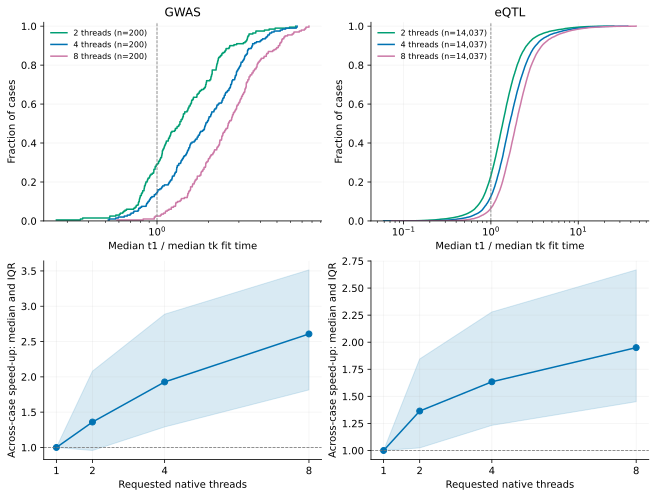

# Performance

These measurements assess the time and memory required for SuSiE-RSS
fine-mapping with prusie 0.3.0 and susieR 0.16.6. The comparison uses fresh fits
on FinnGen R13 type 2 diabetes GWAS loci and GTEx v11 Whole_Blood eQTL analyses.
Runtime covers the complete fitting call; peak resident set size (RSS) is
measured in a separate fresh process for each case and implementation.

<!-- current:highlights:start -->
Measured **prusie 0.3.0** against fresh **susieR 0.16.6** fits.

| Analysis | Cases | Timing pairs | Total-time speed-up¹ | Per-case geometric mean² | Peak RSS ratio³ |
| --- | --- | --- | --- | --- | --- |
| GWAS | 200 | 200 | 27.7× | 35× | 3.66× |
| eQTL | 14157 | 14157 | 19.1× | 22.7× | 3.77× |

¹ Sum of all seven retained R fit times divided by the corresponding prusie total. ² Geometric mean of within-case median-time ratios. ³ Median paired R/prusie fresh-process peak RSS, including interpreter and inputs. The two speed-up summaries use different weighting.
<!-- current:highlights:end -->

The primary comparison uses one numerical thread per fit on a concurrently
loaded AMD EPYC 9754 host: Linux x86-64, glibc 2.35, CPython 3.12.2, NumPy 1.26.4
and R 4.4.0. The [measurement records](assets/benchmark/v030_summary.json)
identify the runtime libraries and measured binary. Results apply to these
inputs, settings and hardware.

[Reproducibility](#reproducibility) distinguishes the measured binary from the
separately qualified release wheel, which was not timed or memory-profiled.
[Numerical accuracy](numerical_accuracy.md) reports agreement with susieR under
the [alpha criterion](model.md#computational-compatibility).

## Data

<!-- generated:panel:start -->
The fixed panel contains **200 FinnGen R13 type 2 diabetes GWAS loci** (n = 486,019; 89,727 cases and 396,292 controls) and **14,157 GTEx v11 Whole_Blood genes** (n = 800). GWAS is fitted with the frozen Gaussian RSS approximation. All cases remain accounted for, including iteration-limit outputs, empty credible sets, numerical discrepancies and operational failures. Gene windows and study participants overlap; cases are not independent biological replications.

| Analysis | Cases | Variants per case | Alpha passes / failures / unavailable | Operational failures |
| --- | --- | --- | --- | --- |
| GWAS | 200 | 1575 to 19221 | 200 / 0 / 0 | 0 |
| eQTL | 14157 | 7 to 6862 | 14156 / 1 / 0 | 0 |
<!-- generated:panel:end -->

For each case, prusie and susieR use the same aligned summary statistics,
variant order and signed LD matrix. LD comes from external 1000 Genomes
reference samples: 99 Finnish (FIN) samples for GWAS and 525 European (EUR)
samples for eQTL. EUR describes the LD reference; the GTEx association cohort
was not restricted to European ancestry for this comparison. See the
[input sources](reproducibility.md#real-gwas-and-eqtl-inputs) for study and
reference provenance and harmonization details.

The alpha counts use the
[complete-matrix comparison criterion](model.md#computational-compatibility).
The eQTL discrepancy remains included in the descriptive performance summaries;
[numerical accuracy](numerical_accuracy.md) reports it separately.

## Methods

Timing surrounds the public `susie_rss` call, including input validation, RSS
preparation, IBSS, posterior summaries and credible-set construction. Imports,
input reads, explicit garbage collection, numerical comparisons and exports
are outside the clock. One warm-up precedes seven retained repeats per case
and implementation. Each case's backends run sequentially on the same pinned
physical core, with their order alternating by the fixed case index. The
primary comparison uses `n_threads=1` and `overwrite_ld=False`.

The headline speed-up is the sum of all seven retained susieR times divided
by the corresponding prusie total, separately for GWAS and eQTL. The per-case
geometric mean summarizes the ratios of median susieR time to median prusie
time, giving each case equal weight. The peak-RSS ratio is susieR peak RSS
divided by prusie peak RSS within each case; the table reports the median of these
paired ratios. These summaries have different weighting.

Memory is measured separately from timing in a new process for each
case and implementation. The process fits once and retains the result. Its
resident-memory high-water mark includes the interpreter, imports, input
loading, preloaded validation reference and fit. It is read immediately after
fitting, before numerical comparisons or result serialization, and reported
in MiB.

Fits request `L=10` components, capped at the variant count, with `tol=0.001`,
`max_iter=100`, `scaled_prior_variance=0.2`, estimated prior variance
(`estimate_prior_method="optim"`) and fixed residual variance 1
(`estimate_residual_variance=False`). Both implementations use uniform variant
priors, `null_weight=0`, `standardize=True`, `coverage=0.95` and
`min_abs_corr=0.5`. Credible-set purity uses all pairs of set members, with
`n_purity` set to the case's variant count. Calls use the Wald RSS adjustment,
ELBO convergence, `check_prior=True` and `refine=False`. With
`check_input=False`, optional eigenvalue and eigenspace diagnostics are skipped;
prusie's basic matrix validation remains within the timed call. Iteration
counts and convergence are retained in the records.

Independent cases run concurrently on up to 64 physical cores on the shared
host, without selecting quiet periods. Host load and repeat variability are
recorded. The per-process address-space limit is 16 GiB for prusie and most R
fits; R receives 64 GiB for GWAS inputs with at least 9,000 variants. Thread
scaling and opt-in LD overwrite are measured in separate series.

Every complete positive timing pair enters the descriptive timing summaries,
including iteration-limit fits, empty credible sets and alpha discrepancies.
Memory summaries use complete memory pairs; operational failures remain
accounted for separately. Agreement with susieR does not establish model
validity.

## Results

### Runtime

<!-- current:runtime:start -->

| Analysis | prusie median (ms) | R median (ms) | Faster / tied / slower | prusie repeat IQR/median | R repeat IQR/median |
| --- | --- | --- | --- | --- | --- |
| GWAS | 2.13e+03 | 6.81e+04 | 200 / 0 / 0 | 0.16 | 0.163 |
| eQTL | 328 | 8.32e+03 | 14157 / 0 / 0 | 0.143 | 0.13 |
<!-- current:runtime:end -->

Runtime entries are medians across cases of the seven-repeat median fit
times. Each variability entry is the across-case median of the within-case
interquartile range divided by median time. Faster/tied/slower counts compare
the within-case medians. The [per-case records](#reproducibility) retain
individual repeats, iteration counts, convergence flags and credible-set
counts.


### Memory

<!-- current:memory:start -->

| Analysis / backend | Fresh-process peak RSS, across-case median (MiB) | Measured cases |
| --- | --- | --- |
| GWAS / prusie | 478 | 200 |
| GWAS / susieR | 1.76e+03 | 200 |
| eQTL / prusie | 229 | 14157 |
| eQTL / susieR | 883 | 14157 |
<!-- current:memory:end -->

Each peak-RSS entry is a separate median across cases. The paired memory
ratio in the opening table is calculated within each case before taking its
median, as defined in [Methods](#methods).


The following distributions show the per-case runtime and memory ratios
defined in [Methods](#methods).


### Thread scaling

Thread counts of 2, 4 and 8 were compared with the default `n_threads=1` on
the same AMD EPYC 9754 host. The panel contains all 200 GWAS loci and the
14,037 eQTL genes with at least 1,024 variants. For each case, thread
speed-up is its median prusie time at one thread divided by its median time
at the requested count. Faster/tied/slower counts compare those medians.

| Analysis | `n_threads` | Faster / tied / slower | Median thread speed-up |
| --- | --- | --- | --- |
| GWAS | 2 | 142 / 0 / 58 | 1.36× |
| GWAS | 4 | 171 / 0 / 29 | 1.93× |
| GWAS | 8 | 195 / 0 / 5 | 2.61× |
| eQTL | 2 | 10780 / 0 / 3257 | 1.36× |
| eQTL | 4 | 12265 / 0 / 1772 | 1.63× |
| eQTL | 8 | 13123 / 0 / 914 | 1.95× |

There were slower cases at every thread count. The figure shows the
across-case distributions, medians and interquartile ranges. See
[Threads](optimization.md#threads) for the work controlled by `n_threads`.



### LD overwrite

On the same host with `n_threads=1`, `overwrite_ld=True` lowered fresh-process
peak RSS in 183 of 200 GWAS cases; 17 had higher peaks and none tied. The
median within-case ratio of peak RSS with `overwrite_ld=False` to peak RSS
with `overwrite_ld=True` was 1.72. These peaks have the full-process scope
described in [Methods](#methods).

This option may consume the caller's LD array even if the call later fails.
Reload the original LD before reuse. The
[LD workspace contract](api.md#optional-ld-workspace) describes supported
inputs and ownership.


### Nested locus windows

This series takes nested sets of leading variants, in their frozen order,
from the largest FinnGen T2D locus. Fitting settings follow
[Methods](#methods). Both implementations converge for every window, and all
six comparisons satisfy the
[complete-alpha criterion](model.md#computational-compatibility). These
measurements describe one locus and its observed convergence paths.

<!-- current:scaling:start -->

| Leading variants | Backend | Median fit time (s) | Observed iterations | Converged | Peak RSS (MiB) |
| --- | --- | --- | --- | --- | --- |
| 500 | prusie | 0.0162 | 14 | True | 49.8 |
| 500 | susieR | 0.997 | 14 | True | 282 |
| 1000 | prusie | 0.057 | 15 | True | 55.4 |
| 1000 | susieR | 3.38 | 15 | True | 319 |
| 2000 | prusie | 0.0783 | 5 | True | 80.6 |
| 2000 | susieR | 2.75 | 5 | True | 413 |
| 4000 | prusie | 0.703 | 11 | True | 180 |
| 4000 | susieR | 22.6 | 11 | True | 1.29e+03 |
| 10000 | prusie | 1.88 | 17 | True | 863 |
| 10000 | susieR | 115 | 17 | True | 3.91e+03 |
| 19221 | prusie | 57.6 | 28 | True | 5.95e+03 |
| 19221 | susieR | 648 | 28 | True | 1.72e+04 |
<!-- current:scaling:end -->


Dense LD matrices are materialized before fitting, and peak process RSS
includes input loading. Lines connect measured windows; iteration counts
change with window size. The two largest windows use the larger R
address-space allowance described in [Methods](#methods).

## Reproducibility

<!-- current:identity:start -->
- Measured compute commit: `a4bddf00dbb6b19e7e13d4267fc739f928ff0c5a`
- Measured CPython 3.12 wheel SHA-256: `b4627f9116b4fbbbe6338c40d965d21e1e0e63e8ecaf4c148af7b4cd7bac65f3`
- Native extension SHA-256: `a9d377e45583b654ddfbe8323a783e32a61bf042c755cb26c3873f2065ed0b3e`
- Statistical reference: susieR 0.16.6, `8e56a8e038e989856d106d9ca5175cc664fea9d2`.
- Qualified release commit: `6d60d5e5723461c3e1fc5a46fd0a0e7b6378cfa7`
- Qualified release wheel SHA-256: `85285c26c1f6ae3caaed99c4d7766ede7f0083ea98eb2d26b7763d8654840b59`

The retained measurements used refine=False and the measured wheel above. The qualified release adds opt-in refinement tracing and report handling. Its native extension and ordinary fitting modules are byte-identical, but the release wheel was not separately timed or memory-profiled.
<!-- current:identity:end -->

The [measurement summary](assets/benchmark/v030_summary.json) records aggregate
results, protocol and software identities. The
[compressed per-case records](assets/benchmark/v030_records.jsonl.gz) retain
individual timing repeats, fresh-process memory measurements, iteration counts,
convergence flags, numerical outcomes and host-load summaries. Compact tables
cover the [primary comparison](assets/benchmark/v030_primary.tsv),
[thread scaling](assets/benchmark/v030_threads.tsv),
[LD overwrite](assets/benchmark/v030_overwrite.tsv) and
[nested locus windows](assets/benchmark/v030_windows.tsv). The separate
[paired optimization records](assets/benchmark/v030_m1.json) support
[Earlier measurements](#earlier-measurements).

These records retain locus and gene identifiers but omit association vectors,
LD matrices and individual genotypes. Repeating fits requires the aligned
inputs and fitting settings described in [Methods](#methods) and the
[real-input guide](reproducibility.md#real-gwas-and-eqtl-inputs).

From the repository root, redraw the figures and regenerate this page's tables
from the retained measurements:

```sh
python tools/benchmark/v030.py figures
python tools/generate_results.py --pages docs/performance.md
```

These commands need no R or association inputs and run no new fits. Add
`--check` to the second command to verify generated text without rewriting it.
The [reproducibility guide](reproducibility.md#tables-and-figures) gives
dependencies and the full documentation build commands.

## Earlier measurements

Separate paired measurements compare the measured 0.3.0 wheel with earlier
prusie implementations on fixed real-data panels: 87 primary cases, 80
confirmation cases and 17 cases with large variant counts. These measurements
use AMD EPYC 7742 processors on Burgundy and the paired protocol v10.

The cumulative runtime comparison uses one numerical thread and sums the
original eight retained complete calls per case, following one warm-up. Across
all 184 cases, total historical-baseline time divided by total 0.3.0 time is
1.73; total intermediate-baseline time divided by total 0.3.0 time is 1.06.
The figure labels these frozen baselines `MAIN` and `base`, respectively.

Memory in this series is post-fit `VmHWM` minus current `VmRSS` immediately
before fitting. Pre-fit high-water excess is recorded separately. The figure
reports the across-case median of within-case median increments, in MiB.
This differs from the full-process peak RSS used in the
[primary comparison](#methods).


<!-- generated:earlier:start -->

| Comparison | Fixed panel | v10 decision | Retained rounds | Applicable / all cases | v10 paired-round runtime W / T / R | Case-median runtime W / T / R | Incremental-memory W / T / R | Role |
| --- | --- | --- | --- | --- | --- | --- | --- | --- |
| 0.3.0 vs intermediate baseline | Primary (87) | DIAGNOSTIC_ONLY | 8 | 87 / 87 | 75 / 0 / 12 | 73 / 0 / 14 | 27 / 0 / 60 | descriptive |
| 0.3.0 vs intermediate baseline | Confirmation (80) | DIAGNOSTIC_ONLY | 8 | 80 / 80 | 71 / 0 / 9 | 71 / 0 / 9 | 36 / 0 / 44 | descriptive |
| 0.3.0 vs intermediate baseline | Large-p (17) | DIAGNOSTIC_ONLY | 8 | 17 / 17 | 13 / 0 / 4 | 13 / 0 / 4 | 6 / 0 / 11 | descriptive |
| 0.3.0 vs historical baseline | Primary (87) | DIAGNOSTIC_ONLY | 8 | 87 / 87 | 87 / 0 / 0 | 87 / 0 / 0 | 28 / 0 / 59 | descriptive |
| 0.3.0 vs historical baseline | Confirmation (80) | DIAGNOSTIC_ONLY | 8 | 80 / 80 | 78 / 0 / 2 | 78 / 0 / 2 | 35 / 1 / 44 | descriptive |
| 0.3.0 vs historical baseline | Large-p (17) | DIAGNOSTIC_ONLY | 8 | 17 / 17 | 17 / 0 / 0 | 17 / 0 / 0 | 7 / 0 / 10 | descriptive |
| 0.3.0 vs previously optimized baseline | Primary (87) | ACCEPTED | 16 | 87 / 87 | 36 / 0 / 51 | 34 / 0 / 53 | 62 / 0 / 25 | non-regression check |
| 0.3.0 vs previously optimized baseline | Confirmation (80) | ACCEPTED | 16 | 80 / 80 | 34 / 0 / 46 | 32 / 0 / 48 | 51 / 0 / 29 | non-regression check |
| 0.3.0 vs previously optimized baseline | Large-p (17) | UNRESOLVED_QUALITY | 16 | 17 / 17 | 5 / 0 / 12 | 5 / 0 / 12 | 17 / 0 / 0 | non-regression check |
| n_threads=2 vs 1 | Primary (87) | DIAGNOSTIC_ONLY | 8 | 87 / 87 | 87 / 0 / 0 | 87 / 0 / 0 | 56 / 1 / 30 | descriptive |
| n_threads=2 vs 1 | Confirmation (80) | DIAGNOSTIC_ONLY | 8 | 78 / 80 | 78 / 0 / 0 | 78 / 0 / 0 | 52 / 1 / 25 | descriptive |
| n_threads=2 vs 1 | Large-p (17) | DIAGNOSTIC_ONLY | 8 | 17 / 17 | 17 / 0 / 0 | 17 / 0 / 0 | 11 / 0 / 6 | descriptive |
| n_threads=4 vs 1 | Primary (87) | ACCEPTED | 8 | 87 / 87 | 87 / 0 / 0 | 87 / 0 / 0 | 52 / 0 / 35 | four-thread option |
| n_threads=4 vs 1 | Confirmation (80) | ACCEPTED | 8 | 78 / 80 | 78 / 0 / 0 | 78 / 0 / 0 | 56 / 0 / 22 | four-thread option |
| n_threads=4 vs 1 | Large-p (17) | ACCEPTED | 8 | 17 / 17 | 17 / 0 / 0 | 17 / 0 / 0 | 12 / 0 / 5 | four-thread option |
| n_threads=8 vs 1 | Primary (87) | DIAGNOSTIC_ONLY | 8 | 87 / 87 | 79 / 0 / 8 | 79 / 0 / 8 | 58 / 2 / 27 | descriptive |
| n_threads=8 vs 1 | Confirmation (80) | DIAGNOSTIC_ONLY | 8 | 78 / 80 | 69 / 0 / 9 | 69 / 0 / 9 | 55 / 3 / 20 | descriptive |
| n_threads=8 vs 1 | Large-p (17) | DIAGNOSTIC_ONLY | 8 | 17 / 17 | 14 / 0 / 3 | 14 / 0 / 3 | 10 / 0 / 7 | descriptive |
| overwrite_ld=True vs False | Primary (87) | ACCEPTED | 8 | 87 / 87 | 75 / 0 / 12 | 78 / 0 / 9 | 80 / 6 / 1 | memory comparison |
| overwrite_ld=True vs False | Confirmation (80) | ACCEPTED | 8 | 80 / 80 | 70 / 0 / 10 | 69 / 0 / 11 | 77 / 1 / 2 | memory comparison |
| overwrite_ld=True vs False | Large-p (17) | ACCEPTED | 8 | 17 / 17 | 16 / 0 / 1 | 17 / 0 / 0 | 14 / 2 / 1 | memory comparison |

These are new paired Burgundy measurements. Cumulative totals do not replace the fixed-panel majority, stratified non-regression check and robustness criteria. The v10 runtime count uses the median of paired-round time ratios; the additional case-median count compares the two within-case median times. These can differ. Memory counts compare within-case medians of incremental peaks. W / T / R means lower, equal and higher candidate measurements. A comparison with 16 retained rounds uses the protocol's single quality retry, pooling both complete windows only for comparisons whose first-window decision was unresolved. Other comparisons retain the original eight rounds. Initial decisions remain in the paired measurement records.
<!-- generated:earlier:end -->

Eight of the nine non-diagnostic panel comparisons are `ACCEPTED`. The large-p
default-path comparison with the previously optimized baseline remains
`UNRESOLVED_QUALITY`: no stratified non-regression veto was observed, but
resampling agreement for that decision was 0.942, below the required 0.95,
after the single permitted quality retry. This result remains an exception to
the robustness criterion. The cause of the recorded large-p/high-iteration
slowdown relative to that baseline has not been established.

The [paired measurement records](assets/benchmark/v030_m1.json) retain software
identities, hardware, individual observations, repeat variability and initial
decisions as well as the final comparisons above.
