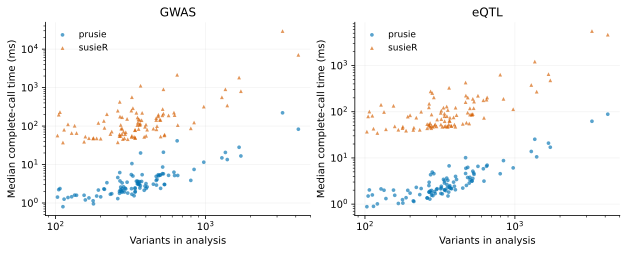
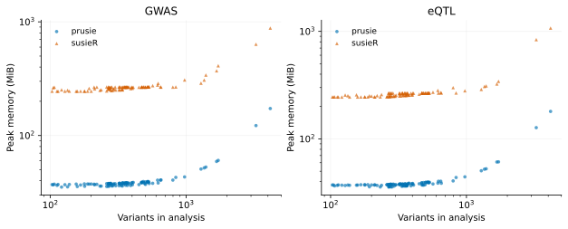

# Performance

These measurements compare prusie with the pinned R implementation. They do
not establish a speed improvement over an earlier prusie version. The dev2
stopping and prior-variance changes correct numerical behavior; no direct
before/after runtime claim is made for those fixes. Individual optimizations
require a separate complete-call comparison in which more than half of the
fixed applicable cases have lower median runtime.

<!-- current:measurements:start -->
## Current development version: 0.2.4.dev2

Measured **0.2.4.dev2** against susieR 0.16.6.

| Analysis | Cases | Maximum PIP error | Paired runtime speedup | Median full-process memory ratio |
| --- | --- | --- | --- | --- |
| GWAS | 100 | 9.14e-09 | 26.23× | 6.345× |
| eQTL | 100 | 1.22e-08 | 21.62× | 6.24× |

Runtime is the geometric mean of per-case susieR/prusie ratios of seven-repeat medians. Memory is the median ratio of fresh-process peaks, including interpreters and inputs. These are complete-call observations on a fixed panel, not measurements of a particular optimization.

The numerical code, input panel and fitting parameters were frozen before these measurements. Compute commit: `ff379ada284a63a3cf1770d43faacc6b929dc923`. The measured CPython 3.12 wheel SHA256 is `7fbc1305a17dfeb2decf446c4703096d4a677a843ce0225641a9fe03300d139a`; the native extension SHA256 is `509f2f1b7c7f330807263241cd3f6e2ac122d938c43fd41c22a209f7a8643816`. Later documentation commits do not change that computation.

| Analysis | prusie median (ms) | susieR median (ms) | Faster / tied / slower | prusie repeat IQR/median | susieR repeat IQR/median |
| --- | --- | --- | --- | --- | --- |
| GWAS | 5.185 | 141.7 | 100 / 0 / 0 | 0.09743 | 0.1439 |
| eQTL | 4.613 | 88.13 | 100 / 0 / 0 | 0.101 | 0.1271 |

Absolute runtime columns are across-case medians of within-case medians. Counts use every case in the fixed denominator; ties do not count as faster. Both unconverged and no-CS cases remain included. Per-repeat records and convergence/CS strata are retained in the downloads.

| Analysis / backend | Full-process peak (MiB) | Current prefit RSS (MiB) | Sampled fit peak (MiB) | Sampled increment (MiB) |
| --- | --- | --- | --- | --- |
| GWAS / prusie | 41.21 | 39.01 | 41.21 | 2.312 |
| GWAS / susieR | 265.9 | 237.7 | 265.9 | 28.18 |
| eQTL / prusie | 41.31 | 39.11 | 41.31 | 2.291 |
| eQTL / susieR | 261.5 | 237.7 | 261.5 | 23.74 |

Each column is a separate across-case median. Full-process peak is a fresh process high-water mark. The prefit baseline is current resident memory after imports, inputs and GC. The sampled increment is the fit-stage sampled peak minus that same current baseline, never a difference of historical high-water marks. Target sampling interval is 2 ms; observed maximum intervals are retained. Short allocation spikes can be missed, so sampled peaks and increments are lower bounds.

The largest observed sampling gaps on the real panel were 35.1 ms for prusie and 404.5 ms for R. Thus the target interval is not a guaranteed resolution, particularly for short fits. Full-process high-water marks remain the primary memory measure.

### Controlled dense scaling

This separate deterministic panel fixes L=5, n=5000, AR(1) correlation rho=0.4 and effects [8,7,6] at [p//5,p//2,4p//5], with 0.15 cos(0.73j) background. It uses tol=0.001, max_iter=100, optimized prior variance and fixed residual variance 1. It is a computational measurement fixture.

Independent validation passes the PIP criterion for all six scales (maximum absolute difference 2.62×10⁻¹¹), with matching convergence flags and CS members. At p=20,000, prusie takes three sweeps and R four; their ELBO trace lengths therefore differ. Complete-call timing retains that observed iteration difference.

| Variables | Backend | Retained median (s) | Iterations | Converged | Full-process peak (MiB) | Sampled increment (MiB) |
| --- | --- | --- | --- | --- | --- | --- |
| 500 | prusie | 0.006436 | 3 | True | 41.72 | 0.6641 |
| 500 | susieR | 0.09579 | 3 | True | 265.9 | 28.36 |
| 1000 | prusie | 0.01623 | 3 | True | 48.43 | 1.648 |
| 1000 | susieR | 0.2449 | 3 | True | 280.7 | 35.35 |
| 2000 | prusie | 0.06377 | 3 | True | 71.5 | 2.352 |
| 2000 | susieR | 0.7726 | 3 | True | 389.8 | 121.8 |
| 4000 | prusie | 0.2385 | 3 | True | 164.7 | 4.148 |
| 4000 | susieR | 3.953 | 3 | True | 829.9 | 470.3 |
| 10000 | prusie | 1.39 | 3 | True | 808.9 | 3.672 |
| 10000 | susieR | 26.46 | 3 | True | 3819 | 2818 |
| 20000 | prusie | 6.947 | 3 | True | 3106 | 14.26 |
| 20000 | susieR | 102 | 4 | True | 1.385e+04 | 1.057e+04 |

All six sizes were attempted within a hard 16 GiB process address-space limit after allocation preflight. Lossless gzip transports are checked against the frozen complete matrix-byte hashes and fully materialized as dense arrays before fitting. This transport changes startup I/O; full-process RSS includes its actual loading cost. Curves connect measured sizes only. Any unavailable cells remain explicitly unavailable.

### Current measurement protocol and records

The full public-call boundary and matched settings are detailed under Methods below. One warmup precedes seven retained repeats; backends run sequentially with one numerical thread. Imports, file reads, explicit GC and exports are outside each fit clock. The machine was shared; host pressure and repeat variability were recorded. Process address space was limited to 16 GiB. The [current environment record](assets/benchmark/protocol.json) identifies AMD EPYC 9754, Linux x86-64/glibc 2.35, CPython 3.12.2, NumPy 2.2.6, R 4.4.0/OpenBLAS 0.3.20 and the actual native/BLAS library hashes. Complete-call ratios do not isolate individual kernel costs.

[Real-panel summary and strata](assets/benchmark/real_summary.json) · [Real-panel case/repeat CSV](assets/benchmark/real_cases.csv) · [Scaling summary](assets/benchmark/scaling_summary.json) · [Scaling case/repeat CSV](assets/benchmark/scaling_cases.csv). These downloads contain anonymous case labels and aggregate diagnostics, not association or genotype inputs.

## Historical comparison: 0.2.3rc4
<!-- current:measurements:end -->

This historical comparison measures complete fine-mapping calls in prusie 0.2.3rc4 and
susieR 0.16.6. The results below reanalyze retained measurements from 6 October
2026; they retain the original executable identities.

## Real-data panel

<!-- generated:panel:start -->
The fixed panel contains 100 genomic windows: 100 analyses of one FinnGen R10 inflammatory bowel disease GWAS (K11_IBD_STRICT; n = 412181) and 100 BLUEPRINT monocyte eQTL analyses (QTD000021; n = 191), representing 83 distinct genes. The interval metadata contain 0 overlapping window pairs. Analyses share study participants and reference samples; the 200 trait analyses are not 200 independent loci.
<!-- generated:panel:end -->

Signed LD was calculated from external 1000 Genomes reference samples: 99 FIN
founders for GWAS and 525 EUR founders for eQTL. Both analyses use the same
aligned variant intersection within each window, with their respective LD.
The input manifest preserves allele/order checks, exclusions and source hashes.

## Runtime and peak memory

<!-- generated:absolute:start -->

| Analysis | prusie time (ms) | susieR time (ms) | prusie peak memory (MiB) | susieR peak memory (MiB) |
| --- | --- | --- | --- | --- |
| GWAS | 2.98 | 106 | 37.8 | 266 |
| eQTL | 2.28 | 80 | 37.7 | 262 |

Runtime columns are medians across cases of each case’s median retained-repeat time. Memory columns are separate across-case medians of fresh-process peaks.

| Analysis | Runtime speedup, geometric mean | Per-case speedup median [Q1, Q3] | Speedup range | Median memory ratio | Median memory reduction |
| --- | --- | --- | --- | --- | --- |
| GWAS | 37.4× | 36.7 [28.1, 45.1] | 16.6–133 | 6.94× | 85.6% |
| eQTL | 33.6× | 31.3 [26.9, 40.2] | 18.6–139 | 6.8× | 85.3% |
<!-- generated:absolute:end -->

For case i, speedup si is median(time_susieR,i) / median(time_prusie,i), calculated
from retained repeats before grouping. The primary runtime summary is
**exp(mean(log si))**. This paired geometric mean differs from the ratio of
across-case median runtimes. Memory ratio is peak_susieR,i / peak_prusie,i;
reduction is 1 − peak_prusie,i / peak_susieR,i. The reported median ratios and
reductions each summarize those per-case values.

Boxes show median and quartiles; points show every eligible pair with deterministic
jitter. Ratios above the dashed 1× line favor prusie. Ratio axes are logarithmic.
[Vector PDF](assets/r_comparison.pdf).

Both axes are logarithmic; each point represents one analysis/backend.
[Vector PDF](assets/runtime_by_variants.pdf).

Peak memory includes interpreters, imports, inputs and the retained fit.
It describes process memory rather than algorithm workspace. These historical
records do not measure resident memory immediately before fitting, so their
ratios cannot quantify incremental fit memory or assign memory savings to the
algorithm alone.
[Vector PDF](assets/memory_by_variants.pdf).

## Methods

Every successful pair with matching settings and seven finite positive retained
times is included, regardless of convergence, credible-set presence or numerical
difference. Each fit has a **100-iteration maximum**, with early convergence
using its actual iteration count. The pair reaching 100 iterations on both sides
is included. Failed or missing records retain explicit statuses and null metrics.
Numerical validity and timing eligibility are separate fields.

Timing surrounds the full public `susie_rss` call: validation, RSS preparation,
IBSS and posterior/credible-set summaries. Imports, file reads, explicit garbage
collection and exports are outside the clock. After one warmup, seven calls are
retained with one result held at a time. Backends run sequentially, with their
order alternating between cases; one numerical thread is used. Runtime uses a
monotonic high-resolution clock. Peak memory is measured independently in a
fresh process per case/backend, fitting once and retaining the full result;
Linux process high-water KiB is divided by 1024 to obtain MiB. SuSiE-RSS names
the summary-statistic model; process RSS in the measurement record means
resident set size.

The machine was an AMD EPYC 9754 system running Linux x86-64 with glibc 2.35.
The measured software was CPython 3.12.2, NumPy 2.2.6 and R 4.4.0. R loaded
OpenBLAS 0.3.20 (Zen, one thread); NumPy loaded its packaged OpenBLAS and the
native SER used the recorded optional glibc libmvec AVX2 path. Full loaded-library
identities, dependency versions and executable hashes are in the
[protocol and environment record](assets/r_comparison_protocol.json).
These measurements apply to the recorded binary and machine.
Complete-call ratios do not isolate R initialization overhead, a particular
optimization or numerical-kernel cost; those claims require separate profiling
or ablation measurements.

Real analyses use L=5, `tol=0.001`, `max_iter=100`, `scaled_prior_variance=0.2`,
fixed residual variance 1, optimized prior variance, normalized uniform priors,
no null column, standardization, coverage 0.95 and minimum absolute correlation
0.5. Complete matrix purity is used. `check_input=False` leaves finite,
symmetry, diagonal and range validation active; additional eigenvalue/projection
diagnostics are disabled in both compared settings. All parameters are in the
[case records](assets/r_comparison_cases.json).

## Repeat variability and retained records

<!-- generated:variability:start -->

| Analysis | prusie repeat IQR/median | susieR repeat IQR/median |
| --- | --- | --- |
| GWAS | 0.0617 | 0.0858 |
| eQTL | 0.0714 | 0.0867 |

Each entry is the median across cases of its seven-repeat IQR/median. Individual repeat times and case ranges are retained in the downloadable records.
<!-- generated:variability:end -->

The [TSV case table](assets/r_comparison_cases.tsv),
[retained repeats](assets/r_comparison_repeats.json),
[summary with operators](assets/r_comparison_summary.json) and
[numerical diagnostics](assets/r_comparison_numerical.json) contain full
fine-mapping records. The separate synthetic regression panel retains four
timed toy cases and three numerical diagnostics; it does not enter either
real-data group. The new [packaged example](example.md) has its own reference
and is not assigned those older timing values.

[Reproducibility](reproducibility.md) explains result-only regeneration and
input-level reruns. [Implementation](implementation.md) explains computational
mechanisms; the whole-call timings do not provide individual ablation estimates.
