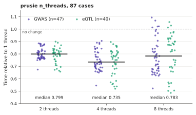

# Performance

These measurements compare the runtime and memory of SuSiE-RSS fine-mapping
with prusie 0.3.0 and susieR 0.16.6 on FinnGen R13 type 2 diabetes GWAS loci
and GTEx v11 Whole_Blood eQTL analyses. Both programs fit the same inputs with
one numerical thread on exclusive AMD EPYC 7742 nodes.

<!-- current:highlights:start -->
Measured **prusie 0.3.0** against **susieR 0.16.6** on the same inputs.

| Evaluated cases | Cases | Cumulative runtime ratio | Cumulative fitting-stage ratio | Median peak-memory ratio |
| --- | --- | --- | --- | --- |
| GWAS | 200 | 49.2× | 55.4× | 5.11× |
| eQTL | 14,157 | 26.6× | 29.8× | 4.60× |

The cumulative ratios divide the summed susieR time by the summed prusie time over three retained complete calls of every evaluated case, with one numerical thread; the fitting stage excludes input and LD preparation. The memory ratio is the median of paired susieR/prusie ratios of peak backend-process memory. All measurements are from exclusive AMD EPYC 7742 nodes. Ratios for other traits, tissues, region sizes and LD references may differ; see [performance](performance.md).
<!-- current:highlights:end -->

The [protocol](assets/benchmark/benchmark_protocol.json) records the timing
boundaries and software identities; [reproducibility](#reproducibility)
identifies the release and its timing-instrumented copy.
[Numerical accuracy](numerical_accuracy.md) reports agreement with susieR
on the complete [alpha matrix](model.md#computational-compatibility).

## Data

<!-- generated:panel:start -->
The fixed panel contains **200 FinnGen R13 type 2 diabetes GWAS loci** (n = 486,019; 89,727 cases and 396,292 controls) and **14,157 GTEx v11 Whole_Blood genes** (n = 800). GWAS is fitted with the Gaussian RSS approximation. Every case is included, including iteration-limit fits and cases with no credible set. Gene windows and study participants overlap, so cases are not independent biological replicates.

| Analysis | Cases | Variants per case | Cases where neither program converged |
| --- | --- | --- | --- |
| GWAS | 200 | 1,575 to 19,221 | 0 |
| eQTL | 14,157 | 7 to 6,862 | 224 |
<!-- generated:panel:end -->

For each case, prusie and susieR use the same aligned summary statistics,
variant order and signed LD matrix. LD comes from external 1000 Genomes
reference samples: 99 Finnish (FIN) samples for GWAS and 525 European (EUR)
samples for eQTL. EUR describes the LD reference; the GTEx association cohort
was not restricted to European ancestry for this comparison. See the
[input sources](reproducibility.md#real-gwas-and-eqtl-inputs) for study and
reference provenance and harmonization details.

[Numerical accuracy](numerical_accuracy.md) reports the differences between
the two programs' results for every case.

## Methods

Complete-call timing surrounds the public `susie_rss` call, including input
validation, RSS preparation, IBSS, posterior summaries and credible-set
construction. The fitting-stage time is measured inside the same calls and
covers solver initialization, IBSS/SER, ELBO and convergence calculations, and
final posterior and credible-set construction. Input handling, LD checks,
repair and symmetrization still run but are excluded from the fitting stage.
Imports, file reads, LD reconstruction, numerical comparisons and exports are
outside both clocks.

Each case and backend runs in a fresh process that loads its inputs untimed,
then makes **one warm-up and three retained calls**. The two backends run one
after the other on the same pinned core, in a seeded, balanced order. Calls use
`n_threads=1` and `overwrite_ld=False`. Twenty-four cases had already completed
seven retained calls under an earlier schedule; their first three are used.

Each timing lane uses one physical core in its own L3 cache domain, with the
other cores and SMT siblings of that domain idle. Memory is bound to the lane's
NUMA node where supported. Admission reserves at most 90% of node memory, using
prior peaks as estimates, and allows at most four cases per socket whose LD
matrix exceeds 1 GiB. These reservations are planning estimates, not per-process
guarantees.

Inputs are staged to node-local storage. Signed LD is computed with
single-thread PLINK before each case from the same reference genotypes,
variants, variant order and alleles as the prepared inputs. In a 24-case check
against the prepared matrices, the largest absolute LD difference was
$2.15\times10^{-14}$, with no sign disagreements.

Both metrics use timing-instrumented copies of the release artifacts. On eight
qualification cases, the instrumented copies returned bitwise-identical alpha
and PIP arrays and the same iteration counts, convergence flags and credible-set
counts as the release; timer overhead was not isolated. The
[measurement archive](reproducibility.md#benchmark-protocol) documents the exact
boundaries.

The cumulative ratio divides the sum of all retained susieR times by the
sum of all retained prusie times over the evaluated cases. As a per-case
summary, each backend's median over its three calls gives a susieR/prusie
ratio for every case; tables report the median and interquartile range (IQR)
of these ratios. Totals add one median call per case.

Peak memory is the resident-set high-water mark of each backend process,
recorded after its final call: `VmHWM` for R and `ru_maxrss` for Python. It
includes the interpreter, libraries, loaded inputs, the warm-up and the
retained calls, so it is not the memory of a single fit. Memory ratios are
medians of per-case susieR/prusie peak ratios.

Fits use `L=10` components (capped at the variant count), `tol=0.001`,
`max_iter=100`, `scaled_prior_variance=0.2`, estimated prior variance
(`estimate_prior_method="optim"`) and fixed residual variance 1
(`estimate_residual_variance=False`). Both programs use uniform variant priors,
`null_weight=0`, `standardize=True`, `coverage=0.95` and `min_abs_corr=0.5`.
Credible-set purity uses all pairs of set members. Calls use the Wald RSS
adjustment, ELBO convergence, `check_prior=True`, `check_input=False` and
`refine=False`; prusie's basic matrix validation stays inside the timed call.

Every case enters the summaries, including iteration-limit fits and cases with
no credible set. Agreement with susieR does not establish
model validity.

## Results

### Runtime

<!-- current:runtime:start -->

| Analysis | Metric | Cumulative susieR/prusie ratio | Per-case ratio, median [IQR] | prusie total | susieR total | Cases faster with prusie |
| --- | --- | --- | --- | --- | --- | --- |
| GWAS | Complete call | 49.2× | 47.7× [38.0-58.8] | 2.7 min | 1.91 h | 200 / 200 |
| GWAS | Fitting stage | 55.4× | 57.3× [42.4-74.5] | 2.3 min | 1.86 h | 200 / 200 |
| eQTL | Complete call | 26.6× | 27.5× [23.3-32.6] | 48.0 min | 21.28 h | 14,157 / 14,157 |
| eQTL | Fitting stage | 29.8× | 35.2× [26.9-47.0] | 41.1 min | 20.39 h | 14,157 / 14,157 |
<!-- current:runtime:end -->

prusie was faster than susieR in every evaluated case. The ratios describe these
panels: they vary with region size and convergence, and other traits, tissues
or LD references may give different values. Totals add one median call per
case and exclude data ingestion and I/O overhead; they are not the elapsed time
of a parallel campaign. The [per-case records](#reproducibility) keep every call,
its timestamp, iteration count, convergence flag and credible-set count.


<!-- current:variability:start -->

| Analysis | Backend | Median repeat IQR/median | Cases with a call >2× its case median | Share of total time in those calls |
| --- | --- | --- | --- | --- |
| GWAS | prusie | 0.0128 | 0 | 0% |
| GWAS | susieR | 0.00668 | 2 | 15.2% |
| eQTL | prusie | 0.0231 | 0 | 0% |
| eQTL | susieR | 0.021 | 0 | 0% |
<!-- current:variability:end -->

Repeat IQR/median is computed within each case and summarized across cases.
Exclusive nodes kept repeat variability around 1–2%, but two susieR GWAS calls
took more than twice their case medians and account for 15.2% of the cumulative
susieR GWAS time. Replacing each by its case median changes the cumulative GWAS
ratio from 49.2× to 43.0×. Both calls are kept and listed with their
timestamps in the
[archive](assets/benchmark/archive/extreme_retained_calls.json).

### Memory

<!-- current:memory:start -->

| Analysis | Backend | Peak RSS, median across cases (MiB) | Cases |
| --- | --- | --- | --- |
| GWAS | prusie | 335 | 200 |
| GWAS | susieR | 1.79e+03 | 200 |
| eQTL | prusie | 198 | 14,157 |
| eQTL | susieR | 880 | 14,157 |
<!-- current:memory:end -->


### Thread scaling

This experiment fitted 87 fixed real-data cases with `n_threads` 1, 2, 4 and 8
on the same exclusive nodes. Each multithreaded call is paired with its
one-thread counterpart over eight rounds. The ratio is the median over rounds
of the multithreaded time divided by the one-thread time; lower is faster.

<!-- current:threads:start -->

| Threads | Median time / one-thread time | Faster / tied / slower, out of 87 |
| --- | --- | --- |
| 2 | 0.799 | 87 / 0 / 0 |
| 4 | 0.735 | 87 / 0 / 0 |
| 8 | 0.783 | 79 / 0 / 8 |
<!-- current:threads:end -->

Four threads gave the lowest median ratio. Eight threads were slower than four
in 52 of 87 cases, and slower than one thread in 8. See
[Threads](optimization.md#threads) for guidance on 2–4 threads and on which work
`n_threads` controls.



### LD overwrite

The `overwrite_ld=True` option lets prusie reuse the caller's LD array as its
working matrix. Each of the 200 GWAS loci was fitted once in a fresh process
with each setting, on the same nodes and reconstructed LD.

<!-- current:overwrite:start -->

| Loci | Equal peaks | Lower with overwrite | Higher with overwrite | Largest gap |
| --- | --- | --- | --- | --- |
| 200 | 198 | 0 | 2 | 12 KiB |
<!-- current:overwrite:end -->

Peak memory did not change. These LD matrices are exactly symmetric, so the
default path already reuses an aligned, C-contiguous float64 matrix without a
second dense copy. Overwriting can save memory only when the input needs repair
or a layout conversion. Final component inclusion probabilities were identical between
the two settings.

The option may consume the caller's LD array even if the call later fails;
reload the original LD before reuse. The
[LD workspace contract](api.md#optional-ld-workspace) describes supported inputs.


### Nested locus windows

These fits use the first 500, 1,000, 2,000, 4,000, 10,000 and all 19,221
variants of the largest FinnGen T2D locus, in their frozen order, with the
settings in [Methods](#methods). They describe one locus and its convergence
paths, not independent loci or a complexity law.

<!-- current:scaling:start -->

| Leading variants | Backend | Complete-call median (s) | Fitting-stage median (s) | Iterations | Peak RSS (MiB) |
| --- | --- | --- | --- | --- | --- |
| 500 | prusie | 0.0105 | 0.00966 | 14 | 132 |
| 500 | susieR | 0.463 | 0.46 | 14 | 285 |
| 1,000 | prusie | 0.0231 | 0.0206 | 15 | 132 |
| 1,000 | susieR | 1.29 | 1.28 | 15 | 354 |
| 2,000 | prusie | 0.0403 | 0.0298 | 5 | 147 |
| 2,000 | susieR | 1.26 | 1.22 | 5 | 505 |
| 4,000 | prusie | 0.169 | 0.127 | 11 | 251 |
| 4,000 | susieR | 10.2 | 9.94 | 11 | 1.33e+03 |
| 10,000 | prusie | 1.02 | 0.795 | 17 | 915 |
| 10,000 | susieR | 59.3 | 58 | 17 | 5.43e+03 |
| 19,221 | prusie | 5.84 | 4.92 | 28 | 3.09e+03 |
| 19,221 | susieR | 415 | 408 | 28 | 1.94e+04 |
<!-- current:scaling:end -->


Iteration counts change with window size, so runtime need not grow
monotonically with the number of variants. The susieR runtime and peak-memory
values at 10,000 variants come from a dedicated replay on the same node and
core, because one of the original retained calls stalled outside the solver; see
[window10000_retime.json](assets/benchmark/window10000_retime.json).

## Reproducibility

<!-- current:identity:start -->
- Release code: `6d60d5e5723461c3e1fc5a46fd0a0e7b6378cfa7`
- Release wheel SHA-256: `85285c26c1f6ae3caaed99c4d7766ede7f0083ea98eb2d26b7763d8654840b59`
- Release native extension SHA-256: `a9d377e45583b654ddfbe8323a783e32a61bf042c755cb26c3873f2065ed0b3e`
- Benchmark protocol SHA-256: `3893ec7f92fc042f15eade88a4c27a452835bf3285dfda037d6133c55fc56825` (hash of the protocol file as executed; the published copy was later edited only to remove host names, so its bytes differ)
- Statistical reference: R 4.4.0; susieR 0.16.6, `8e56a8e038e989856d106d9ca5175cc664fea9d2`.

Both runtime metrics use timing-instrumented copies of these release artifacts; the instrumented native binary is not byte-identical to the release wheel. The patch, derived binary hashes and timing boundaries are in the [measurement archive](reproducibility.md#benchmark-protocol).
<!-- current:identity:end -->

The [benchmark summary](assets/benchmark/benchmark_summary.json) and
[per-case records](assets/benchmark/benchmark_records.jsonl.gz) keep both timing
metrics, call timestamps, peak memory, iteration and convergence outcomes and
numerical differences. The [LD-overwrite records](assets/benchmark/benchmark_overwrite_records.jsonl.gz)
and [thread-scaling records](assets/benchmark/thread_scaling.json) hold the two
supplementary experiments. The [protocol](assets/benchmark/benchmark_protocol.json)
and [archive guide](reproducibility.md#benchmark-protocol) document how the
measurements were made.

These records keep locus and gene identifiers but omit association statistics,
LD matrices and individual genotypes. Repeating the fits requires the aligned
inputs and settings described in [Methods](#methods) and the
[real-input guide](reproducibility.md#real-gwas-and-eqtl-inputs).

From the repository root, redraw the figures and regenerate this page's tables
from the published records:

```sh
python tools/benchmark/v030.py figures
python tools/generate_results.py --pages docs/performance.md
```

These commands need neither R nor association inputs and run no fits. Add
`--check` to the second command to verify the generated text without rewriting
it. The [reproducibility guide](reproducibility.md#tables-and-figures) lists the
dependencies and the full documentation build.
