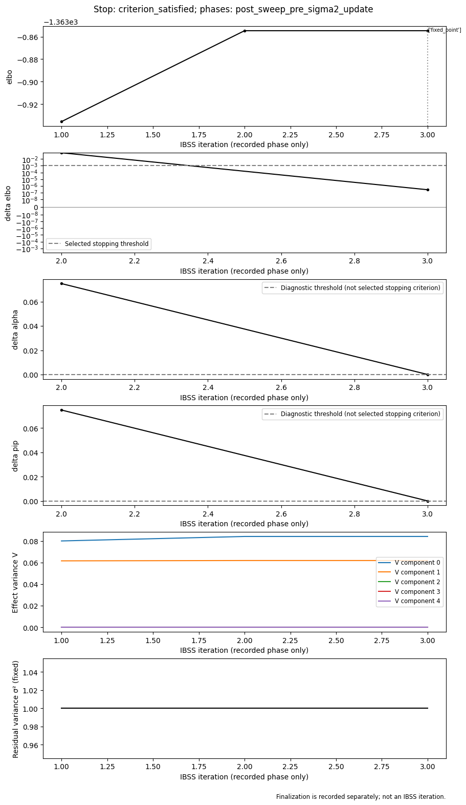
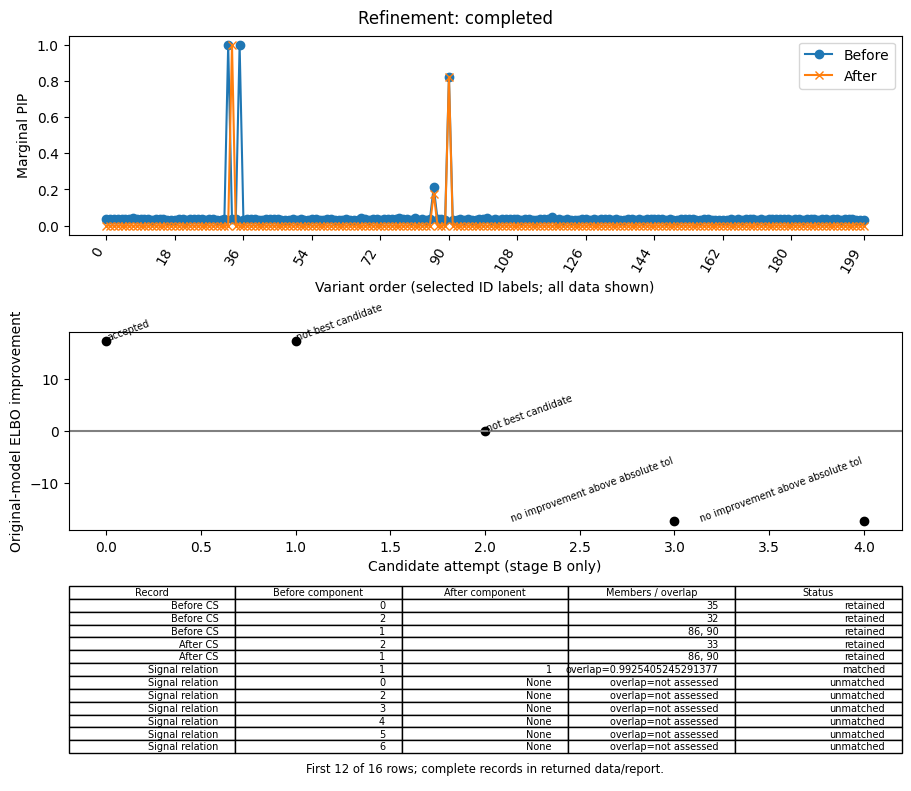

# post_analysis review snapshot

This branch contains standard Gaussian SuSiE convergence diagnostics, validated warm starts, two-stage refinement, and deterministic post-analysis. Start with the [usage guide](../../post_analysis.md), then the two recorded examples below. No inf/ash implementation is included in this branch.

The implementation reviewed here is **`e45914e512e04feef37cf7310bc0b309582d6058`**, based on audited standard-model commit `4bb69ed951f7cf18a7c0aebd61cad392b4989654`. Later review-material and interpretation commits organize existing results; they did not generate new fits. Package metadata still says `0.2.3rc6`, so identify this implementation by source SHA. [Artifact provenance](artifact_manifest.json) records original file hashes, public copies, and transformations. The original complete local records remain preserved.

## Read the two examples

| Example | Interpretation | Key views | Complete evidence |
|---|---|---|---|
| Stable, 500 synthetic variants | [Scientific interpretation](examples/stable/interpretation.md) | [Convergence](examples/stable/figure_3.png), [sensitivity](examples/stable/figure_6.png) | [Evidence JSON](examples/stable/evidence.json) |
| Local optimum, 200 variants | [Scientific interpretation](examples/problem/interpretation.md) | [Refinement](examples/problem/figure_4.png), [sensitivity](examples/problem/figure_6.png) | [Evidence JSON](examples/problem/evidence.json) |

Each example directory retains all seven PNG/SVG views, complete CSV tables, `evidence.json` with original evidence IDs, structured convergence/refinement/LD/comparison files, and exact baseline/refined fit persistence. The two old HTML renderings duplicated these figures and evidence facts and are omitted from the current tree. Their original hashes remain in [artifact_manifest.json](artifact_manifest.json); [REPRODUCE.md](REPRODUCE.md) explains how to recover the exact HTML from Git history. All other files indexed by that manifest remain here.

For the maintained offline presentation, see the [worked examples](../../worked_examples.md). Those reports identify their later presentation and comparison source revisions separately from the retained numerical producers. PNGs and numerical exports in this snapshot remain directly readable without fitting.

The stable fixture is the existing independently generated synthetic toy example (seed 20261007), under GPL-3.0-or-later. The problem fixture is the official BSD-licensed susieR `FinemappingConvergence` sufficient-statistics example: a simulated response based on real genotypes, without individual genotypes in this distribution. Input files, metadata and notices are linked in the interpretations. Neither report supplies real physical coordinates or biological annotations.

## Source and test index

Paths below refer to actual files on this branch. Component IDs are preserved identifiers within each fit; compare signals using posterior/CS/LD evidence rather than equating component numbers across fits.

| Area | Implementation | Focused tests |
|---|---|---|
| Online metrics, stop rules, cycle detection | [rust/diagnostics.rs](../../../rust/diagnostics.rs): `FitControl`, `Snapshot`, `Diagnostics`, `pip`, `elbo_stable`, `detect_cycle`; [rust/core.rs](../../../rust/core.rs): `fit_controlled` | Native tests in both files; [test_convergence_refinement.py](../../../tests/test_convergence_refinement.py) |
| Tracking, variance-update phase, trim/finalization | [rust/core.rs](../../../rust/core.rs): sweep snapshots and post-loop trim; [bindings/diagnostic_helpers.rs](../../../bindings/diagnostic_helpers.rs); [diagnostics.py](../../../src/prusie/diagnostics.py): `ConvergenceConfig`, `diagnose_convergence`; [result.py](../../../src/prusie/result.py): `SusieResult` | [test_convergence_refinement.py](../../../tests/test_convergence_refinement.py) |
| `s_init`, prepared data, continuation, rebuilt products | [api.py](../../../src/prusie/api.py): `susie_rss`, `susie_suff_stat`, `_susie_suff_stat`; [refinement.py](../../../src/prusie/refinement.py): `PreparedData`, `make_prepared`, `initial_options`, `_run`, `continue_fit`; native initialization in `fit_controlled` | [test_convergence_refinement.py](../../../tests/test_convergence_refinement.py), [test_api.py](../../../tests/test_api.py) |
| Two-stage refinement and consistent objective | [refinement.py](../../../src/prusie/refinement.py): `RefinementConfig`, `refine_fit`, `evaluate_objective` | [test_convergence_refinement.py](../../../tests/test_convergence_refinement.py) |
| CS audit, posterior summaries, direct proxies, conditional prior/BF odds | [posterior.py](../../../src/prusie/posterior.py): `credible_sets`; [analysis.py](../../../src/prusie/analysis.py): `summarize` | [test_post_analysis.py](../../../tests/test_post_analysis.py) |
| RSS LD diagnostics and mixture solve | [ld.py](../../../src/prusie/ld.py): `prepare_ld`, `estimate_s_rss`, `_mixture`, `kriging_rss`, `diagnose_ld` | [test_ld_diagnostics.py](../../../tests/test_ld_diagnostics.py) |
| Sensitivity and signal matching | [comparison.py](../../../src/prusie/comparison.py): `_signals`, `compare_fits`, `sensitivity_key`, `run_sensitivity` | [test_comparison.py](../../../tests/test_comparison.py) |
| Seven views and local gene tracks | [plots.py](../../../src/prusie/plots.py): `plot_locus`, `plot_signal`, `plot_convergence`, `plot_refinement`, `plot_ld_diagnostics`, `plot_sensitivity`, `plot_prior_influence`, `read_gene_track` | [test_plots_report.py](../../../tests/test_plots_report.py) |
| Offline report, persistence and evidence | [report.py](../../../src/prusie/report.py): `save_analysis`, `load_analysis`, `export_tables`, `evidence_bundle`, `write_report` | [test_plots_report.py](../../../tests/test_plots_report.py) |
| Existing optional CLI adapter | [ai.py](../../../src/prusie/ai.py): `CodexCLI`, `validate_interpretation`, `InterpretationProvider` | [test_ai.py](../../../tests/test_ai.py): mocks; real connectivity remains unverified |
| Executed examples and packaged data | [examples/post_analysis.py](../../../examples/post_analysis.py), [datasets.py](../../../src/prusie/datasets.py) | Recorded outputs and receipts in `examples/` below this directory |
| Retained standard optimizations | [rust/ser_context_tests.rs](../../../rust/ser_context_tests.rs), [rust/vector_math.rs](../../../rust/vector_math.rs), native operator path | [test_operator_dispatch.py](../../../tests/test_operator_dispatch.py), [test_default_ids.py](../../../tests/test_default_ids.py), [test_numeric_vector_transfer.py](../../../tests/test_numeric_vector_transfer.py) |

## Numerical evidence and its scope

These are labeled **public editions** or selected summaries of existing records, not substitutes for the original complete local audit. Numerical discrepancies and failed development attempts have not been reclassified as passes.

| Evidence | What it establishes |
|---|---|
| [Implementation mapping](numerical/implementation_mapping.md), [reference identity](numerical/reference_identity.json) | Three exact susieR source snapshots; old/new stop, initialization, trim, epsilon-weight and cycle differences. Full external source mirrors are excluded. |
| [Numerical validation](numerical/numerical_validation.json) | 18 default cases / 12,833 exact array elements; bounded old/latest R comparisons; actual maximum errors and candidate stages. This is not a new broad benchmark. |
| [Old R candidates](numerical/refinement_oracle_old.json), [latest R candidates](numerical/refinement_oracle_latest.json) | Complete saved baseline, first-round A/B candidate and refined numerical states. Original R behavior is retained. |
| [Raw R LD oracles](numerical/ld_oracles.json), [certified R mixtures](numerical/kriging_certified_oracle.json) | Six 6-variant cases and 18 mixture conditions. Default R `mixsqp` and full-simplex optimality-checked reference results are separate. Raw maximum logLR difference is 0.871891; certified-reference maximum is 2.03694e-7. These are **not** paired R outputs for the 500/200-variant examples. |
| [Original implementation acceptance summary](numerical/acceptance.json), [verification summary](numerical/verification_summary.json) | Scope, pass/skip counts, command outcomes, preserved failed attempts and resolutions. Acceptance is local implementation acceptance, not independent peer review or remote CI. |
| [Measured overheads](numerical/overheads.json) | Original small 200-variant measurements, repeats, ranges, environment, and mock-only AI timing. No performance-selection claim. |
| Example `refinement.json`, `convergence.json`, `comparison.json` | Original-prior post-trim objective versus logged ELBO, all A/B attempts, per-iteration phases and complete signal relationships. |

For the problem example, the accepted **consistent post-trim objective** gain is 17.45830930196098; subtracting logged ELBOs instead gives 17.458333143775235. Eight trimmed zero-V rows and the inherited unnormalized epsilon prior-weight convention explain the difference. Stage A changes the prior and is never used to select the original-model solution. Both example interpretations distinguish convergence from global optimality.

## Items for review

1. **Remote CI is not green.** [Initial branch run](https://github.com/LucaJiang/prusie/actions/runs/38120042142) failed at the first `python -m pytest tests` step after successful installs. Later checks were skipped. Public job-log download returned HTTP 403; the failing test/error is not yet established. Preserve this distinction from previous local validation. No test, tolerance or workflow was weakened for this delivery. Final-push status is reported separately in the delivery receipt.
2. **Interpretation of weak active components in matching.** `comparison.py::_signals` includes components with V above `prior_tol`, even without a retained CS. The problem baseline has ten active components but three CSs; comparison with L=12 produces 63 `ambiguous` component relations. These are not 63 causal signals. Review grouping/presentation while retaining the full many-to-many evidence in `examples/problem/comparison.json`.
3. **Figure selection and table truncation.** `examples/post_analysis.py` chooses the first retained CS for `plot_signal` and `plot_prior_influence`: problem figures 2/7 therefore show component 2 (`33`), not the high-LD component 1 (`86`,`90`). `plots.py::_table` limits display to twelve rows; problem figure 4 shows 12/16 rows and figure 6 shows 12/90, hiding relevant unmatched/later comparisons. All rows remain exported. Figure 3 shows only the selected final fit, not the initial ten-iteration problem fit. Review these concrete defaults before changing the overall layout.
4. **LD flag agreement needs case-matched evidence.** No variants are flagged in either saved example, but paired default-R and independently certified-R vectors for these exact input hashes are absent. The six-variant solver study cannot certify their per-variant flag agreement. See each interpretation for residual extremes, threshold margins and the precise missing fields.
5. **Objective and phase semantics merit independent scientific review.** `refinement.py::evaluate_objective`, native variance-update/trim ordering and ordinary epsilon-weight compatibility determine the compared objective. Review the stored stage-specific values and the explicit hard exclusion difference from upstream; do not equate logged pre-trim ELBO with the consistent returned-state objective.

The two interpretations were generated by the **current Codex session for human scientific review**, reading existing files and all fourteen PNGs. They are not adapter output or evidence of adapter authentication. Deterministic computation/export remains prusie's responsibility. Future skill/MCP integration may organize analysis, but none is implemented here; the optional adapter is retained unchanged.
