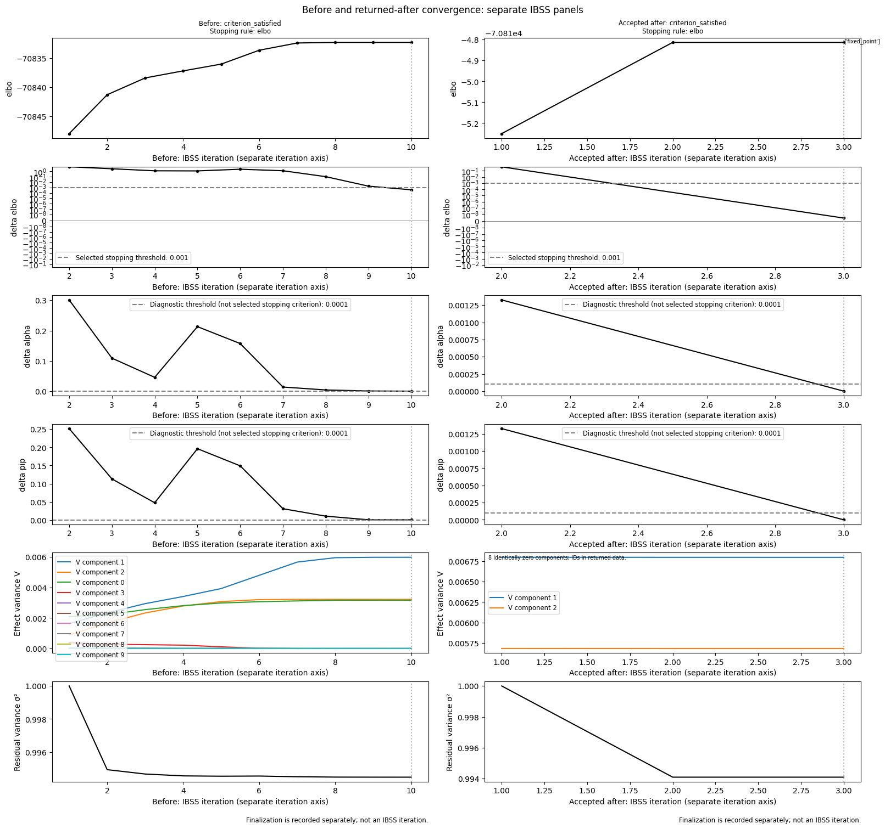
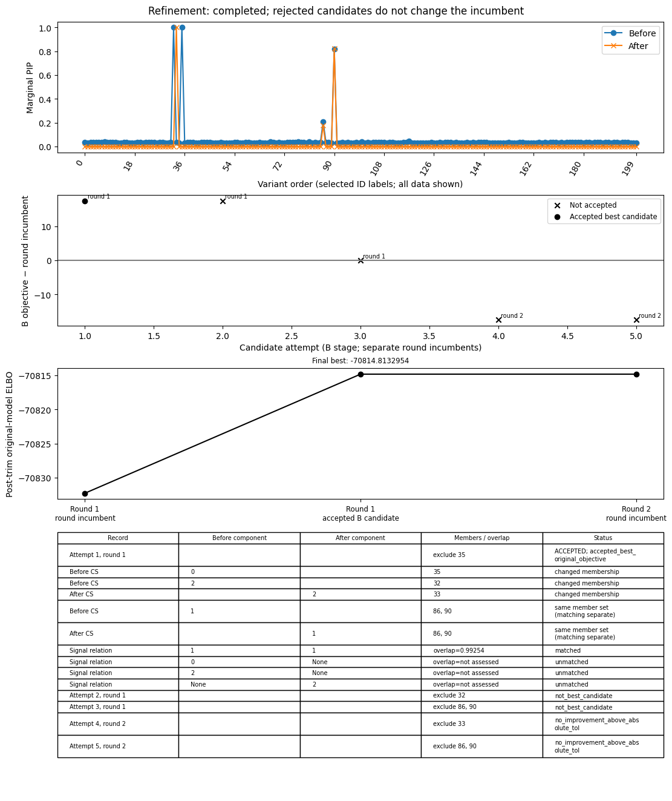
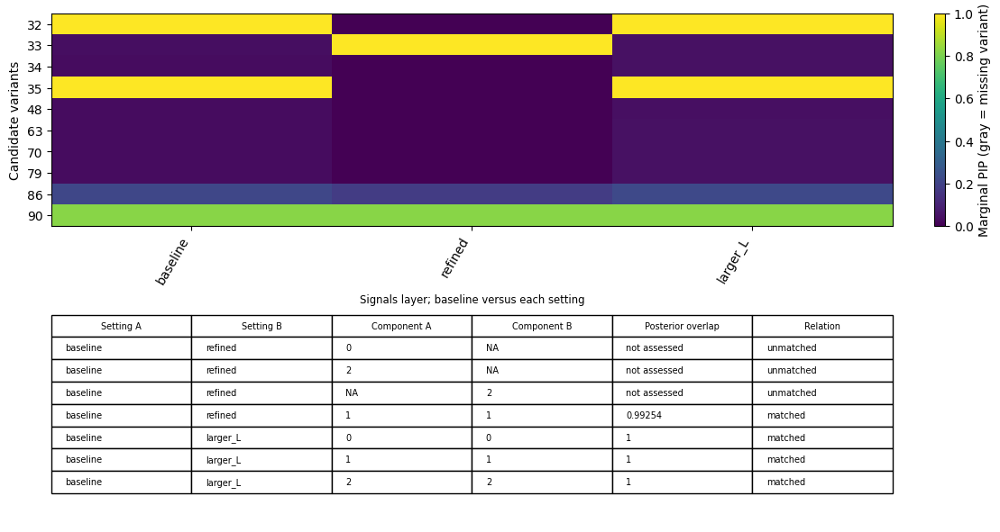
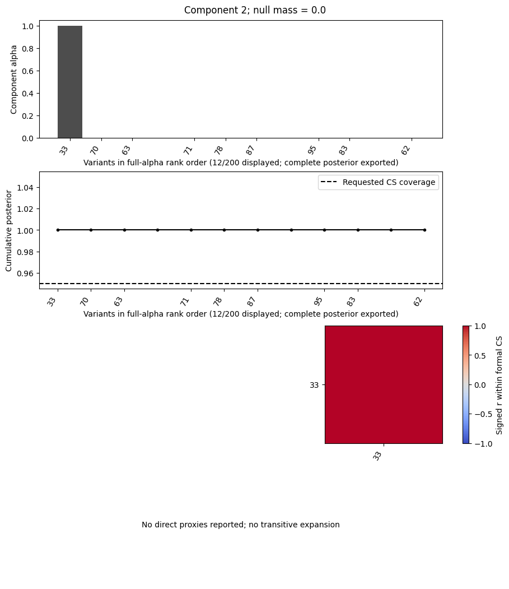
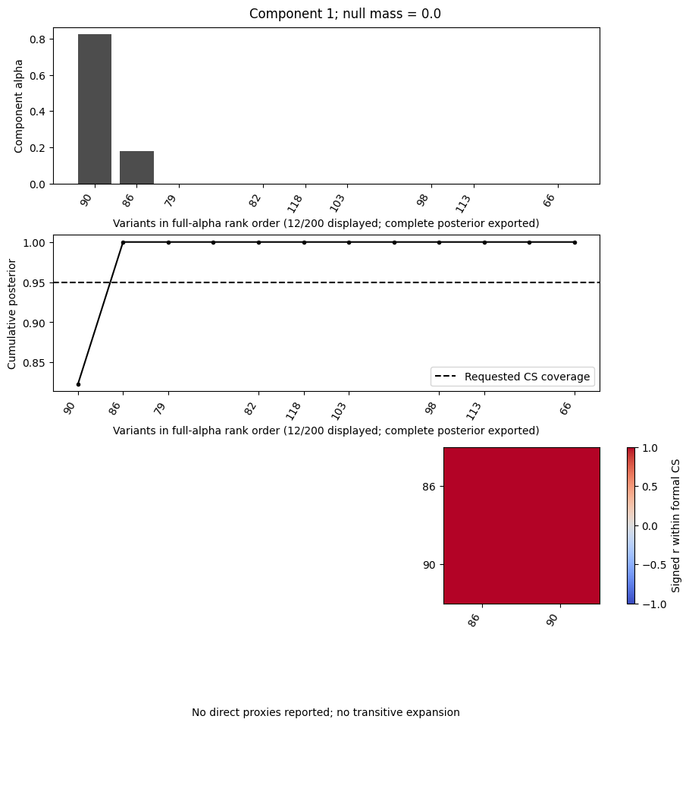
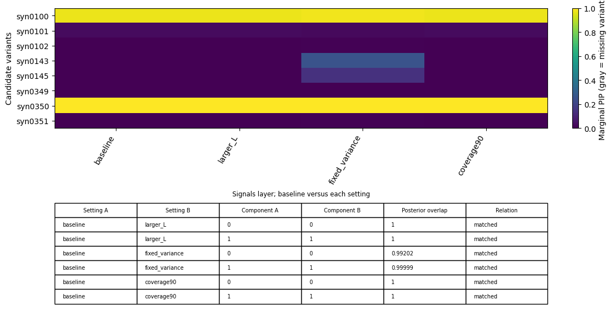

# Post-analysis review fixes

This review snapshot fixes requested-control inheritance, incomplete LD assessment
display, matrix-signature allocation, signal/component comparison and offline
report presentation. The Gaussian IBSS mathematics, ordinary finite-ELBO stopping
rule, reference data and numerical tolerances are unchanged.

- [Problem interpretation](examples/problem/interpretation.md), [compact results](examples/problem/analysis_summary.json), [offline HTML](examples/problem/index.html).
- [Stable interpretation](examples/stable/interpretation.md), [compact results](examples/stable/analysis_summary.json), [offline HTML](examples/stable/index.html).
- [Usage documentation](../../post_analysis.md), [reproduction](REPRODUCE.md), [numerical checks](numerical/verification.json), [default-output comparison](numerical/default_numerical_validation.json), [hash memory measurements](numerical/hash_memory.json).
- [Original review snapshot](../post_analysis/README.md), including its original R differences, reference-solution checks, acceptance, overheads and implementation mapping, is preserved unchanged.

Download the report directory and open `index.html` locally. GitHub's file page
does not execute the HTML. PNG previews work directly on GitHub. The short
`analysis_summary.json` provides the reading entry point; `evidence.json` contains
the full facts with JSON pointers and stable evidence IDs. CSV and lossless
`analysis.json`/`arrays.npz` remain available beside each report. Long tables have
complete exports; plotted candidate subsets are labelled explicitly.

## What to inspect first

The problem example satisfies its initial ELBO stopping condition, yet refinement
improves the common post-trim objective by **17.45830930196098**. The separate
trajectories and accepted-incumbent path explain these different statements.
The main sensitivity view now shows CS-supported relations; weak unretained
components remain in the complete component view.

The refined singleton and the unresolved high-LD pair have different resolution:

The stable example retains its two singleton CS across the displayed settings,
but fixing prior variance changes additional variant probabilities substantially.

## Source and numerical identities

| Role | Commit / identity |
|---|---|
| Historical baseline/refined fits, original diagnostics and search records | `e45914e512e04feef37cf7310bc0b309582d6058` |
| Reviewed implementation and three bounded alternative fits | `1f2b246ebd7970929711b2a51bb08f6a76ddad56` |
| Final figure/report source | `997aba947d6246c00b52f7083f2d7bdce49a656e` |
| Installed development identity | `prusie 0.2.4.dev1`, native `0.2.4-dev.1`; no release |

Each report's `provenance.json` separates these identities and lists checksums of
the historical inputs it read. The final materials commit is a documentation and
artifact delivery, not the producer of the old numerical results. Three alternative
fits were necessary because their full posterior states were not in the old public
snapshot: stable `larger_L` and `fixed_variance`, and problem `larger_L`.
Their PIPs agree exactly with the previous saved comparison. Coverage90 is a
posterior-only view. Later render passes reuse those saved alternatives and do
not fit or re-run LD optimization.

Inputs are the already redistributed [500-variant synthetic toy fixture](../../../src/prusie/data/teaching/metadata.json)
and [200-variant convergence fixture](../../../src/prusie/data/convergence/metadata.json).
Their frozen license/source notices remain with the fixtures. No private study
data or new biological annotation is introduced.

## Source index

| Area | Actual files and entry points |
|---|---|
| IBSS metrics, signed stopping and cycles (unchanged) | [rust/core.rs](../../../rust/core.rs): `fit_controlled`; [rust/diagnostics.rs](../../../rust/diagnostics.rs): `FitControl`, `Snapshot`, `elbo_stable`, `detect_cycle` |
| Requested versus effective controls | [diagnostics.py](../../../src/prusie/diagnostics.py): `ConvergenceConfig`, `resolve_convergence`, `convergence_summary`; [api.py](../../../src/prusie/api.py): `_susie_suff_stat` |
| Tracking, trim, warm start and continuation | [refinement.py](../../../src/prusie/refinement.py): `PreparedData`, `initial_options`, `_run`, `continue_fit`; native finalization remains in `rust/core.rs` |
| Two-stage refinement and common objective | [refinement.py](../../../src/prusie/refinement.py): `refine_fit`, `evaluate_objective`; A/B `solver_settings` and actual convergence are recorded |
| Bounded data identity hash | [refinement.py](../../../src/prusie/refinement.py): `_hash_float64_c_order`, `data_signature`; float64 canonical C-order signature semantics preserved |
| CS audit, posterior resolution, proxies and prior/BF | [analysis.py](../../../src/prusie/analysis.py): `summarize`; [posterior.py](../../../src/prusie/posterior.py): `credible_sets`, `marginal_pip` |
| RSS LD diagnostics and mixture | [ld.py](../../../src/prusie/ld.py): `kriging_rss`, `diagnose_ld`, `diagnostic_status`, `diagnostic_counts`, `_mixture` |
| Sensitivity and comparison layers | [comparison.py](../../../src/prusie/comparison.py): `_signals`, `compare_fits`, `comparison_relations`, `run_sensitivity`, `sensitivity_key` |
| Seven plot types and coordinate constraints | [plots.py](../../../src/prusie/plots.py): `plot_convergence`, `plot_refinement`, `plot_signal`, `plot_prior_influence`, `plot_sensitivity`, `plot_ld_diagnostics`, `plot_locus`, `read_gene_track` |
| Report, complete evidence and persistence | [report.py](../../../src/prusie/report.py): `analysis_summary`, `write_report`, `evidence_bundle`, `save_analysis`, `load_analysis` |
| Optional AI adapter (unchanged) | [ai.py](../../../src/prusie/ai.py): `CodexCLI`; mock tests remain separate from connectivity verification |
| Example rendering | [render_review.py](../../../examples/render_review.py), [post_analysis.py](../../../examples/post_analysis.py): `make_figures`; explicit component selection and before/after views |
| CI and minimal installation | [ci.yml](../../../.github/workflows/ci.yml): full `test,analysis` extras; [check_artifacts.py](../../../tools/check_artifacts.py): fresh NumPy-only wheel/rebuilt-wheel probes |

Key regressions: [convergence/hash identity](../../../tests/test_convergence_identity_review.py),
[existing convergence/refinement](../../../tests/test_convergence_refinement.py),
[comparison](../../../tests/test_comparison.py), [LD](../../../tests/test_ld_diagnostics.py),
[plot semantics](../../../tests/test_plot_review_semantics.py),
[plot/persistence integration](../../../tests/test_plots_report.py),
[report summary](../../../tests/test_report_review.py),
[posterior analysis](../../../tests/test_post_analysis.py), and
[optional adapter mocks](../../../tests/test_ai.py).

## Numerical scope and retained limitations

The 19-case default check covers 17 existing analytical fixtures and the existing
500/200-variant examples with tracking off/compact/dense: 57 fits, 60,576 array
elements, maximum absolute difference **0**, including PIP, alpha, moments,
variance and logged objectives. It is a bounded regression check, not a new
regional benchmark. Requested-control changes affect explicitly controlled
continuations/searches; they are tested separately.

The isolated 4162×4162 F-order hash probe used a preallocated 138,577,952-byte
matrix. Traced temporary peak was 138,580,649 bytes for the old whole-matrix
bytes path versus 263,648 bytes for the new path. Single-call elapsed times were
0.4161 and 0.1390 seconds. These are hash-only measurements, not complete-fit
timings or a general speed claim. [Full small/large measurements](numerical/hash_memory.json)
include actual process RSS before/after and the matched digests.

Logged sweep ELBO and the common post-trim refinement objective remain distinct.
The historical [raw R mixture results](../post_analysis/numerical/ld_oracles.json)
and [certified-reference results](../post_analysis/numerical/kriging_certified_oracle.json)
retain real discrepancies. Rechecking those small oracles does not establish a
numerical error bound for the two example LD matrices.

## Items for review

1. **Exact example-level R flag agreement remains unmeasured.** `ld.py::_mixture`
   has small-fixture reference checks, while the saved 200/500-variant reports
   lack paired original-R and certified-reference per-variant log LR/flags on
   the exact same adjusted z, LD, regularization and thresholds. Both native
   examples report zero flags; this is not a claim of universal reference agreement.
2. **Signal identity remains descriptive.** `comparison.py::compare_fits` separates
   formal CS evidence from diffuse overlap. Matching and CS counts do not establish
   causal counts or conditional independence; nonzero genotype correlation alone
   does not imply effects cannot be distinguished conditionally.
3. **Candidate views are explicit subsets.** Problem `figure_5.png` omits variant
   `0`, whose baseline-to-L12 PIP change is the full-region maximum (0.00969419)
   but stays below 0.1 and outside formal CS. `comparison.json` retains that row;
   `plot_sensitivity(..., candidates_only=False)` shows all variants. The main
   CS changes are visible. Signal/prior panels label selected counts and keep
   all CS members and complete exported component records.
4. **Ordinary readability, not publication styling.** Problem `figure_2.png`
   has a dense baseline variance legend and signed-log tick labels. Recorded
   phase/threshold/data are available in `plot_data.json`; custom supplied axes
   and `variance_components` can focus the view. No genome build/physical
   positions were supplied for these fixtures, so no gene track is asserted.

The English interpretations are **generated by the current Codex session for
human scientific review**. [Session record](session_interpretation.json) records
configured model identity and actual visual inspection. No nested model or
adapter connectivity call was made. CI status must be checked for the final
commit in [branch Actions](https://github.com/LucaJiang/prusie/actions?query=branch%3Apost_analysis);
local checks and earlier successful runs are not substituted for it.
