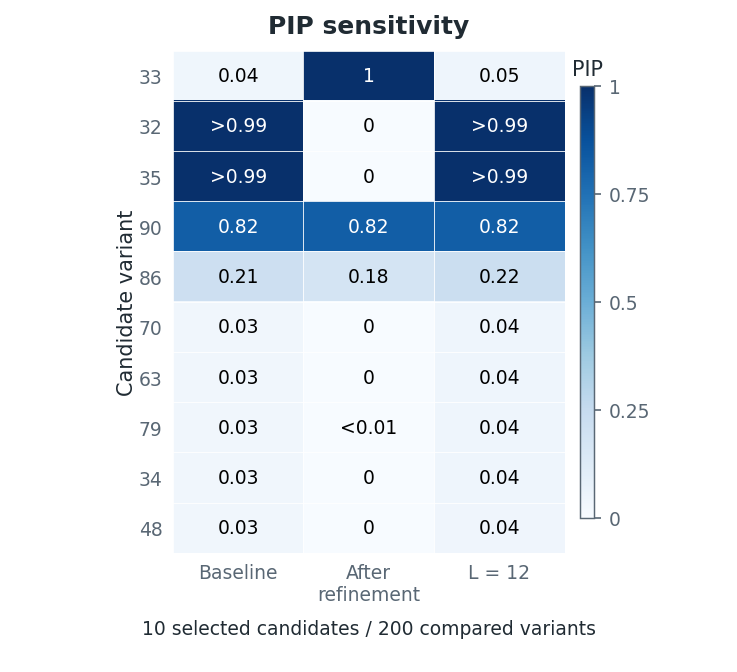

# Sensitivity and LD diagnostics

To assess how fine-mapping conclusions depend on modeling choices or input
data, compare variant posterior inclusion probabilities (PIPs) and credible sets
across explicit alternatives. Linkage disequilibrium (LD) diagnostics assess
consistency between signed association z-scores and the supplied LD correlation
matrix. Their flags suggest possible mismatch; they do not change alleles or
remove variants.

The examples below continue the `example` and `fit` from the
[quick start](example.md). Plotting and LD diagnostics require the
[analysis extra](install.md#optional-analysis-tools).

## Compare explicit settings

Name each alternative so that changes in PIPs or credible sets can be traced to
a specific choice. This plan increases $L$, the maximum number of single-effect
components, compares a fixed effect-size prior variance, and lowers the requested
credible-set coverage:

```python
plan = [
    {"name": "larger_L", "changes": {"L": 6}},
    {"name": "fixed_variance", "changes": {
        "scaled_prior_variance": 0.05,
        "estimate_prior_variance": False,
    }},
    {"name": "coverage90", "report": {"coverage": 0.90}},
]
sensitivity = prusie.run_sensitivity(example["inputs"], plan, baseline=fit)
comparison = sensitivity["comparison"]
for record in sensitivity["records"]:
    print(record["name"], "new fit:", record["fit_performed"])
```

Expected output with an empty cache:

```text
baseline new fit: False
larger_L new fit: True
fixed_variance new fit: True
coverage90 new fit: False
```

The supplied `fit` is reused as the baseline. The two `changes` items inherit its
recorded model settings except for the named changes. Fixing the effect-size
[prior variance](model.md#a-sum-of-single-effects) requires
`estimate_prior_variance=False`; changing only `scaled_prior_variance` while
estimating it tests sensitivity to initialization.

The `report` item re-extracts credible sets at `coverage=0.90` without refitting,
so PIPs are unchanged. It also accepts `min_abs_corr` to change the purity
threshold.

Requested convergence controls are inherited from the baseline unless overridden
by `convergence` in `baseline_settings`. If none were requested, each fit uses
the fitting function's default [stopping rule](model.md#stopping-rules). A runtime
fallback is not inherited.

Use `prusie.compare_fits` directly when all fits already exist.

## Plot and interpret the comparison

A comparison can preserve the leading credible sets while changing support for
other variants. Use the heatmap to compare candidate PIPs across settings:

```python
from prusie.viz import plot_sensitivity

sensitivity_view = plot_sensitivity(
    comparison, layout="compact",
    display_names={"baseline": "Baseline", "larger_L": "L = 6",
                   "fixed_variance": "Scaled prior variance\n0.05 (fixed)",
                   "coverage90": "CS coverage\n90%"},
)
figure, axes, plotted_data = sensitivity_view
```

The official [Toy example](worked_examples.md#sensitivity-and-ld-compatibility)
provides an executed comparison of a baseline fit, refinement and an increase
from `L=10` to `L=12`:



Refinement moves support between variants, whereas increasing `L` preserves the
baseline's three credible sets and changes diffuse posterior support. Components
without retained credible sets can still contribute to PIPs. Full-precision
values are in the [saved comparison](examples/post_analysis/official/comparison.json).
The fitting and plotting code above illustrates other explicit settings on the
quick-start inputs; its settings are recorded independently from this report.

The baseline is the first column. All columns share the same variant order and
linear PIP scale from 0 to 1. Cell labels use `<0.01` and `>0.99` near the
endpoints, keeping exact 0 and 1 explicit; variants absent from a fit are grey
`NA`. Full-precision probabilities remain in `plotted_data["pip_matrix"]` and the
CSV/JSON exports. `candidates_only=False` shows every variant on the
[comparison support](#common-and-union-comparison-support).

`plotted_data["baseline_changes"]` records the largest PIP change from baseline
for each alternative across that support, including variants outside the
heatmap. Use `layout="full"` to add relation tables. The default `layer="signals"`
shows retained credible sets and their overlap with unresolved effects;
`layer="components"` includes all active components and components with retained
credible sets. Pagination changes only the table display, retaining complete
records.

## Variant alignment and prior weights

When changing windows or filters, align each alternative's association vectors
and both LD axes to its own variant order and effect alleles; see
[input alignment](inputs.md#variant-order-and-alleles). Each alternative `inputs`
mapping supplies its own statistics, LD and explicit unique `variant_ids`.
Those IDs align the comparison and determine how inherited prior weights and
metadata are mapped. Absent variants remain unobserved, with unavailable PIPs.

When reusing `baseline=fit`, supply its original inputs. Agreement of IDs,
metadata and settings alone does not verify equal z-scores or LD.

For permutations and subsets, inherited weights follow the IDs. A subset
conditions the prior on the retained variants and the null column. Let
$\mathcal S$ be the retained variant IDs, $w_j$ their raw weights and $\eta$ the
inherited `null_weight`. The normalized prior probability of the null column is

$$
\pi_{\mathrm{null}}
=\frac{\eta}{(1-\eta)\sum_{j\in\mathcal S}w_j+\eta}.
$$

The augmented weights are normalized once, without first normalizing the
variant weights. Thus changing the window can change the final null probability,
even though an `inputs` item must keep `null_weight` unchanged. Raw weights must
be finite, nonnegative and have a positive finite total; zero support is rejected
even with a positive null weight.

For new IDs under a nonuniform baseline prior, supply complete alternative
weights in the alternative order. This illustrative fragment assumes
`new_inputs` already contains aligned alternative data and any required metadata,
with `new_variant_weights` in that order:

```python
alternative_inputs = dict(new_inputs, prior_weights=new_variant_weights)
alternative_plan = [{"name": "alternative_window", "inputs": alternative_inputs}]
```

Explicit `prior_weights=None` requests uniform weights. Without an explicit
prior, a uniform baseline extends its existing equal raw weight to new IDs.
If the baseline has metadata columns, new IDs also require explicit
`variant_metadata`; that mapping may omit unavailable columns.

`prior_resolution` in `sensitivity["records"]` describes the mapping, raw and
normalized weights and effective null probability. Input alternatives also
record `input_resolution`. IDs, dimensions and weights are checked before any
fit starts. Alternative fits start from the prior and preserve baseline inputs
and results; [continuation and refinement](post_analysis.md#continue-first-then-consider-refinement)
are separate choices. Changing LD does not automatically enable residual-variance
estimation.

An optional caller-owned `cache` hashes resolved inputs, variant order, allele
metadata, settings, initialization and software version. Cached fit objects are
shared; do not modify them while using the cache.

## Common and union comparison support

When fits contain different variants, choose a comparison support before
interpreting their PIP changes or signal relations. The `mode` argument of
`prusie.compare_fits` selects:

| Mode | Displayed variants | Support for pairwise PIP and overlap metrics |
| --- | --- | --- |
| `"union"` (default) | Union across fits | Each pair's intersection |
| `"common"` | Intersection across all fits | The same global intersection for every pair |

For example, compare the existing fits on their global intersection:

```python
common_comparison = prusie.compare_fits(
    sensitivity["fits"], baseline="baseline", mode="common",
    R=example["inputs"]["R"], ld_reference="baseline",
)
```

Common mode also restricts ranks, top-candidate selection, shared counts and
allele alignment to that global intersection. Representative LD requires both
original representative variants in the named LD reference; common mode
additionally requires them in the global intersection.

Comparison does not refit or renormalize the posteriors. Original component
probabilities, credible sets, set sizes/purities and representative IDs remain
unchanged. `support` and per-record `support_scope` identify the policy;
`unobserved_mass` records posterior mass outside that support.
`full_region_pip_correlation` uses the same declared support despite its legacy
name; missing PIPs are never filled with zero.

An empty global intersection gives zero shared counts, unavailable PIP metrics
and unmatched components. It provides no evidence of biological absence.

Candidates include retained credible-set members on the support, leading variants
from components with retained sets, and variants meeting `pip_threshold`. If a
fit has no retained set, its leading PIPs supply additional candidates. The PIP
threshold does not trim a large credible set; common mode can omit members
absent from another fit.

Relations use posterior overlap on this support, credible-set overlap and
representative LD, rather than equal component numbers. In the signal view,
overlap with a component lacking a retained credible set is `unresolved`.
Diffuse components can overlap strongly without localizing a signal. The
[signal and component views](#plot-and-interpret-the-comparison) keep these
relations distinct.

`split`, `merge` and `ambiguous` describe connections between retained credible
sets; components without retained sets do not determine those labels. These
relations do not establish biological signal identities. Unmatched relations
remain visible, and a one-to-one display match is only an aid. PIP changes,
ranks, threshold crossings, credible-set sizes/purities and high-LD exchanges
remain separate metrics rather than a combined robustness score.

## Diagnose consistency of z and LD

To investigate possible mismatch, compare each signed z-score with its
conditional distribution given the other scores and the supplied LD. Run this
check explicitly, separately from fitting:

```python
ld = prusie.diagnose_ld(
    example["inputs"]["z"], example["inputs"]["R"],
    n=example["inputs"]["n"], variant_ids=fit.variant_ids,
)
print(ld["status_counts"])
```

The diagnostic follows the SuSiE-RSS null model

$$
\widetilde{\mathbf z}\sim
N\!\left(\mathbf 0,(1-s)\mathbf R+s\mathbf I_p\right),
$$

where $\mathbf R$ is the signed LD correlation matrix for $p$ variants,
$\mathbf I_p$ is the identity matrix and $s$ regularizes the covariance toward
independence. With sample size $n$, $\widetilde{\mathbf z}$ uses the
[finite-sample Wald adjustment](model.md#known-sample-size-and-wald-z-statistics);
without `n`, the scores are unadjusted. `diagnose_ld` estimates $s$ with
`method="null-mle"` unless `s` is supplied. `estimate_s_rss` also supports
`"null-partialmle"` and `"null-pseudomle"`. If a supplied or estimated $s$ exceeds
1, `diagnose_ld` replaces it by 0.8 and warns.

A normal scale mixture fitted to the standardized conditional residuals gives
the likelihood ratio (LR) for reversing a score's sign versus retaining it.
The default flag requires both $\log\mathrm{LR}>2$ (`flip_log_lr=2`) and
$|\widetilde z_j|>2$ (`flip_abs_z=2`), with strict inequalities. A large
conditional residual alone is not an allele-flip flag.

| Report state | Meaning |
| --- | --- |
| Assessed, flagged | The joint rule was evaluated and satisfied |
| Assessed, not flagged | The joint rule was evaluated and not satisfied |
| Conditional only | Conditional quantities exist, but the full flip test is unavailable |
| Not assessed | The required observation or calculation is unavailable |

Read `status_counts` alongside the flags: conditional-only and unassessed rows
are not negative flip tests. Absence of flags does not prove LD calibration or
causal identity. Investigate flags by checking ancestry, effect alleles,
variant order, filtering and LD-reference identity; see
[input alignment](inputs.md#variant-order-and-alleles). The diagnostic changes
neither input statistics nor LD and does not flip alleles or remove variants.

Eigenvalues below `r_tol` (default `1e-8`) are set to zero only within the
diagnostic; eigenvalues below `-r_tol` produce a warning. At $s=0$, singular LD
uses a recorded spectral pseudoinverse convention. A caller-owned `cache` can
reuse the eigendecomposition.

The mixture-weight fit requires optimizer convergence and a Karush–Kuhn–Tucker
(KKT) optimality check for constrained maximum likelihood. The optimizer differs
from susieR's `mixsqp`, so flip likelihood ratios need not agree. Failed mixture
optimization retains available conditional quantities as `conditional_only`.

Missing z-scores use working zeros in the calculation, recorded separately
from unavailable observed scores. These variants remain `not_assessed` and
are omitted from the observed-score plot. Unavailable results keep their reason.

```python
from prusie.viz import plot_ld_diagnostics
from prusie.report import write_report

ld_view = plot_ld_diagnostics(ld, layout="compact")
summary = prusie.summarize(fit, example["inputs"]["R"], z=example["inputs"]["z"])
print(prusie.summary_text(summary, ld=ld, comparison=comparison))
report = write_report(
    summary, "output/diagnostics", ld=ld, comparison=comparison,
    figures={"Sensitivity": sensitivity_view, "LD diagnostics": ld_view},
)
```

Open `output/diagnostics/index.html` to read the heatmap, full-support PIP changes,
LD states and downloadable tables together. `plot_ld_diagnostics` defaults to
conditional residuals in its second panel; `auxiliary="log_lr"` shows flip log
likelihood ratios instead.

In `summarize`, `metadata` carries per-variant annotations such as allele labels,
EAF, N, INFO and `qc_flags`; `input_info` carries study-level information such as
`genome_build`, `ld_ancestry`, `ld_reference_n` and `ld_source`. Unprovided QC
information remains `not_assessed`. Finite supplied `pvalues` take precedence
over z-based association values; otherwise finite z-scores give a labelled
two-sided normal approximation computed stably in the log tail.
