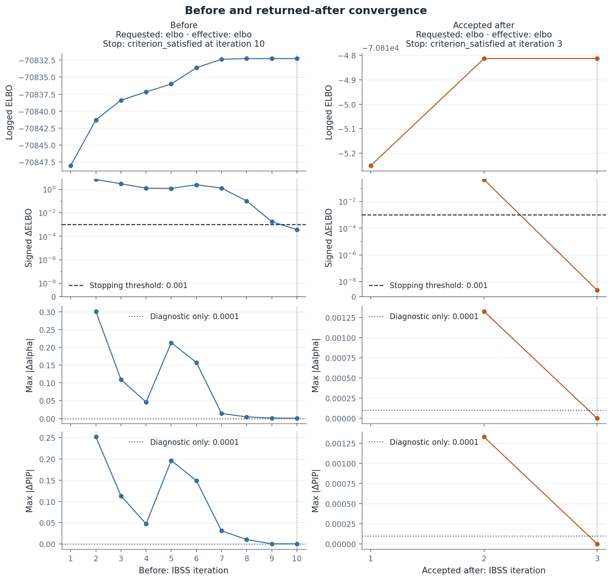
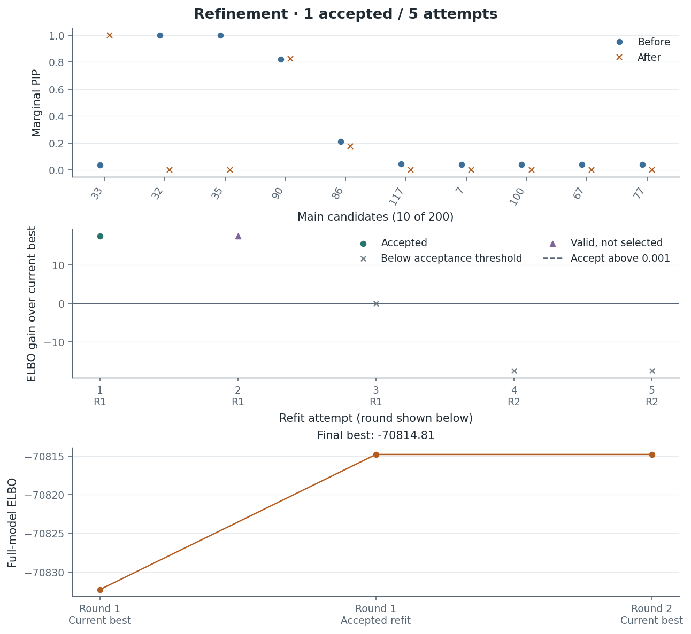
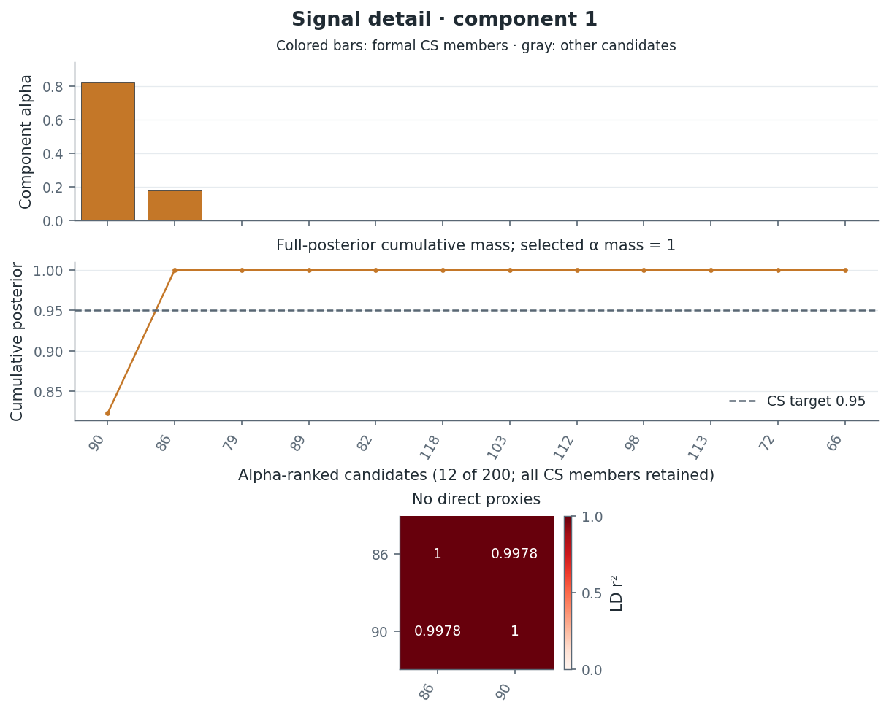
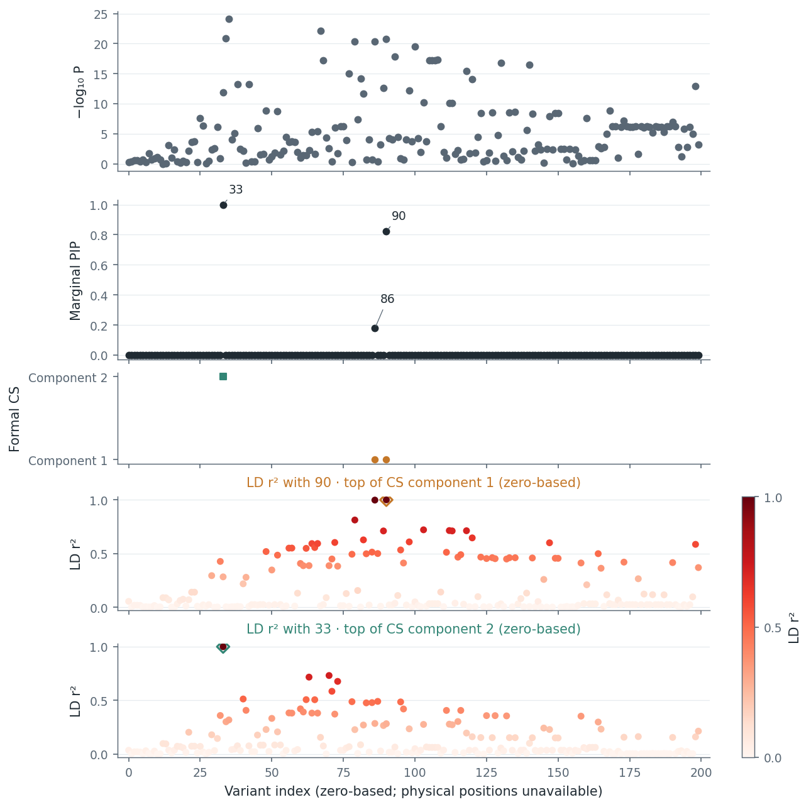

# Toy example

The official susieR `FinemappingConvergence` fixture illustrates a fit that
satisfies its stopping rule and then improves under refinement. It contains
200 variants and sufficient statistics for a simulated response based on real
genotypes; no individual genotypes are included. This is a solver example,
not a biological association study.

[Open the offline report](examples/post_analysis/official/index.html) or browse
its [figure index](examples/post_analysis/official/figure_index.json).
The saved analysis uses prusie 0.3.0; input checksums, parameters and exact
Python source and native binary identities are in the
[provenance](examples/post_analysis/official/provenance.json).

Component IDs below are original **zero-based fit rows**: component 1 is the
second row of `alpha`, corresponding to susieR's one-based component 2.
Variant IDs are zero-based positional indices. Genomic positions, alleles,
genome build and gene annotations are unavailable.

## A stopped fit improved by refinement

The baseline permits `L=10` single effects and satisfies its ELBO stopping rule
after ten sweeps at `tol=0.001`. Refinement evaluates five credible-set exclusion
attempts in two rounds, using ten inner fits, and accepts one candidate. The
returned candidate satisfies its inner stopping rule after three sweeps.
The example opts into tracking for both the baseline and refinement, so the
report shows the accepted candidate's three original stage-B sweeps.

{.figure-complex}

The search ranks candidates by their last logged ELBO under the original prior.
Here it rises from −70832.271605 to −70814.813272, a gain of 17.458333.
Its before/after values and gain are recorded in
[the analysis summary](examples/post_analysis/official/analysis_summary.json)
under `refinement`; recomputed post-finalization ELBO is a separate diagnostic.
The [convergence and refinement guide](post_analysis.md#continue-first-then-consider-refinement)
explains the search settings and objective convention. Satisfying an inner
stopping rule does not establish a global optimum. The unsuccessful subsequent
attempts establish only that no executed candidate exceeded the search's
absolute improvement threshold.

{.figure-complex}

| Variant | Initial PIP | Refined PIP | `L=12` PIP |
| --- | ---: | ---: | ---: |
| 32 | >0.9999 | 0 | >0.9999 |
| 33 | 0.03660 | 1 | 0.04627 |
| 35 | >0.9999 | 0 | >0.9999 |
| 86 | 0.2114 | 0.1772 | 0.2192 |
| 90 | 0.8214 | 0.8228 | 0.8232 |

The initial singleton CS `{35}` and `{32}` are replaced by `{33}`, while
`{86,90}` remains. Zeros and ones are stored PIPs; `>0.9999` denotes an interior
probability close to one. Full-precision values remain in the
[comparison](examples/post_analysis/official/comparison.json).
Neither CS membership nor CS count determines the true number of causal effects.

### What remains unresolved

The refined component 1 CS `{86,90}` has posterior mass greater than 0.9999.
Its component probabilities are approximately 0.177 and 0.823. Strong LD,
$r\approx0.9989$ and $r^2\approx0.9978$, limits resolution within this set.
The effective number of candidates is about 1.595; it measures posterior
concentration, not a causal count. Component 2 has the singleton CS `{33}`;
singleton purity is 1 by definition and says nothing about surrounding LD.

{.figure-complex}

The report presents component 1 before component 2, preserving their identities.
In the locus overview, separate LD panels use the top variant of **each** CS:
90 for component 1 and 33 for component 2. A CS top maximizes its own component's
`alpha` among its CS members; exact ties use lexical variant ID order, matching
`summary["credible_sets"][i]["representative_rule"]`. Global marginal PIP does
not select a CS top. Reference IDs, tied IDs, signed r and r² for all 200 variants
are exported under `locus overview.ld_references` in
[plot data](examples/post_analysis/official/plot_data.json).

{.figure-complex}

The absolute LD correlation between 33 and 90 is about 0.532. That pairwise
correlation alone does not establish whether modeled effects are conditionally
distinguishable. PIP, alpha, r and r² are unitless; effect estimates use the scale
of the supplied sufficient statistics. The association track shows a two-sided
normal approximation applied to marginal t statistics derived from `XtX`,
`Xty` and `yty` (degrees of freedom `n - 2`). These are not external GWAS z scores.

### Sensitivity and LD compatibility


Increasing `L` from 10 to 12 retains the baseline's three CS. The largest PIP
change over all 200 variants occurs at variant `0`, outside the main candidate
view: 0.03856 → 0.04825, an absolute change of 0.009694. Nine active components
without retained CS contribute to the `L=12` background; diffuse overlap does
not establish additional localized signals.

The signed LD matrix is normalized from the same in-sample `XtX`. Diagnostics
use the t-derived statistics with a normal approximation. The matrix is nearly
singular; inspect its recorded regularization and
[LD diagnostic records](examples/post_analysis/official/ld_diagnostics.json).
A completed assessment flags none of the 200 variants under the recorded joint
rule (log LR > 2 and absolute adjusted z-score > 2). This does not validate an
external LD reference or prove allele alignment. Paired susieR flip-flag
agreement has not been established.

## Choose a signal detail

Use the official refined fit's posterior `summary` and signed LD matrix `R`,
with rows and columns in the order of `summary["variants"]`:

```python
from prusie.viz import plot_signal

pair, _, pair_data = plot_signal(
    summary, component_id=1, R=R, layout="compact", ld_measure="r2"
)
singleton, _, singleton_data = plot_signal(
    summary, component_id=2, R=R, layout="compact", ld_measure="r2"
)
```

The compact views retain all CS members, show component probabilities and full
posterior cumulative mass, and display within-CS r². `variant_id="90"` can
instead select the retained component with the highest alpha for that variant.
The [plotting API](api.md#figures-and-local-style) describes local styles and
exported data. `plot_locus` uses one LD panel per CS by default; an explicit
`reference_variant` selects a single reference, no retained CS falls back to the
highest marginal PIP, and missing `R` produces an unassessed placeholder.

## Sources and reproducibility

The [fixture metadata](examples/post_analysis/official/metadata.json) identifies
upstream `FinemappingConvergence.RData` at susieR commit
`1f9166cf88ed19c1d6acd4ee53a605ff9505a563`, with source SHA256
`8b9ac71cd119cd8e9818340fb1152e422d9b7eaefac747058d8087f6c0b5139b`.
The packaged reference is pinned to susieR 0.16.6 at
`8e56a8e038e989856d106d9ca5175cc664fea9d2`. Preserve the
[upstream attribution](examples/post_analysis/official/LICENSE.txt) and
[full BSD-3-Clause license](examples/post_analysis/official/BSD-3-Clause.txt),
reproduced from the repository third-party notices. The fixture’s original
license stub is also retained unchanged.

From a source checkout with the `analysis` extra installed, reproduce this
single official example, including baseline, refinement, `L=12` sensitivity and
LD diagnostics:

```sh
python examples/post_analysis.py --output-dir output/post-analysis --case official
```

To render the saved numerical results without fitting or running diagnostics:

```sh
python examples/post_analysis.py --saved-dir docs/examples/post_analysis \
  --output-dir output/rendered-example --case official
```

Opening the report runs no computations. Keep its directory together: it includes
PNG/SVG figures, full-precision CSV tables, lossless JSON/NPZ records, input and
software provenance, license files and a figure index. Rendering saved records
preserves their numerical software identity and records the renderer separately.
