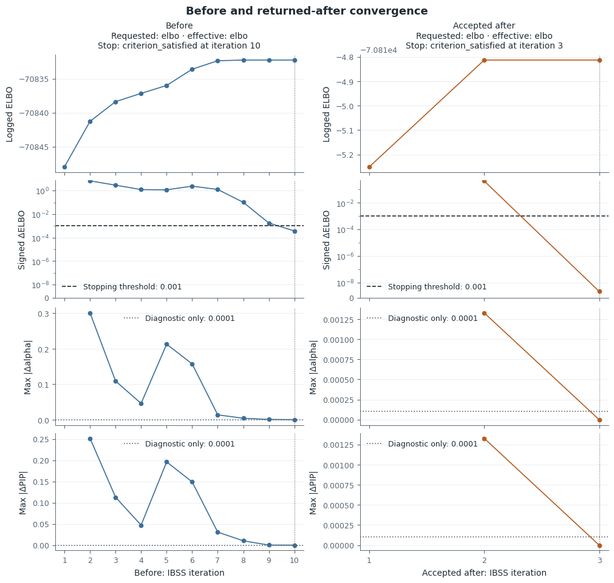

# Two worked fine-mapping examples

These examples show how to read the posterior, stopping evidence and sensitivity
together. The stable example has persistent leading credible sets but a
prior-sensitive background. The problem example reaches its initial stopping
condition, then finds a better solution through refinement.

| Example | Input | Open the saved result |
| --- | --- | --- |
| Stable | Packaged 500-variant synthetic toy data | [Offline report](examples/post_analysis/stable/index.html), [figure index](examples/post_analysis/stable/figure_index.json) |
| Problem | Official susieR 200-SNP `FinemappingConvergence` sufficient statistics | [Offline report](examples/post_analysis/problem/index.html), [figure index](examples/post_analysis/problem/figure_index.json) |

These are saved numerical examples from the source revisions identified under
[Sources and reproducibility](#sources-and-reproducibility). Their values are
rounded for reading; the linked tables retain complete values, variant IDs and
comparison support. Rendering these records with a newer package does not
remeasure its fits.

## Stable signals with a prior-sensitive background

The baseline stops after three sweeps with the requested and effective ELBO rule,
at tolerance 0.001. It has two active components and two singleton CS,
`{syn0100}` and `{syn0350}`. Their posterior masses are approximately 0.9697 and
0.99994, and their effective candidate counts are 1.146 and 1.001. Singleton
purity is 1 by definition; it does not describe LD to surrounding variants.

Refinement tests two exclusions in one round, using four inner fits. Neither
stage-B candidate improves the common objective by more than 0.001, so no
candidate is accepted. Before and after have the same post-trim original-model
objective, approximately −1363.854754, and identical PIPs. This supports stability
under the executed search, without establishing global optimality.


| Variant | Baseline PIP | Fixed scaled prior variance 0.05 |
| --- | ---: | ---: |
| syn0350 | 0.99994 | 0.99995 |
| syn0100 | 0.9697 | 0.9777 |
| syn0101 | 0.03028 | 0.02701 |
| syn0143 | 5.318×10⁻¹¹ | 0.2544 |
| syn0145 | 2.066×10⁻¹¹ | 0.1430 |

Increasing L from 5 to 6 leaves all PIPs unchanged. Changing reported CS coverage
from 0.95 to 0.90 also leaves them unchanged, because that operation reuses the
posterior. Fixing `scaled_prior_variance=0.05` with
`estimate_prior_variance=False` preserves both leading CS but changes the
background substantially.

The component table explains why these are distinct observations. The estimated
baseline retains two active components; the fixed positive-variance setting
retains all five, three without retained CS. Disabling estimation removes the
step that could shrink unused component V to zero, so those extra components
remain available to distribute probability. The rise at `syn0143` and `syn0145`
is evidence of sensitivity to this model choice, not proof of additional causal
signals. The parameter is **scaled prior variance**; working-scale V also depends
on the response variance.

All 500 variants are present in every setting. The LD diagnostic assesses all
500 and flags none, with no conditional-only or unassessed rows. That recorded
result does not remove the prior sensitivity above.

Read the [full comparison](examples/post_analysis/stable/comparison.json),
[component and CS summary](examples/post_analysis/stable/posterior_summary.json)
and [LD records](examples/post_analysis/stable/ld_diagnostics.json) for the values
underlying these statements.

## A stopped fit improved by refinement

The 200-variant baseline satisfies its ELBO stopping rule after ten sweeps. That
is evidence about one trajectory. Refinement evaluates five exclusion attempts
in two rounds, using ten inner fits, and accepts one candidate. The returned
candidate satisfies its inner stopping rule after three sweeps.

{.figure-complex}

The comparable **post-trim original-model objective** changes from
−70832.271605 to −70814.813295, a gain of **17.4583**. The final logged sweep ELBO
has a slightly different value and is not substituted in this comparison.
Different starting solutions have different outcomes even though both satisfy
their inner stopping rules.

{.figure-complex}

| Variant | Initial PIP | Refined PIP | L = 12 PIP |
| --- | ---: | ---: | ---: |
| 32 | >0.9999 | 0 | >0.9999 |
| 33 | 0.03660 | 1 | 0.04627 |
| 35 | >0.9999 | 0 | >0.9999 |
| 86 | 0.2114 | 0.1772 | 0.2192 |
| 90 | 0.8214 | 0.8228 | 0.8232 |

The initial singleton CS `{35}` and `{32}` are replaced by `{33}`; the `{86,90}`
CS remains. The stored refined PIPs at 32 and 35 are zero, and the stored value
at 33 is one. These are observed numerical values, not missing variants; bounds
mark initial probabilities that are close to, but below, one. The change in
singleton support is substantial, rather than a redistribution within one
unchanged CS.

### What remains unresolved

The refined `{86,90}` CS has mass greater than 0.9999, approximately 1.595 effective
candidates, and |r| = 0.9989. Its roughly 0.177/0.823 probability allocation leaves
LD-limited resolution. The LD panel displays r² (approximately 0.9978 off the
diagonal) on a fixed 0–1 scale. The report shows this pair separately from the concentrated
singleton `{33}`.

{.figure-complex}

Variant 33 has genotype correlation about 0.532 with 90. That correlation is not
a test of whether the two modeled effects are conditionally distinguishable.
Neither the retained pair nor the number of CS determines the true number of
causal effects. The result supports two distinct posterior summaries: a
concentrated candidate at 33 and unresolved allocation within 86/90.

### Sensitivity beyond the displayed candidates


L = 12 retains the initial three CS. Its largest PIP change over the full
200-variant support occurs at variant `0`, outside the main candidate view:
0.03856 → 0.04825, an absolute change of 0.009694. The complete table and summary
retain this change. Nine active components without retained CS contribute to
the L = 12 background; their broad overlaps are kept in the component evidence
without treating them as identified signal splits or merges.

All 200 variants are observed in every setting. All 200 receive a completed LD
assessment, with none flagged. Variant 33 has the largest absolute conditional
residual (about 3.872) but log LR about −90.95. Variant `0` has log LR about 3.560,
but |adjusted z| about 0.644. Neither satisfies the joint rule
**log LR > 2 and |adjusted z| > 2**. A residual label is therefore not an allele-flip
claim. The LD matrix is close to singular; use the saved diagnostic warnings and
input identity when assessing this result.

Read the [full comparison](examples/post_analysis/problem/comparison.json),
[posterior and search summary](examples/post_analysis/problem/posterior_summary.json)
and [LD diagnostics](examples/post_analysis/problem/ld_diagnostics.json). Exact
paired R flip-flag agreement was not established for either full example; the
separate small-fixture numerical checks do not supply that missing comparison.

## Choose a signal detail

Select a component according to the question it answers. This illustrative
fragment requires the problem fit's posterior `summary` and aligned LD matrix
`R`; they are not the quick-start toy result. Its two retained CS justify
distinct detail views:

```python
from prusie.plots import plot_signal

singleton = plot_signal(summary, variant_id="33", R=R,
                        layout="compact", ld_measure="r2")
pair = plot_signal(summary, variant_id="90", R=R,
                   layout="compact", ld_measure="r2")
```

Here `summary` and `R` are the problem result and aligned LD matrix. IDs in this
example identify its saved variants; use your own CS members or component IDs
for another fit. See the [API](api.md#figures-and-local-style) for local style,
full layouts and exported plotting data, and the
[sensitivity guide](sensitivity.md) for variant alignment and prior policies.

## Sources and reproducibility

<details markdown="1">
<summary>Inputs, licenses, numerical provenance and rendering commands</summary>

The stable inputs are independently generated synthetic data; their
[generation metadata](https://github.com/LucaJiang/prusie/blob/main/src/prusie/data/teaching/metadata.json)
and [GPL-3.0-or-later notice](https://github.com/LucaJiang/prusie/blob/main/src/prusie/data/teaching/LICENSE.txt)
ship with the package. The problem fixture uses a simulated response with
real-genotype-derived sufficient statistics, without individual genotypes;
[source metadata](https://github.com/LucaJiang/prusie/blob/main/src/prusie/data/convergence/metadata.json)
records the pinned upstream input and BSD-3-Clause license, with
[upstream attribution](https://github.com/LucaJiang/prusie/blob/main/src/prusie/data/convergence/LICENSE.txt).

The reports reuse recorded fits and diagnostics. Their provenance separates
the numerical producer from the current plotting and reporting source; updating
the presentation does not create a new numerical result. The linked JSON and
CSV retain full precision, identifiers and comparison support. No biological
mechanism or gene annotation accompanies these inputs.

To regenerate presentation from the saved fits and diagnostics, use the source
revision recorded as `render_source_sha` in the
[stable provenance](examples/post_analysis/stable/provenance.json) or
[problem provenance](examples/post_analysis/problem/provenance.json). Set
`RENDER_SOURCE_SHA` to that full 40-character revision:

```sh
python examples/render_review.py --output-dir output/rendered-examples \
  --sensitivity-dir docs/review/post_analysis_fixes/examples \
  --render-source-sha "$RENDER_SOURCE_SHA"
```

This command reuses saved baseline, refined and alternative fits and LD records;
it recomputes posterior summaries, comparisons and presentation without new fits.
The original fit producer is `e45914e512e04feef37cf7310bc0b309582d6058` and the
three additional sensitivity fits were produced at
`1f2b246ebd7970929711b2a51bb08f6a76ddad56`. Per-case provenance records the exact
inputs and saved source files.

To fit both examples anew from the source checkout with the analysis extra installed:

```sh
PRUSIE_SER_MATH=scalar python examples/post_analysis.py --output-dir output/post-analysis --case both
```

This explicit command runs fits and diagnostics, using the scalar SER math
setting recorded for the saved numerical examples. Opening the saved reports above
does not. Each report includes PNG/SVG, complete CSV tables, lossless JSON/NPZ,
provenance and a figure index. The compact main figures are supplemented by a
separate variance-details figure and full search tables.

</details>
